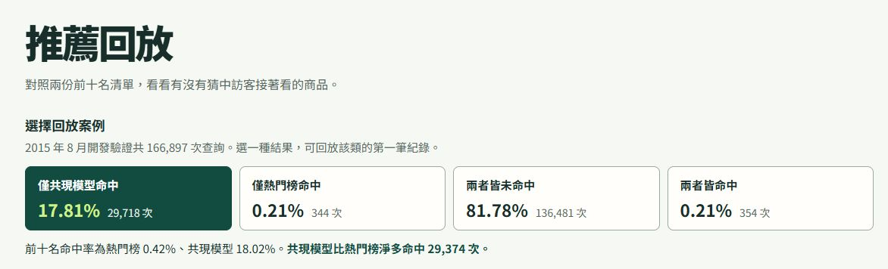
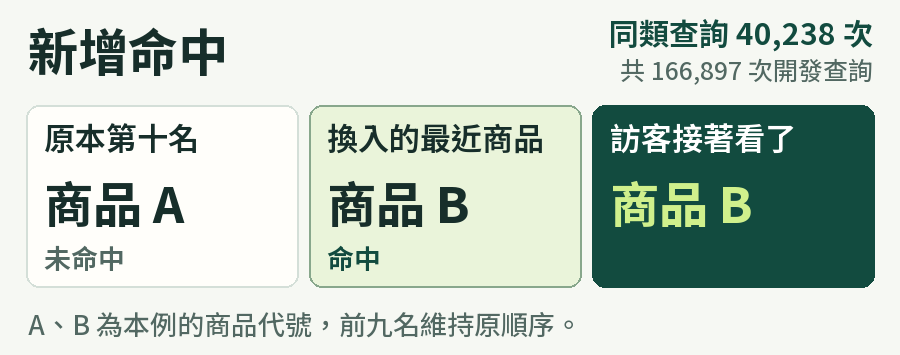
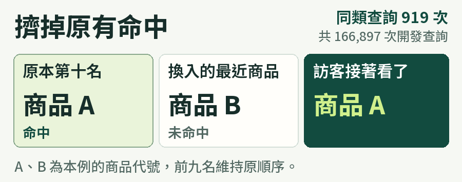
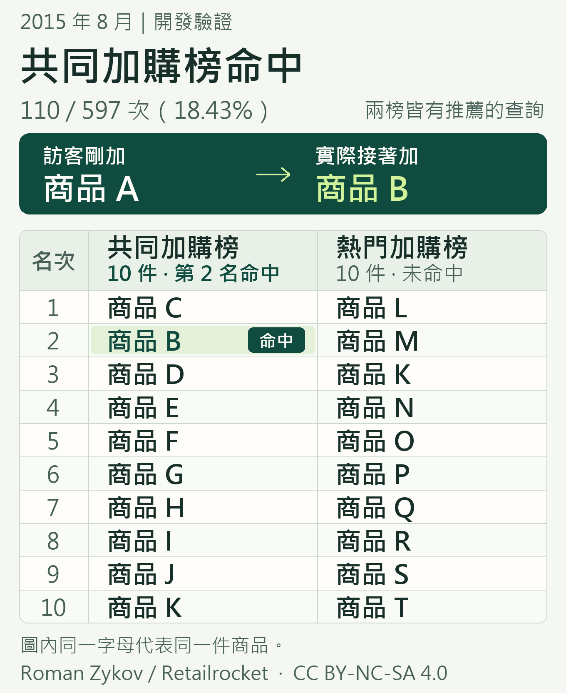
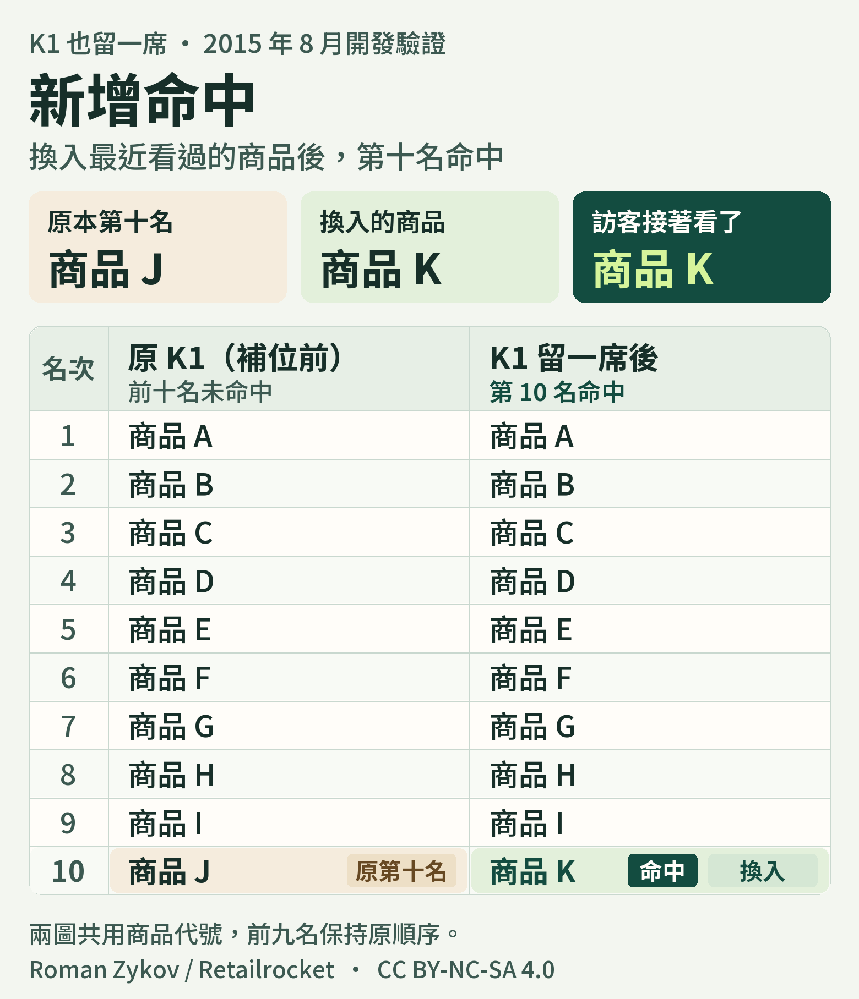

# 電商智慧推薦系統

一位訪客看完一件商品，接下來會點哪一件？這個專案用 Retailrocket 的歷史瀏覽紀錄比較熱門榜、共現與近鄰推薦，也用 Olist 訂單與 UCI 零售資料研究品類銷售與顧客行為。

**[開啟互動推薦展示](https://likaisuwork9616.github.io/smart-ecommerce-recommendation-system/)**。選擇兩個已核對的匿名商品，切換瀏覽、加購與購買，查看前十名和每席來源。可直接用瀏覽器操作。

<a id="august-paired-results"></a>

## 八月推薦成對結果


圖表改繪自 Roman Zykov／Retailrocket 的資料，區間按訪客抽樣 2,000 次估計。[八月成對報告](reports/mainline/recommendation_default_paired_august_20261123.json) · [瀏覽失誤分析](#august-browse-miss-analysis) · [K1 留一席對照圖](#k1-recency-replay) · [正式採用門檻](#recommendation-default-acceptance) · [資料來源](https://www.kaggle.com/datasets/retailrocket/ecommerce-dataset) · [圖表授權 CC BY-NC-SA 4.0](https://creativecommons.org/licenses/by-nc-sa/4.0/)

## 推薦回放｜兩張榜單各猜中幾次？

在 2015 年 8 月的 **166,897 次開發驗證查詢**中，每次都推薦十件商品。熱門榜猜中 **698 次（0.42%）**，依商品共同瀏覽紀錄排序的共現模型猜中 **30,072 次（18.02%）**。共現模型淨多猜中 **29,374 次**。最常見的結果仍是兩份榜單都沒猜中，占 **81.78%**。



回放把兩份榜單與訪客實際接著看的商品並排。只要前十名包含下一步瀏覽的任一件商品，這次查詢就算命中一次。下表最後一欄是各類別在封存檔中的第一筆案例。

| 前十名命中結果 | 查詢次數 | 占全部查詢 | 該類第一筆案例 |
| --- | ---: | ---: | --- |
| 只有共現模型命中 | 29,718 | 17.81% | 下一件商品在共現榜第 5 名 |
| 只有熱門榜命中 | 344 | 0.21% | 下一件商品在熱門榜第 5 名 |
| 兩者皆命中 | 354 | 0.21% | 熱門榜第 6 名，共現模型第 2 名 |
| 兩者皆未命中 | 136,481 | 81.78% | 共現模型的十個名額全由熱門商品補足 |

**模型何時猜不中？** 兩種方法都用 2015 年 8 月以前的瀏覽紀錄訓練。8 月有 11,943 次查詢，模型對訪客下一步實際瀏覽的所有商品都缺乏訓練資料支持，兩張榜單在這批查詢都零命中。9 月的預留回溯測試仍鎖定，上線後對購買率與營收的影響也仍待驗證。[開發驗證與限制](docs/STAGE10_RETAILROCKET_C1_P0_RESEARCH_HANDOFF_V1.md) · [四筆回放案例的核對紀錄](docs/PROJECT_PROGRESS.md#2026-11-19-推薦回放)

### 留一席給最近看過的商品，有多少幫助？

在同一批 **166,897 次開發查詢**中，保留原共現榜前九名，只在最近看過且可推薦的商品還沒上榜時替換第十名。結果有 **40,238 次新增命中，919 次失去原有命中，淨多猜中 39,319 次**。

| 全部開發查詢 | 原共現榜 | 最近商品留一席 | 差異 |
| --- | ---: | ---: | ---: |
| 前十名至少猜中一件的查詢 | 30,072 | 69,391 | +39,319 |
| 前十名命中率 | 18.02% | 41.58% | +23.56 個百分點 |
| 考慮命中名次的平均分數（NDCG@10，愈高愈好） | 0.106401 | 0.174500 | +0.068100 |

「最近」以同一次瀏覽截至查詢當下的紀錄為準。只有在查詢前已出現在目錄的商品才可選，同毫秒有多件合格時取數值編號最小的一件。選中的商品已在前十、或找不到合格商品時保留原榜。實際替換了 151,080 次。

#### 換掉第十名的兩個案例

兩張圖各取該類第一筆實際回放。每張圖內，A 是原第十名，B 是換入的最近商品；兩圖的代號分別對應各自案例的商品。





瀏覽資料來自 Roman Zykov／Retailrocket 的 *Retailrocket recommender system dataset* v2（CC BY-NC-SA 4.0）。本頁截圖呈現回放統計，兩張案例圖將商品編號改為圖內代號。[資料來源與授權紀錄](docs/STAGE8_RETAILROCKET_SOURCE_AND_CONTRACT_V1.md#來源版本與授權)

本機互動版可切換案例，查看原商品編號與當時的瀏覽紀錄。[本機新增命中案例](http://127.0.0.1:8765/replay?case=recency_gained) · [本機擠掉原有命中案例](http://127.0.0.1:8765/replay?case=recency_lost)

### 找到看過相似商品的訪客，能猜得更準嗎？

K1 從訓練資料找出最多 500 段看過相似商品的瀏覽紀錄，再依相似程度替商品投票。在同一批八月開發查詢中，K1 的前十名猜中 **77,692 次**，比原共現榜淨多 **47,620 次**。

| 推薦方式 | 前十名命中次數 | 命中率 | 平均排名分數 NDCG@10 |
| --- | ---: | ---: | ---: |
| 原共現榜 C1（主要對照） | 30,072 | 18.02% | 0.106401 |
| 共現榜留一席給最近商品（同月參照） | 69,391 | 41.58% | 0.174500 |
| 近鄰推薦 K1 | **77,692** | **46.55%** | **0.351510** |

有 **51,850 次只有 K1 猜中**，也有 **4,230 次只有 C1 猜中**。命中商品排得愈前面，NDCG@10 給的分數愈高。K1 相對 C1 平均多 **0.245110**，按訪客配對抽樣的 95% 區間為 **[0.236805, 0.253356]**。仍有 89,205 次 K1 前十名沒有猜中，包含 11,943 次下一步商品全部缺乏訓練支持的查詢。九月保留測試與上線成效仍待驗證。[全量驗算方法](docs/STAGE12_K1_AUGUST_READBACK_20261119.md) · [八月結果與限制](reports/stage12/k1_august_readback_20261119.json)

#### K1 與 C1 的兩個回放案例

兩張圖各取八月開發查詢中該類的第一筆。**先找商品 A**，它是這位訪客實際接著看的商品，再看 A 出現在哪一榜、第幾名。同一張圖的兩欄共用商品代號，下一張圖另行編碼。


圖卡改繪自 Roman Zykov／Retailrocket 的歷史瀏覽資料，商品編號已替換為圖內代號。下表連到可查看原商品編號的本機互動回放。[資料來源](https://www.kaggle.com/datasets/retailrocket/ecommerce-dataset) · [圖卡授權 CC BY-NC-SA 4.0](https://creativecommons.org/licenses/by-nc-sa/4.0/)

| 開啟本機回放 | 占全部 166,897 筆開發查詢 | 這一例的實際結果 |
| --- | ---: | --- |
| [只有 K1 命中](http://127.0.0.1:8765/replay?case=k1_vs_c1_k1_only) | 51,850 次（31.07%） | 下一件商品在 K1 第 3 名，C1 前十名未命中。 |
| [只有 C1 命中](http://127.0.0.1:8765/replay?case=k1_vs_c1_c1_only) | 4,230 次（2.53%） | 下一件商品在 C1 第 5 名，K1 前十名未命中。 |

<a id="cart-august-results"></a>

## 其他人也加入購物車，能猜中下一件嗎？

訪客剛把一件商品加入購物車，接著還會加什麼？用 Retailrocket **2015 年 8 月的加購紀錄**做開發驗證。共同加購榜只列出訓練期內至少有兩位不同訪客曾在同一段購物活動中一起加購的商品，最多十件。熱門加購榜則按訓練期的加購次數排名。兩榜都排除訪客剛加的那件商品。

| 八月實際結果 | 共同加購榜 | 熱門加購榜 |
| --- | ---: | ---: |
| 全部 14,725 次加購機會中，能推薦至少一件 | 1,839 次（12.49%） | 14,725 次（100%） |
| 全部 14,725 次中，能列滿十件 | 255 次（1.73%） | 14,725 次（100%） |
| 可驗證下一步的 4,266 次中，能推薦至少一件 | 597 次（13.99%） | 4,266 次（100%） |
| 同樣 4,266 次中，前十名猜中下一步加購 | **110 次（2.58%）** | **30 次（0.70%）** |

只有共同加購榜猜中的有 100 次，只有熱門榜猜中的有 20 次，因此共同加購榜**淨多猜中 80 次**。只看共同加購榜能推薦、也有下一步可核對的 597 次，它猜中 110 次，熱門榜在同一批猜中 14 次。全部加購機會中有 **12,886 次**找不到合格配對。

資料沒有購物車編號，以同一訪客相鄰活動間隔不超過 30 分鐘界定購物階段。當段沒有下一個加購時點的 9,449 次，以及下一個時點只重加原商品的 1,010 次，都計入覆蓋率。命中率只用能觀察到下一步加了其他商品的 4,266 次，空榜也算未命中。這是八月歷史行為的結果，九月保留測試仍鎖定，實際展示能否帶來更多加購仍待驗證。[驗證方法與重跑方式](docs/PROJECT_PROGRESS.md#cart-august-validation) · [八月聚合報告](reports/stage13/retailrocket_cart_next_add_201508.json)

<a id="cart-popular-fill-results"></a>

### 共同加購優先，熱門加購補滿十席

保留共同加購榜每件商品的原名次，再依訓練期熱門加購榜的順序，跳過已列出的商品，把空位補滿。同一批 **4,266 次**八月開發查詢的結果如下。

| 推薦方式 | 前十名命中 | 第 1 名命中 | MRR@10 |
| --- | ---: | ---: | ---: |
| 原共同加購榜 | 110 次（2.58%） | 47 次 | 0.015784 |
| 原熱門加購榜 | 30 次（0.70%） | 14 次 | 0.004506 |
| 只在共同加購榜全空時改用熱門榜 | 126 次（2.95%） | 50 次 | 0.017450 |
| **保留共同加購，再用熱門補滿** | **130 次（3.05%）** | **50 次** | **0.017849** |

補滿後，原共同加購榜的 **110 次命中都保留原名次**，另增加 **20 次**。其中 16 次來自空榜，4 次來自原本只列出部分商品的榜單。這 4 次的首次命中分別有 3 次在第 2 名、1 次在第 5 名。MRR@10 讓前面名次的命中得分更高，並將未命中計為零。

14,725 次加購機會都能列滿十件，其中 12,886 次（87.51%）會全部使用熱門商品。八月補位驗證有逐席記錄來源，九月保留測試繼續封存。[補位方法與逐名次統計](docs/PROJECT_PROGRESS.md#cart-popular-fill) · [八月補位報告](reports/stage13/retailrocket_cart_popular_fill_201508.json)

<a id="cart-fill-replay-cards"></a>

#### 空榜與短榜的補位對照

兩張圖各取該類在八月驗證順序中的第一筆。每張圖以 **A** 代表訪客剛加的商品，以 **B** 代表實際接著加的商品。左欄是補位前，右欄是補位後。每個有商品的席位都標示來源，次數與占比以 **20 次新增命中**為分母。


圖卡改繪自 Roman Zykov／Retailrocket 的歷史加購資料。可從下表開啟本機互動回放，查看原商品編號。[資料來源](https://www.kaggle.com/datasets/retailrocket/ecommerce-dataset) · [圖卡授權 CC BY-NC-SA 4.0](https://creativecommons.org/licenses/by-nc-sa/4.0/)

| 本機補位回放 | 占新增命中 | 這一筆的變化 |
| --- | ---: | --- |
| [空榜補位命中](http://127.0.0.1:8765/replay?case=cart_fill_empty) | 16 次（80%） | 原榜為空，補入 10 件熱門商品後，第 3 名猜中實際下一件。 |
| [短榜補位命中](http://127.0.0.1:8765/replay?case=cart_fill_short) | 4 次（20%） | 原本只列 1 件。保留第 1 名、補入 9 件後，第 2 名猜中實際下一件。 |

<a id="cart-replay-cards"></a>

### 回放兩次實際加購

兩張圖各取原共同加購榜在八月驗證順序中的第一筆命中或未命中。每張圖把訪客剛加的商品標為 **A**，實際接著加的商品標為 **B**。同一張圖的兩欄共用代號，每張圖各自編碼。次數與占比都以**兩榜有推薦、且能核對下一步的 597 次**為分母。




圖卡改繪自 Roman Zykov／Retailrocket 的歷史加購資料。由下表開啟本機互動回放，可查看原商品編號。[資料來源](https://www.kaggle.com/datasets/retailrocket/ecommerce-dataset) · [圖卡授權 CC BY-NC-SA 4.0](https://creativecommons.org/licenses/by-nc-sa/4.0/)

| 本機互動回放 | 次數與占比 | 在這一筆看到什麼 |
| --- | ---: | --- |
| [共同加購榜命中](http://127.0.0.1:8765/replay?case=cart_hit) | 110 次（18.43%） | 第 3 筆。兩榜各列十件，實際下一件排在共同加購榜第 2 名，熱門榜未命中。 |
| [共同加購榜未命中](http://127.0.0.1:8765/replay?case=cart_miss) | 487 次（81.57%） | 第 1 筆。共同加購榜只列出七件，第 8 至 10 名留空，熱門榜列滿十件。兩榜都沒猜中。 |

<a id="purchase-basket-results"></a>

## 其他人也買了，有多少交易支持？

用八月之前的 Retailrocket 交易事件建榜，把同一匿名訪客、同一交易編號下的不同商品視為一組。共同購買榜只列出至少由兩位不同訪客支持的搭配。熱門購買榜則按商品出現在多少筆訓練交易排序。

| 2015 年 8 月開發驗證 | 共同購買榜 | 熱門購買榜 |
| --- | ---: | ---: |
| 全部 4,613 次商品查詢中（含單件交易），可推薦至少一件 | 191（4.14%） | 4,613（100%） |
| 1,477 次能核對同筆交易其他商品的查詢中，前十名命中 | 33（2.23%） | **94（6.36%）** |
| 只看共同購買榜有商品可推的同一批 118 次，前十名命中 | **33（27.97%）** | 18（15.25%） |

八月 3,660 個交易群組中有 524 個含至少兩件不同商品。共同購買的訊號集中在少數商品。這次以同筆交易的其他商品驗證搭配，實際購買先後與展示後的轉換率仍需另驗。九月保留測試繼續封存。[驗證方法與限制](docs/PROJECT_PROGRESS.md#purchase-basket-validation) · [八月聚合報告](reports/stage13/retailrocket_purchase_basket_201508.json)

<a id="purchase-popular-fill-results"></a>

### 共同購買優先，熱門購買補滿十席

保留共同購買榜的原名次，再按原熱門購買榜的順序，跳過已在榜上的商品，補滿十席。以下比較沿用同一批 **1,477 次**八月開發查詢。

| 推薦方式 | 前十名命中 | 第 1 名命中 | MRR@10 |
| --- | ---: | ---: | ---: |
| 原共同購買榜 | 33 次（2.23%） | 27 次 | 0.020199 |
| 原熱門購買榜 | 94 次（6.36%） | 32 次 | 0.039570 |
| 只在共同購買榜全空時改用熱門榜 | 109 次（7.38%） | 59 次 | 0.054126 |
| **保留共同購買，再用熱門補滿** | **113 次（7.65%）** | **59 次** | **0.055029** |

補滿比原熱門榜多命中 **19 次**，原熱門榜的 94 次命中都保留。其中 14 次首次命中前移、76 次同名次、4 次後移。相較只補空榜，短榜再補滿多命中 **4 次**，首次命中都在第 3 名。全部 4,613 次商品查詢都能列滿十件，其中 4,422 次（95.86%）完全使用熱門商品。[逐筆比對方法與重跑方式](docs/PROJECT_PROGRESS.md#purchase-popular-fill) · [八月補位報告](reports/stage13/retailrocket_purchase_popular_fill_201508.json)

<a id="purchase-fill-replay-cards"></a>

#### 購買補位的兩筆三榜回放

圖中並排比較原共同購買榜、原熱門購買榜和補位後的十席。八月的「短榜新增命中」和「原熱門榜命中後移」是**同一組 4 筆查詢**，這裡選兩筆不同的交易。兩圖共用商品代號，起點都是 **A**，原熱門榜和補位榜猜中的搭配商品都是 **B**。第一筆同筆買了 B、M、N、O，第二筆只同筆買了 B。


「短榜新增命中」是相對只補空榜，「原熱門榜命中後移」則相對原熱門購買榜。圖卡改繪自 Roman Zykov／Retailrocket 的交易資料。下表保留本機互動回放，可查看原商品編號。[資料來源](https://www.kaggle.com/datasets/retailrocket/ecommerce-dataset) · [圖卡授權 CC BY-NC-SA 4.0](https://creativecommons.org/licenses/by-nc-sa/4.0/)

| 開啟本機回放 | 同筆交易的其他商品 | 原共同購買榜 | 原熱門購買榜 | 補位後 |
| --- | ---: | --- | --- | --- |
| [短榜補位新增命中](http://127.0.0.1:8765/replay?case=purchase_fill_short_gain) | 4 件 | 只列 1 件，未命中 | 第 2 名首次命中 | 第 3 名首次命中 |
| [原熱門榜命中後移](http://127.0.0.1:8765/replay?case=purchase_fill_popular_later) | 1 件 | 只列 1 件，未命中 | 第 2 名首次命中 | 第 3 名首次命中 |

<a id="recommendation-default-acceptance"></a>

## 什麼情況下採用新的預設推薦？

瀏覽、加購、購買各自用相同查詢對照。候選須在 **100% 的查詢列滿十件不同的合格商品**，且第 1 名命中率至少等於基準。MRR@10 以每筆首次命中名次的倒數計分，未命中給零分，愈高表示命中較多或較早。

| 場景 | 候選／主要基準 | 前十名命中率門檻 | MRR@10 門檻 | 八月命中率（基準 → 候選） | 八月增益 95% 區間（百分點） |
| --- | --- | ---: | ---: | ---: | ---: |
| 瀏覽 | 近鄰 K1／共現榜留一席給最近看過的商品 | 比基準至少高 1.00 個百分點 | 比基準至少高 0.010 | 41.58% → 46.55% | +4.618 至 +5.312 |
| 加購 | 共同加購優先，熱門補滿／只補空榜 | 比基準至少高 0.05 個百分點 | 至少等於基準 | 2.95% → 3.05% | +0.022 至 +0.200 |
| 購買 | 共同購買優先，熱門補滿／只補空榜 | 比基準至少高 0.10 個百分點 | 至少等於基準 | 7.38% → 7.65% | +0.062 至 +0.562 |

成對計分入口在八月重現了三組比較。以訪客為單位做 2,000 次抽樣後，三組命中率增益的 95% 區間下限均高於零。加購和購買各多命中四次。這些是已看過的開發資料，正式採用仍須在另一份獲准名冊通過同一套門檻。九月保留測試繼續封存。[八月成對報告](reports/mainline/recommendation_default_paired_august_20261123.json) · [驗收清單與重跑命令](docs/RECOMMENDATION_DEFAULT_ACCEPTANCE_CHECKLIST.md) · [完整門檻與原榜比較](docs/RECOMMENDATION_DEFAULT_ACCEPTANCE.md)

<a id="august-browse-miss-analysis"></a>

### 八月瀏覽失誤分析

逐筆核對同一批 166,897 次開發查詢的 K1、原 C1 與 C1 留一席榜單。可推薦指商品首次被瀏覽的時間早於查詢。下一個時點有多件實際瀏覽商品時，只要其中一件符合資格，就計為有可推薦目標。

| 查詢群組 | 拆分結果 | 筆數 | 占該群組 |
| --- | --- | ---: | ---: |
| 只有 C1 留一席榜命中的 6,376 筆 | 原 C1 就命中 | 3,742 | 58.69% |
| 同上 | 靠留一席才命中 | 2,634 | 41.31% |
| K1 與 C1 留一席都未命中的 82,829 筆 | 當時至少有一件目標商品可推薦 | 77,143 | 93.14% |
| 同上 | 當時所有目標商品均未進入可推薦目錄 | 5,686 | 6.86% |

K1 漏掉的查詢中，有 2,635 筆的最近合格商品就是實際目標。原 K1 有 1,242 筆到第十名才首次命中，這是替換第十名時可能擠掉的命中上限。[完整失誤分析報告](reports/mainline/recommendation_browse_miss_analysis_20261123.json)

<a id="august-k1-recency-slot"></a>

### K1 也留一席

用八月全部 166,897 筆查詢比較原 K1 與留一席。保留前九名，最近看過且可推薦的商品尚未上榜才替換第十名，共替換 17,592 筆。

| 方法 | 前十名命中 | 命中率 | MRR@10 |
| --- | ---: | ---: | ---: |
| 原 K1 | 77,692 | 46.55% | 0.31544528 |
| K1 也留一席 | 80,258 | 48.09% | 0.31698276 |

逐筆對照**新增命中 2,635 次、擠掉 69 次，淨增 2,566 次**。命中率增加 1.54 個百分點，MRR@10 增加 0.00153748。前九名逐筆保持原位，兩種方法都命中的查詢也保留原首次命中名次。這是八月開發結果，正式採用仍待獨立名冊，九月保留測試繼續封存。[完整成對結果](reports/mainline/recommendation_k1_recency_slot_20261123.json)

<a id="k1-recency-replay"></a>

#### 補位前後的兩筆回放

兩張圖各取八月封存名冊中該類的第一筆，並排顯示補位前後的前十名。圖中共用商品代號，讓原第十名、換入商品和訪客實際接著看的商品能直接對照。[案例選取與核對紀錄](reports/mainline/recommendation_k1_recency_replay_20261123.json)




圖卡改繪自 Roman Zykov／Retailrocket 的八月開發案例。下表可點開本機回放。[資料來源](https://www.kaggle.com/datasets/retailrocket/ecommerce-dataset) · [圖卡授權 CC BY-NC-SA 4.0](https://creativecommons.org/licenses/by-nc-sa/4.0/)

| 本機案例 | 八月名冊位置 | 原 K1 | K1 留一席後 |
| --- | ---: | --- | --- |
| [新增命中](http://127.0.0.1:8765/replay?case=k1_recency_gained) | 第 149 筆 | 前十名未命中 | 換入商品在第十名命中 |
| [擠掉原有命中](http://127.0.0.1:8765/replay?case=k1_recency_lost) | 第 1,640 筆 | 第十名命中 | 原命中商品被換出 |

## 從訂單到顧客，三個分析問題

| 問題 | 專案做了什麼、看到了什麼 | 查看成果 |
| --- | --- | --- |
| **SQL｜每筆已送達訂單平均多少錢？** | 先把同一張訂單的各商品售價與運費加總，再對訂單取平均。這樣一張有三件商品的訂單也只計一次。這是十個商業查詢之一。 | [MySQL 查詢原文](sql/03_business_analysis.sql) · [Olist 資料表關聯圖](docs/olist_core_erd.png) |
| **商業分析｜哪些品類的商品銷售金額最高？** | Olist 的前三名依序是健康美容、鐘錶禮品、寢具衛浴與餐桌用品。排名按訂單明細的商品售價加總，運費另計。 | [前十品類實際圖表](reports/images/olist_top10_categories_revenue.png) · [八張圖與統計口徑](docs/STAGE3_BUSINESS_ANALYSIS.md) |
| **顧客分群｜隔一年，顧客還在同一群嗎？** | 在另一份 UCI 零售資料中，以第一年的門檻，按距上次購買的時間、購買頻率與金額（RFM）分級。兩年都活躍且資料完整的 2,663 人中，只有 289 人（10.85%）三項分級都相同。這項結果描述跨年變動，行銷成效仍待驗證。 | [跨年分群與分母](docs/STAGE6_UCI_RFM_TEMPORAL_V1.md) · [Olist 與 UCI 分群研究](docs/STAGE6_RFM_RESEARCH_HANDOFF.md) |

## 目前進度

| 工作 | 狀態 |
| --- | --- |
| 推薦展示 | 公開展示可切換兩個匿名商品的三種榜單。本機可搜尋 199,125 件訓練商品，也可查看十個瀏覽、四個加購與兩個購買回放案例。[互動展示](https://likaisuwork9616.github.io/smart-ecommerce-recommendation-system/) · [本機啟動方式](#開啟商品推薦網頁) |
| 預設推薦驗收 | 三組候選與基準版本已固定，成對計分入口已通過合成與八月核對。正式採用等獨立名冊，九月保留測試繼續封存。[計分入口與驗收清單](docs/RECOMMENDATION_DEFAULT_ACCEPTANCE_CHECKLIST.md#paired-scorer) |
| 其他人也加入購物車 | 八月補位驗證將前十名命中由 110 次增至 130 次。GitHub 首頁可直接看空榜補位與短榜補位的新增命中及每席來源，本機也可切換兩例。[補位對照圖](#cart-fill-replay-cards) · [補位驗證與回放](docs/PROJECT_PROGRESS.md#cart-popular-fill) |
| 其他人也買了 | 八月補滿十席命中 113 次，比原熱門購買榜多 19 次。GitHub 與本機都可看兩例的三榜名次及逐席來源。[三榜對照圖](#purchase-fill-replay-cards) |
| K1 近鄰推薦 | 八月 166,897 筆開發查詢完成獨立驗算，K1 比 C1 淨多命中 47,620 次。可在首頁直接查看兩者成效與限制。[八月驗算紀錄](docs/STAGE12_K1_AUGUST_READBACK_20261119.md) |
| 每日 10% 延遲提醒 | 等待每日完整訂單名冊、資料首次可查時間、歷史版本及日結對帳。收到後再驗證固定 10% 提醒預算的適用性。[資料交接明細](docs/PROJECT_PROGRESS.md#daily10-source-check) |

[專案進度](docs/PROJECT_PROGRESS.md) · [分階段文件索引](docs/README.md) · [完整實驗與操作紀錄](docs/PROJECT_ARCHIVE.md)

## 開啟商品推薦網頁

先備妥專案虛擬環境與 Stage 10 商品查詢模型。[模型檔案與啟動說明](docs/PROJECT_ARCHIVE.md#開啟商品推薦網頁)

要查詢加購和購買推薦，將已驗證的 Stage 8 事件資料庫還原到 `shop-mysql-runtime/retailrocket_dataset_v1/builder.sqlite`。服務啟動時用 2015-05-04 至 2015-08-01 前的固定 UTC 訓練資料建立兩種推薦索引，並核對既有訓練報告。[加購報告](reports/stage13/retailrocket_cart_next_add_201508.json) · [購買報告](reports/stage13/retailrocket_purchase_basket_201508.json)

啟動本機網頁服務。

```powershell
.\.venv\Scripts\python.exe -m scripts.serve_c1_demo
```

開啟[本機商品查詢](http://127.0.0.1:8765/)，輸入商品編號或點選範例，再選「其他人也看了」、「其他人也加入購物車」或「其他人也買了」。加購與購買先保留共同榜原名次，再依各自的熱門榜補到十席，並標明每席來源。無共同配對時，全榜由熱門商品補位。這兩種榜單是開發候選，正式採用待獨立名冊驗收，九月保留測試繼續封存。

### 準備本機推薦回放

瀏覽回放使用 Stage 10 保存包。K1 案例另需從本機 Stage 12 保存包還原 `shop-mysql-runtime/retailrocket_session_knn_paired_v1/queries.jsonl`。[回放來源與啟動說明](docs/PROJECT_ARCHIVE.md#開啟商品推薦網頁) · [K1 八月驗收報告](reports/stage12/k1_august_readback_20261119.json)

備妥上述八月保存包後，執行以下命令建立 K1 留一席回放檔。程式會核對全量統計與兩例收據，再將商品編號及榜單存到本機。[K1 留一席回放](#k1-recency-replay)

```powershell
.\.venv\Scripts\python.exe -B -m scripts.k1_recency_replay
```

首次建立加購回放時，備妥訓練盤點使用的 Stage 8 本機事件資料庫，在專案根目錄執行下列指令。程式會依八月驗證報告核對兩例，將商品編號與榜單存入本機。之後可直接啟動服務。[加購案例核對紀錄](reports/stage13/retailrocket_cart_replay_201508.json)

```powershell
.\.venv\Scripts\python.exe -m scripts.cart_replay_examples
```

首次建立兩筆熱門補位回放時，使用同一份 Stage 8 本機事件資料庫，執行下列指令。[補位案例核對紀錄](reports/stage13/retailrocket_cart_popular_fill_replay_201508.json)

```powershell
.\.venv\Scripts\python.exe -m scripts.cart_popular_fill_replay
```

首次建立兩筆購買補位回放時，同樣使用 Stage 8 本機事件資料庫。[購買案例核對紀錄](reports/stage13/retailrocket_purchase_popular_fill_replay_201508.json)

```powershell
.\.venv\Scripts\python.exe -m scripts.purchase_popular_fill_replay
```

準備好案例後，啟動或重啟服務，再開啟[本機推薦回放](http://127.0.0.1:8765/replay)。
