# 電商智慧推薦系統

Smart E-Commerce Recommendation System

本機安裝、啟動與驗證方式請見 [環境建置指南](docs/LOCAL_SETUP.md)。

從資料建置到目前的完整工作、每輪目的與成敗，見[專案歷程與進度](docs/PROJECT_PROGRESS.md)。

每次推送 GitHub 都會同步更新本 README，記錄功能、進度與實驗結果；協作規則見 [AGENTS.md](AGENTS.md)。Python 套件安裝於 `.venv/`；MySQL 是獨立服務，放在專案 `.runtime/`，不在 Python 虛擬環境裡。

本專案以電商資料分析與推薦系統為主軸，使用 **Olist Brazilian E-Commerce Dataset** 與 **Retailrocket Recommender System Dataset**，逐步完成從資料匯入、SQL 分析、商業 EDA、機器學習預測、推薦系統，到後續 API 與前端展示的完整資料產品流程。

目前專案已完成：

- Stage 1：Olist 資料認識與環境建立
- Stage 2：Olist SQL 基礎查詢
- Stage 3：Olist 商業分析 EDA 初版
- Stage 4：Olist 訂單延遲預測、多模型回測、每月重訓、校準與每日提醒上限；物流訊號與預測時點盤點完成，下一輪建議核准時新增主賣家過去交運摘要三欄，尚未訓練；研究主方案開發召回25.15%、歷史下限19.63%，仍未達適用要求

接續可進行：

- Stage 4：先改善固定 10% 預算的辨識能力，再確認新期間表現；Dashboard 暫緩
- Stage 5：Olist 評論好壞預測

後續每一步完成並推送GitHub後，都會用白話總結做了什麼、實際發現、未解決問題與下一步建議，附進度表及commit連結。現階段繼續處理 Stage 4，先訓練與驗證，再做 Dashboard。

---

## 專案目標

本專案的目標不是單純訓練一個模型，而是練習完整的資料產品開發流程：

```text
資料集下載
↓
資料清理與資料庫設計
↓
SQL 查詢與商業分析
↓
EDA 視覺化分析
↓
機器學習模型
↓
推薦系統
↓
FastAPI 後端 API
↓
AJAX 前端串接
↓
Dashboard 與作品集展示
```

---

## 使用資料集

### 1. Olist Brazilian E-Commerce Dataset

Olist 資料集主要用於電商訂單與商業分析。

適合分析：

- 訂單數趨勢
- 營收趨勢
- 商品品類營收
- 付款方式分布
- 評論分數分布
- 物流配送天數
- 延遲訂單比例
- 顧客地區分布
- 後續延遲預測與評論預測模型

### 2. Retailrocket Recommender System Dataset

Retailrocket 資料集主要用於推薦系統與使用者行為分析。

適合分析：

- 商品瀏覽行為
- 加入購物車行為
- 購買行為
- 熱門商品推薦
- Item-to-Item 推薦
- 個人化推薦系統
- 推薦 API 串接

---

## 目前專案資料夾結構

目前已包含 Olist SQL、商業 EDA 與訂單延遲預測。後續進入推薦系統與 API 階段時，再逐步新增對應資料夾；下列 `.venv/`、`.runtime/`、原始資料與模型僅保留在本機。

```text
smart-ecommerce-recommendation-system/
│
├── README.md
├── AGENTS.md
├── requirements.txt
├── requirements-lock.txt
├── .gitignore
├── .venv/                         # 本機 Python 套件
├── .runtime/                      # 本機 MySQL、DBeaver 與執行狀態
├── models/                        # 本機模型 artifact
│
├── data/
│   ├── README.md
│   ├── raw/
│   │   ├── olist/
│   │   └── retailrocket/
│   ├── processed/
│   └── sample/
│
├── docs/
│   ├── olist_core_erd.png
│   ├── LOCAL_SETUP.md
│   ├── STAGE4_DELAY_PREDICTION.md
│   ├── STAGE4_ALERT_OPTIMIZATION.md
│   ├── STAGE4_MONTHLY_DIAGNOSTICS.md
│   ├── STAGE4_WAITING_EXPERIMENT.md
│   ├── STAGE4_MULTIMONTH_VALIDATION.md
│   ├── STAGE4_MONTHLY_RETRAINING.md
│   ├── STAGE4_CALIBRATION_BUDGET.md
│   ├── STAGE4_BUDGET_RANKING.md
│   ├── STAGE4_PENDING_RANKING.md
│   └── STAGE4_OUTCOME_CLOCK.md
│
├── notebooks/
│   ├── 01_olist_data_overview.ipynb
│   ├── 02_olist_sql_analysis.ipynb
│   ├── 03_olist_business_analysis.ipynb
│   └── 04_olist_delay_prediction.ipynb
│
├── reports/
│   ├── stage4/                    # 固定測試與模型回測指標
│   └── images/                    # EDA 與 Stage 4 圖表
│
├── scripts/
│   ├── load_olist_to_mysql.py
│   ├── db_config.py
│   ├── db_config_example.py
│   ├── delay_features.py
│   ├── delay_history_features.py
│   ├── delay_route_features.py
│   ├── delay_waiting_split.py
│   ├── delay_multimonth_validation.py
│   ├── delay_rolling_validation.py
│   ├── delay_alert_policy.py
│   ├── train_delay_model.py
│   ├── compare_delay_models.py
│   ├── compare_waiting_strategies.py
│   ├── compare_multimonth_validation.py
│   ├── compare_monthly_retraining.py
│   ├── improve_delay_alerts.py
│   ├── diagnose_delay_errors.py
│   ├── predict_delay.py
│   ├── setup_local_mysql.py
│   ├── start_mysql.ps1
│   ├── stop_mysql.ps1
│   ├── start_jupyter.ps1
│   ├── start_dbeaver.ps1
│   └── verify_environment.py
│
├── tests/                         # 特徵、時間切分與模型比較檢查
│
└── sql/
    ├── 01_create_database.sql
    ├── 02_basic_check.sql
    └── 03_business_analysis.sql
```

---

## 資料夾說明

| 資料夾 / 檔案 | 說明 |
|---|---|
| `data/raw/olist/` | Olist 原始 CSV 資料 |
| `data/raw/retailrocket/` | Retailrocket 原始資料 |
| `docs/` | 本機環境、Stage 4 方法說明與 Olist 核心 ERD |
| `notebooks/` | Jupyter Notebook 分析流程 |
| `reports/stage4/` | 模型評估指標、時間回測比較與資料版本 |
| `reports/images/` | EDA 與模型評估圖表 |
| `scripts/` | 資料匯入、環境啟動、特徵建置、模型訓練與推論 |
| `tests/` | 資料聚合、標記與避免時間洩漏的自動檢查 |
| `sql/` | MySQL 建表、檢查與商業分析 SQL |
| `requirements.txt` | Python 套件需求 |
| `requirements-lock.txt` | 本機 Python 3.12／Windows 套件鎖定版本 |
| `.gitignore` | Git 忽略規則 |

---

## 目前完成進度

### Stage 1：Olist 資料認識與環境建立

已完成：

- 下載 Olist 資料集
- 建立專案資料夾結構
- 整理原始資料放置位置
- 使用 Python 載入 CSV
- 匯入 Olist 資料到 MySQL
- 使用 DBeaver 檢查資料表
- 建立初步 ERD 圖
- 理解主要資料表之間的關係

主要資料表：

- `orders`
- `order_items`
- `order_payments`
- `order_reviews`
- `customers`
- `products`
- `sellers`
- `geolocation`
- `product_category_name_translation`

ERD 圖位置：

```text
docs/olist_core_erd.png
```

---

### Stage 2：Olist SQL 基礎分析

已完成：

- 查詢總訂單數
- 查詢各訂單狀態數量
- 查詢銷售額最高商品
- 查詢商品品類營收
- 計算平均客單價 AOV
- 練習多表 JOIN
- 使用 Notebook 執行 SQL 查詢
- 將 SQL 分析整理於 `02_olist_sql_analysis.ipynb`

相關檔案：

```text
notebooks/02_olist_sql_analysis.ipynb
sql/02_basic_check.sql
```

---

### Stage 3：Olist 商業分析 EDA

目前 Stage 3 已完成 EDA 初版。

主要 Notebook：

```text
notebooks/03_olist_business_analysis.ipynb
```

SQL 查詢整理：

```text
sql/03_business_analysis.sql
```

EDA 圖表輸出位置：

```text
reports/images/
```

本階段完成以下分析：

- 每月訂單數趨勢
- 每月營收趨勢
- Top 10 商品品類營收
- 付款方式分布
- 評論分數分布
- 物流配送天數分布
- 延遲訂單比例
- 各州顧客訂單分布

---

## Stage 3：EDA 成果展示

### 1. 每月訂單數趨勢

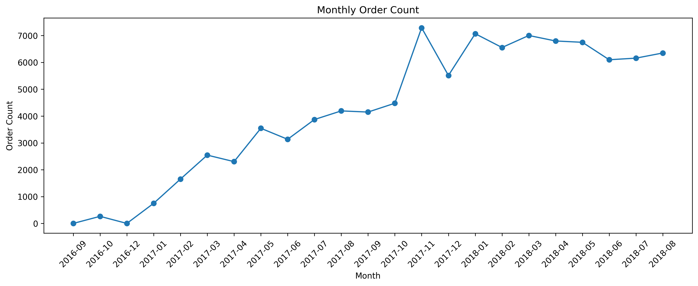

分析目的：

觀察 Olist 平台每月訂單量變化，判斷平台交易量是否有成長趨勢、季節性波動或異常月份。

商業意義：

訂單數可以反映平台需求變化，但需要與營收與平均客單價一起比較，才能判斷成長品質。

---

### 2. 每月營收趨勢

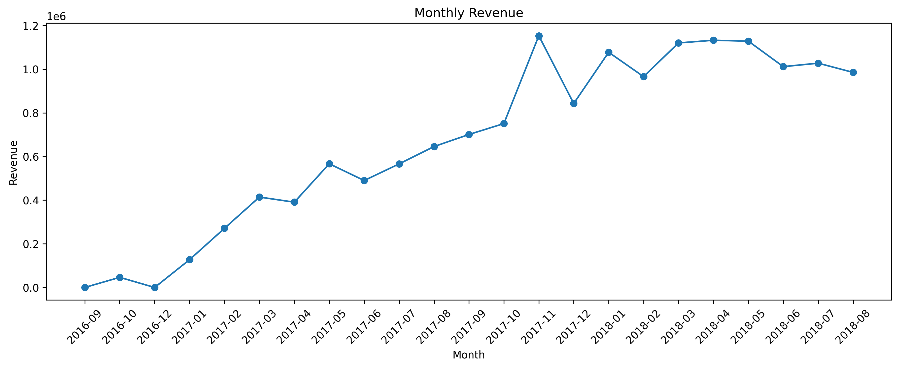

分析目的：

觀察每月營收變化，並與每月訂單數趨勢互相比較。

商業意義：

若營收與訂單數同步上升，代表交易規模擴大；若訂單數上升但營收沒有同步增加，可能代表客單價下降。

---

### 3. Top 10 商品品類營收

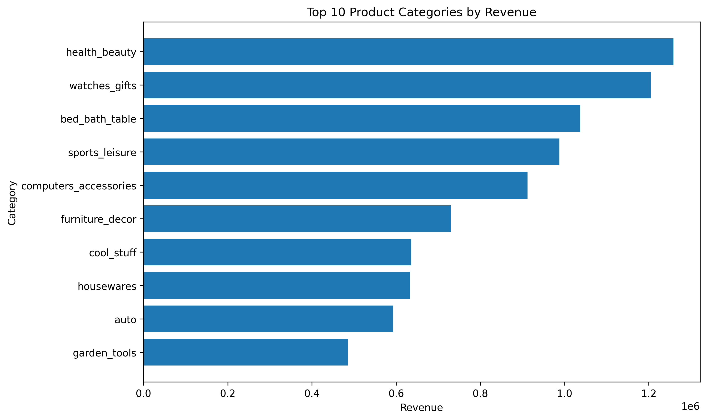

分析目的：

找出平台主要營收來源品類，判斷營收是否集中在少數商品類別。

商業意義：

高營收品類可以作為平台重點經營方向，例如加強庫存、廣告投放與推薦曝光。

---

### 4. 付款方式分布

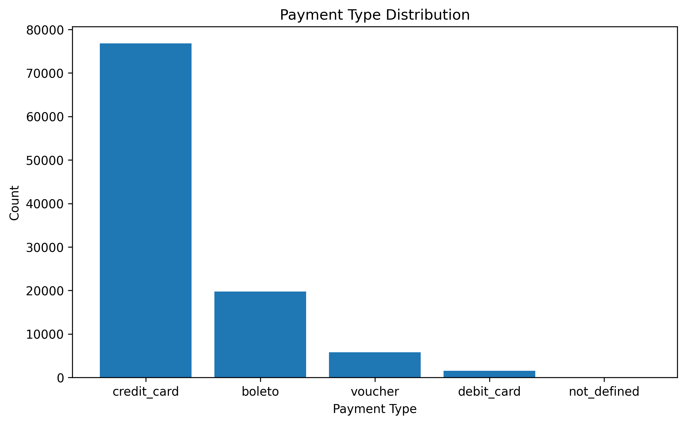

分析目的：

了解顧客主要使用哪些付款方式。

商業意義：

付款方式會影響結帳流程設計、分期付款策略與付款失敗風險管理。

---

### 5. 評論分數分布

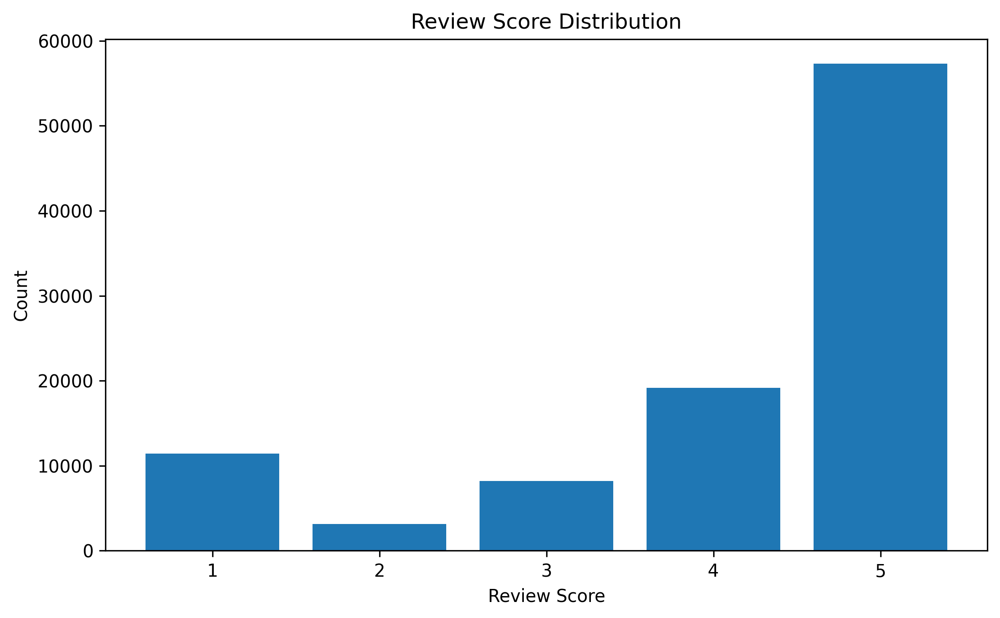

分析目的：

觀察顧客評價分布，了解整體滿意度狀況。

商業意義：

評論分數可作為顧客體驗指標，也能作為後續 Stage 5 評論好壞預測模型的基礎。

---

### 6. 物流配送天數分布

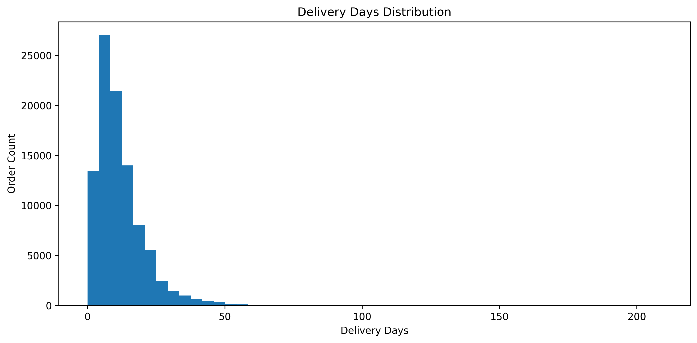

分析目的：

了解訂單從下單到實際送達所需天數，觀察是否存在極端延遲案例。

商業意義：

配送速度是電商顧客體驗的重要因素，配送時間過長可能造成差評或取消訂單。

---

### 7. 延遲訂單比例

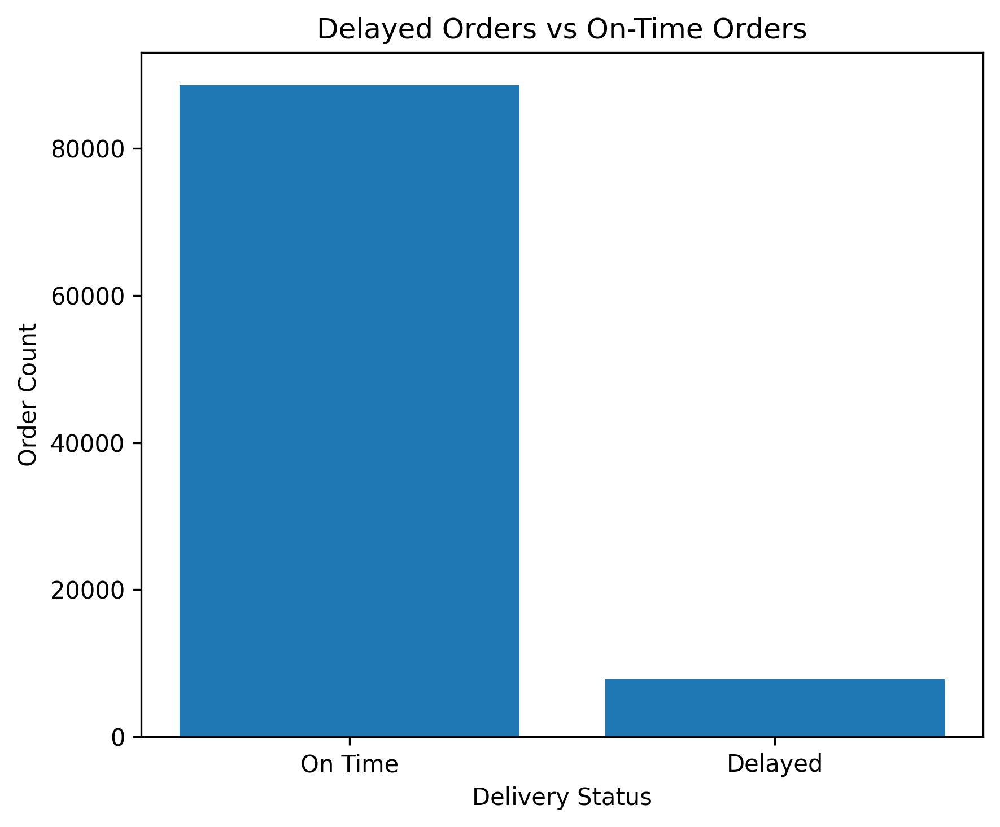

分析目的：

計算有多少訂單晚於預估送達日期。

商業意義：

延遲訂單比例是 Stage 4「訂單是否延遲預測」的分析基礎。Stage 3 下列公式比較完整 timestamp；Stage 4 改為比較日曆日期，預估當日送達算準時，不能直接沿用兩者的延遲率。

Stage 3 的延遲定義：

```text
order_delivered_customer_date > order_estimated_delivery_date
→ delayed = 1

否則
→ delayed = 0
```

---

### 8. 各州顧客訂單分布

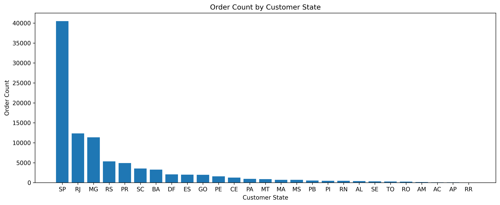

分析目的：

了解 Olist 顧客訂單主要集中在哪些州。

商業意義：

高訂單州別可以作為物流倉儲、行銷投放與區域營運策略的重要依據。

---

## Stage 3 商業洞察總結

透過本階段 EDA，可以初步掌握 Olist 平台的營運狀況：

1. **訂單與營收趨勢**  
   每月訂單數與每月營收可以用來判斷平台整體交易規模是否穩定成長。

2. **商品品類營收集中度**  
   Top 10 商品品類營收可以看出平台主要收入來源，後續可以進一步分析各品類的訂單數、平均售價、運費與評論表現。

3. **付款方式偏好**  
   付款方式分布可以反映顧客的結帳習慣，協助後續優化付款流程與分期付款策略。

4. **顧客滿意度**  
   評論分數分布可以作為顧客滿意度的初步指標，後續可延伸為評論好壞預測模型。

5. **物流配送效率**  
   配送天數分布與延遲訂單比例可以用來衡量物流效率，是後續延遲預測模型的核心分析方向。

6. **地區需求分布**  
   各州顧客訂單分布可以看出市場需求集中區域，後續可進一步分析跨州配送是否影響配送天數與延遲率。

---

## 安全設定說明

本專案使用 `scripts/db_config.py` 管理本機 MySQL 連線設定。

由於 `db_config.py` 可能包含資料庫帳號與密碼，因此不建議上傳至 GitHub。

建議做法：

```text
上傳：
scripts/db_config_example.py

不上傳：
scripts/db_config.py
```

`.gitignore` 建議加入：

```gitignore
scripts/db_config.py
```

`db_config_example.py` 範例：

```python
DB_CONFIG = {
    "user": "your_mysql_user",
    "password": "your_mysql_password",
    "host": "localhost",
    "port": 3306,
    "database": "olist_ecommerce",
    "charset": "utf8mb4"
}
```

---

## 使用技術

目前已使用：

- Python
- Pandas
- Matplotlib
- SQLAlchemy
- PyMySQL
- MySQL
- DBeaver
- Jupyter Notebook
- Scikit-learn
- Joblib
- XGBoost / LightGBM
- Git / GitHub

後續預計使用：

- Streamlit
- FastAPI
- JavaScript
- AJAX

---

## Stage 4：訂單是否延遲預測

已完成每訂單一列的 21 個特徵、延遲標記、缺值處理、類別編碼、時間切分、模型比較、門檻選擇、保留資料評估與本機推論。目前預設推論模型仍為 **Random Forest**；新增 6 種模型的開發時間回測，與原版固定測試分開呈現。

### 原版固定測試結果

- **預測時點**：訂單／付款核准時 `order_approved_at`。
- **標記定義**：實際送達的日曆日期晚於預估日期才算延遲；預估當日送達算準時。Stage 3 使用完整 timestamp，因此兩階段延遲率口徑不同。
- **可用資料**：96,394 張時間完整且合理的已送達訂單，6,532 張延遲（6.78%）。實際配送時間、最終狀態、評論及 ID 不進模型。
- **切分方法**：依核准日期建立約 60%／20%／20% 的 train／validation／test，同一天不跨組；排除在下一區間起點尚未送達的 train／validation 標籤。
- **選模方法**：只用 train 學習補值、編碼與模型；依 validation AP 選模型，再依 validation F1 選門檻，最後固定模型與門檻評估 test。

| 區段 | 核准日期 | 成熟標籤篩選後筆數 | 延遲比例 |
| --- | --- | ---: | ---: |
| Train | 2016-09-15 至 2018-03-02 | 54,145 | 5.06% |
| Validation | 2018-03-03 至 2018-05-25 | 17,356 | 8.30% |
| Test | 2018-05-26 至 2018-08-29 | 19,380 | 3.47% |

Validation AP：Dummy 0.0830、Logistic Regression 0.1511、Random Forest 0.1593。選定 **Random Forest**，決策門檻 **0.450103**。

| Test 指標 | Random Forest | 全猜準時基準 |
| --- | ---: | ---: |
| Average Precision | 0.0568 | 0.0347 |
| ROC-AUC | 0.6690 | 0.5000 |
| Precision | 5.69% | 0.00% |
| Recall | 23.07% | 0.00% |
| F1 | 0.0912 | 0.0000 |
| Balanced accuracy | 54.66% | 50.00% |
| Accuracy | 84.07% | 96.53% |

模型抓到 672 張延遲訂單中的 155 張，但產生 2,571 張誤報。排序能力高於基準，誤報與漏報仍多；這是可重現的第一版離線模型，尚未達到可直接自動處置訂單的品質。期間延遲率有明顯變化，成熟標籤篩選也會偏向保留較快送達的訂單，詳見方法文件。

Validation permutation importance 顯示模型較依賴顧客州別、運費、跨州比例、預估配送天數與賣家州別；這是模型依賴程度，不能解讀成延遲的因果因素。模型分數未經機率校準。

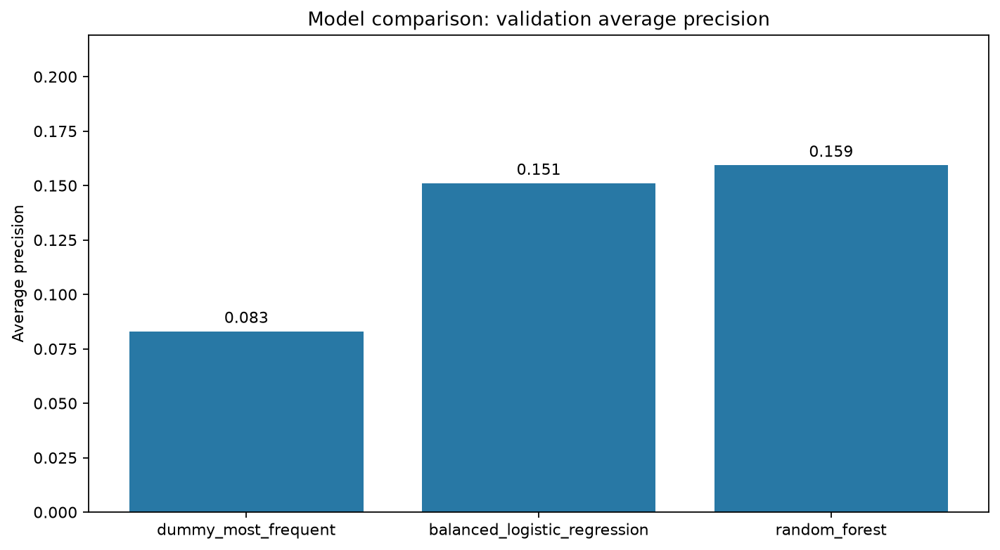
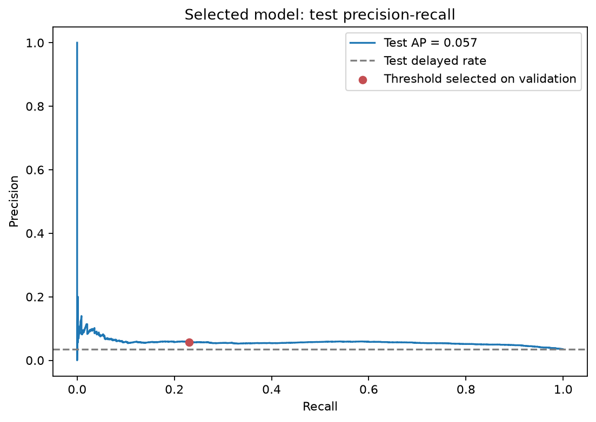
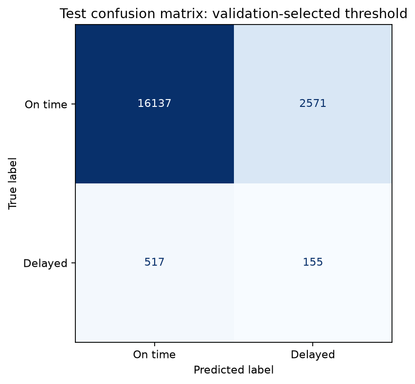
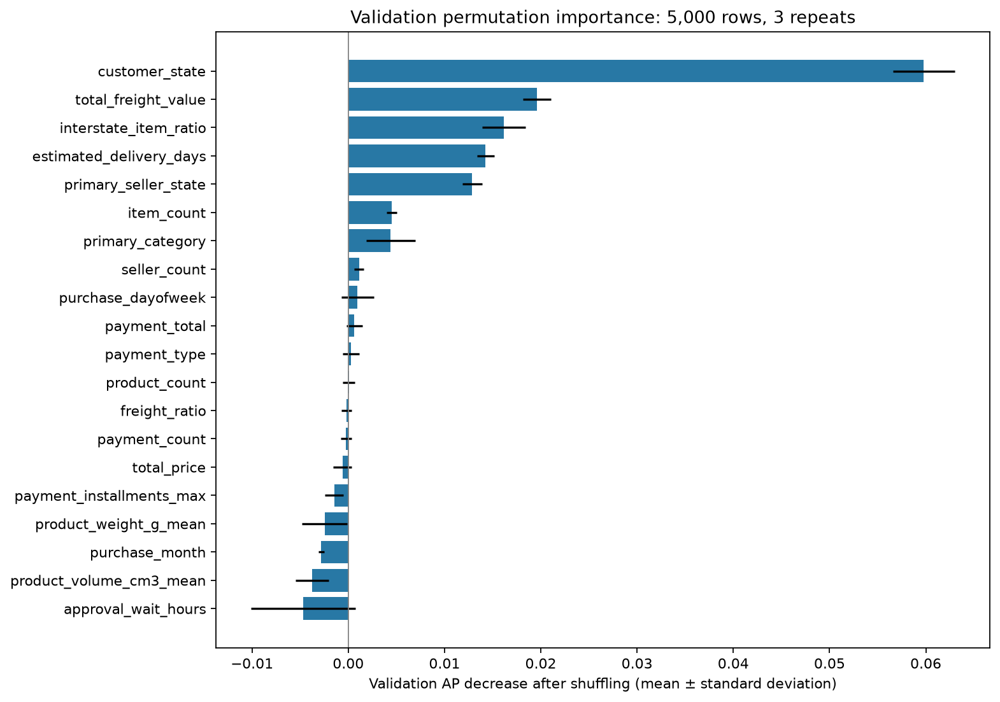

### 新增：6 種模型的時間回測比較

使用同一套 21 欄特徵，比較 Logistic Regression、Random Forest、Extra Trees、HistGradientBoosting、XGBoost、LightGBM，另外保留全猜準時的 Dummy 基準。XGBoost 3.4.1 與 LightGBM 4.7.0 已安裝於 `.venv/`，版本記錄在 `requirements-lock.txt`。

三組 evaluation 分別是 **2017-12、2018-02、2018-04**；validation 分別是 2017-10、2017-12、2018-02，中間各留一個月等待配送結果。每組只用更早且標籤已成熟的 train 訓練，門檻只依 validation F1 選擇。原版 test 訂單不參與比較，原模型與原 test 報告保留。

以下是實際回測的 AP（Average Precision，衡量延遲訂單的排序能力，越高越好，並非 accuracy）。三個月份等權平均；標準差描述月份差異，不是信賴區間。

| 模型 | 2017-12 AP | 2018-02 AP | 2018-04 AP | 平均 AP | AP 標準差 |
| --- | ---: | ---: | ---: | ---: | ---: |
| **Logistic Regression** | **0.1085** | 0.2074 | **0.1420** | **0.1526** | 0.0411 |
| Random Forest | 0.0834 | 0.2067 | 0.1202 | 0.1368 | 0.0517 |
| Extra Trees | 0.0799 | 0.2060 | 0.1225 | 0.1361 | 0.0524 |
| XGBoost | 0.0809 | 0.2111 | 0.1155 | 0.1358 | 0.0551 |
| LightGBM | 0.0770 | **0.2150** | 0.1090 | 0.1337 | 0.0590 |
| HistGradientBoosting | 0.0779 | 0.2000 | 0.0921 | 0.1233 | 0.0545 |
| Dummy：全猜準時 | 0.0786 | 0.1362 | 0.0462 | 0.0870 | 0.0372 |

| 模型 | 平均 ROC-AUC | 平均 F1 | 平均 Recall | 平均 Precision |
| --- | ---: | ---: | ---: | ---: |
| Logistic Regression | 0.6590 | 0.1763 | 54.49% | 13.50% |
| Random Forest | 0.6349 | 0.1727 | 63.71% | 10.16% |
| Extra Trees | 0.6339 | 0.1667 | 57.10% | 10.36% |
| XGBoost | 0.6180 | 0.1338 | 64.13% | 8.21% |
| LightGBM | 0.6110 | 0.1439 | 65.64% | 8.48% |
| HistGradientBoosting | 0.5950 | 0.1389 | 60.94% | 8.69% |

**本設定下，Logistic Regression 的平均 AP、F1 與 precision 最高；LightGBM 在 2018-02 單月的 AP 最高。** 新增的樹模型沒有穩定勝過 Random Forest。月份差異明顯，延遲比例依序為 7.86%、13.62%、4.62%；各模型仍有大量誤報，門檻也受成熟標籤篩選影響。

這是開發回測排名，不能當成新模型在未知最終測試集上的成績，也不能與前表原版 test 直接比較。評估使用事後已送達結果，部分標籤在原 test 起點後才可觀察。目前預設推論仍用原版 Random Forest；後續可優先驗證 Logistic Regression，並改善特徵與門檻成本。完整切分、排除筆數與限制見 [Stage 4 方法文件](docs/STAGE4_DELAY_PREDICTION.md)。

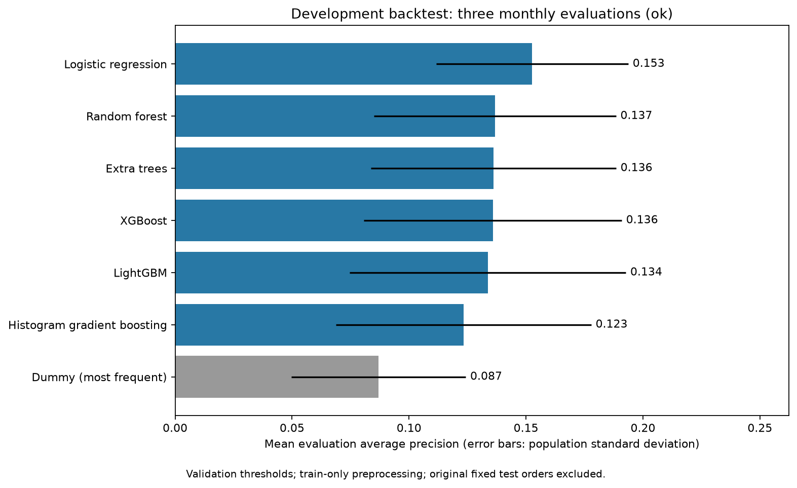

### 誤報改善：平衡模式

依使用者指定，改為 **validation 至少抓到 30% 延遲，再選提醒量最少的模型與門檻**。實測 RF／Logistic 的原特徵與近 90 天配送歷史特徵，共 4 候選；歷史結果嚴格限制在該訂單核准前已送達者。

最終仍選 **原特徵 Random Forest**，門檻由 0.450103 改為 **0.453508**，validation 召回為 **30.05%**。新增歷史特徵沒有改善這次的誤報，因此沒有採用。

已檢視保留資料的回溯診斷（不是新的獨立測試）：

| 指標 | 原版 | 平衡模式 |
| --- | ---: | ---: |
| 誤報 FP | 2,571 | **2,401** |
| 抓到延遲 TP | 155 | 152 |
| 漏掉延遲 FN | 517 | 520 |
| Precision | 5.69% | 5.95% |
| Recall | 23.07% | 22.62% |

誤報少 **170 張（6.61%）**，代價是少抓 **3 張**延遲訂單。這是小幅改善，仍有大量誤報。原特徵 RF 在三組開發回測合計的誤報由 8,825 降至 7,712（減少 12.61%），抓到延遲由 1,183 降至 1,099。

逐月自動選模的實驗方案有一個月份召回僅 1.12%，平衡 RF 也有月份低於 30%；因此**保留原版預設**，新門檻以 `--profile balanced` 明確選用，不能保證未來召回率。完整候選、月份差異與限制見 [誤報改善說明](docs/STAGE4_ALERT_OPTIMIZATION.md)。

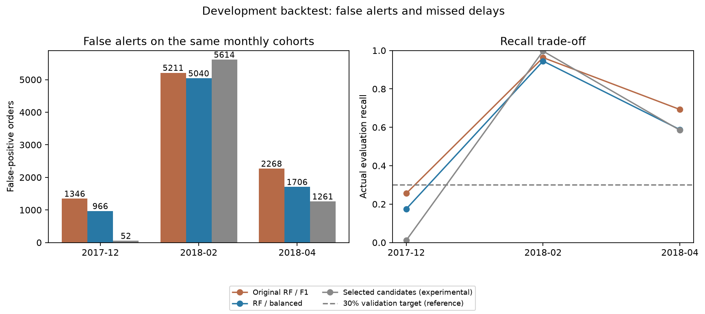

### 月份落差與容易誤報的情況

固定平衡模式 RF 與門檻 0.453508，檢查同一批已看過的保留資料。本次新增診斷程式、逐月與八維分群報告，沒有重新訓練或修改提醒規則；以下是**回溯診斷，不是新的獨立測試或改善成績**。

| 核准期間 | 訂單數 | 誤報 FP | FPR：FP／準時數 | 抓到 TP | 漏掉 FN | Recall |
| --- | ---: | ---: | ---: | ---: | ---: | ---: |
| 2018-06 | 6,094 | 427 | 7.09% | 21 | 50 | 29.58% |
| 2018-07 | 6,021 | 982 | 16.85% | 55 | 138 | 28.50% |
| 2018-08-01～29 | 6,495 | 985 | 16.18% | 76 | 330 | 18.72% |

另有 5 月 26～31 日的 770 單、7 張誤報、兩張延遲皆漏掉；5、8 月不是完整月份。6、7 月單量接近，誤報率卻明顯上升。

- **跨州路線是優先檢查對象**：SP → RJ 誤報 556／1,313 張準時單（FPR 42.35%），占全部誤報 23.16%；SP → SC 為 223／373（59.79%）。路線方向是主賣家州到顧客州，兩者在不同月份也反覆誤報。全部商品均跨州的 FPR 18.11%，同州為 4.90%；不能直接停掉跨州提醒，因為它也抓到 100 張延遲。
- **承諾與資料組成持續改變**：6→8 月平均承諾由 28.06 降至 15.38 天，已完成訂單的實際平均配送由 8.91 降至 7.39 天；延遲率上升不能直接解讀成配送變慢。22～30 天承諾群誤報最多（928 張），不是只有最短承諾容易誤報。
- **成熟標籤有明顯取樣偏差**：validation 的 5 月 1～25 日原有 452 張延遲，截止前可用的只剩 27 張；最終 validation 的延遲樣本有 82.72% 來自 3 月，合計 recall 達 30% 不代表逐月達標。

完整 6、7 月在共同「顧客州 × 承諾區間」固定組成後，FPR 為 8.06%／9.65%，共同樣本涵蓋各月準時單 84.36%／76.75%。族群組成與差距有關，但仍不能解釋全部；這是部分樣本的描述性比較，不是因果估計。新賣家與高運費分群的差異較小，尚不足以當作主要原因。

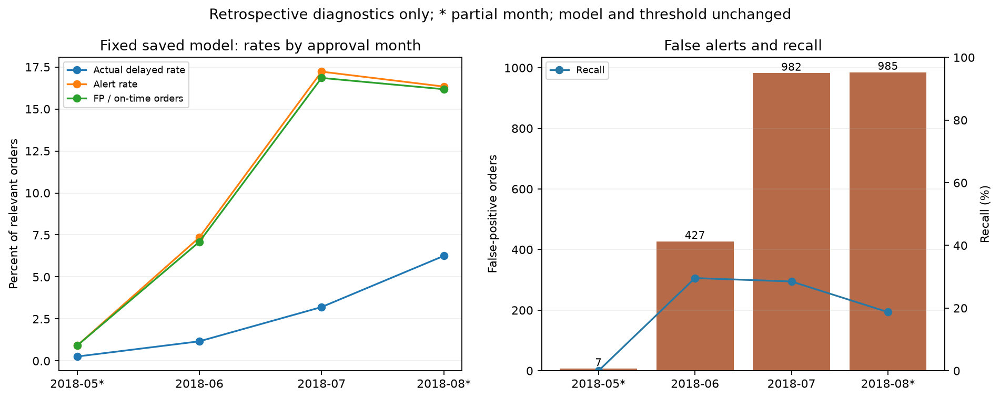
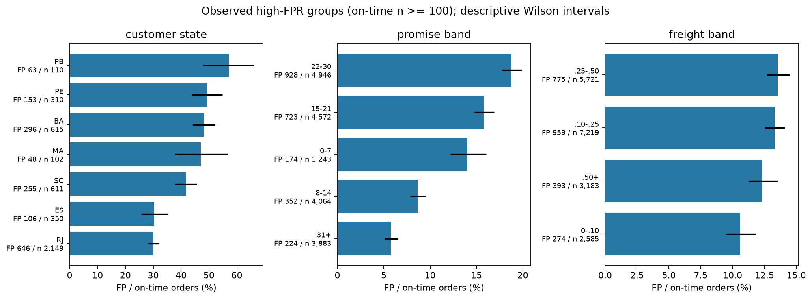

完整分母、部分月份、小樣本、標籤篩選與後續實驗設計見 [月份誤報診斷](docs/STAGE4_MONTHLY_DIAGNOSTICS.md)。本輪先完成問題定位，保留現有模型與門檻。

### 等待期與路線承諾特徵實驗

已完成 24 次訓練：train／validation 都保留 **30 或 60 天等待期**，比較 Random Forest／Logistic Regression 的原 21 欄與新增路線承諾特徵（共 30 欄）。**60 天在執行前指定為主要方案，30 天是敏感度比較**；同一等待期內只依 validation 至少 30% recall、提醒量最少來選模型與門檻。

60 天讓有效已送達 cohort 的 validation 延遲樣本保留率達 **98.31%／98.40%／95.05%**；30 天為 84.07%／82.75%／66.09%。等待讓更多慢件取得答案，但 train／validation 也更舊，不能把方法差異全歸因於等待天數。未送達、取消及無效時間訂單另列原始分母，不當作準時。

下表沿用已檢視的 2017-12、2018-02、2018-04 開發月份，同一批 18,833 單／1,642 張延遲。**這是開發回測；原 2018-05-26 起保留資料本輪不評估。**

| 等待／RF 特徵 | 誤報 FP | 抓到 TP | 漏掉 FN | Recall |
| --- | ---: | ---: | ---: | ---: |
| 舊 RF／平衡（背景對照） | 7,712 | 1,099 | 543 | 66.93% |
| 30 天／原特徵 | 2,954 | 565 | 1,077 | 34.41% |
| 30 天／路線承諾 | 2,887 | 710 | 932 | 43.24% |
| 60 天／原特徵 | 4,854 | 713 | 929 | 43.42% |
| 60 天／路線承諾 | 3,434 | 659 | 983 | 40.13% |

相同 30 天 RF 下，路線特徵**少 67 張誤報、多抓 145 張延遲**，但最低月份 recall 仍只有 16.14%。相同 60 天 RF 則少 1,420 張誤報，同時少抓 54 張延遲。60 天三個 fold 都依 validation 選中 RF／路線承諾，2017-12 recall 卻僅 **4.04%**；驗證標籤更完整，沒有保證後續月份表現穩定。

新特徵包含有向州別路線、近 90 天配送中位數／第 90 百分位、承諾相對分位的差值／比例及歷史 CDF。送達 timestamp 必須嚴格早於當前核准時間，配送天數採日曆尺度；當月前幾天已完成的配送可更新後續訂單歷史，不用未來答案。

分群仍有代價：60 天 RF 的顧客 SP 誤報由 2,409 降至 1,065，但漏報由 172 增至 256；SP → RJ 誤報反而由 463 增至 532，同時抓到延遲由 176 增至 227。因此不自動取代預設模型，六份研究 artifact 獨立存於 `models/research/`，需以 `--model` 明確載入。完整十策略、逐月取捨及操作見 [等待期實驗](docs/STAGE4_WAITING_EXPERIMENT.md)。

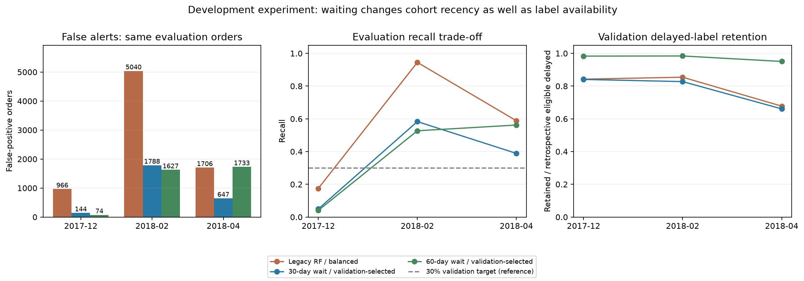

圖中 30／60 天採逐 fold validation 選出的候選；30 天第一個 fold 選 Logistic，因此與上表固定 RF 的數字不同。

### 多月份驗證

已完成 **12 次訓練**：固定至少 60 天等待，取連續三個完整日曆月驗證，沿用 RF／Logistic 的原特徵／路線特徵四個候選。每個 fold 的模型在最早驗證月開始時訓練一次，三種策略共用同一模型與分數：只用最新月選門檻與模型、三月合計 recall ≥30%、以及預先指定的主策略「每月 recall 都 ≥30%」。後兩種策略的選模都使用全三月提醒量，公平比較月度限制。

驗證月份分別為 2017-07～09、2017-09～11、2017-10～12，逐月延遲標籤保留率為 98.36%～100%（限有效已送達 cohort）。完整月份對齊後實際等待 61／62／90 天；train 則只保留 7,517／14,284／18,089 張，較舊單月方案更少、更舊。舊實驗僅作背景，不能把差異全歸因於多月份。

以下是三種策略各自依 validation 選模，在同一批 18,833 張訂單的**開發回測**：

| 驗證策略 | 誤報 FP | 抓到 TP | 漏掉 FN | Precision | Recall | 最差驗證月 Recall | 最差回測月 Recall |
| --- | ---: | ---: | ---: | ---: | ---: | ---: | ---: |
| 只看最新月 | 3,974 | 589 | 1,053 | 12.91% | 35.87% | 12.50% | 10.09% |
| 三月合計達標 | 3,293 | 563 | 1,079 | 14.60% | 34.29% | 18.33% | 16.37% |
| **每月都達標（主策略）** | **5,728** | **609** | **1,033** | **9.61%** | **37.09%** | **30.00%** | **8.07%** |

逐月限制比三月合計**多抓 46 張延遲，卻多 2,435 張誤報**，沒有達成減少誤報的目標。2017-12 主策略改選 Logistic／路線，抓到 36／446 張（8.07%），低於三月合計選中的 Logistic／原特徵 73／446 張（16.37%）；2018-04 則改選 RF／原特徵，誤報達 4,455 張。固定候選下，降低共同門檻會同時增加或維持 TP 與 FP；選模改變後，後續月份可能反而少抓延遲。

每個驗證月達標仍不能保證後續月份達標，這次沒有自動提升研究模型。三份模型另存 `models/research/olist_delay_multimonth_{month}.joblib`，以 `--model` 載入。本輪不評估原 holdout；早期 evaluation 在後續 fold 成為 validation 是合法滾動開發回測，不能當獨立未知測試。完整 15 種候選／策略、逐月結果與操作見 [多月份驗證](docs/STAGE4_MULTIMONTH_VALIDATION.md)。

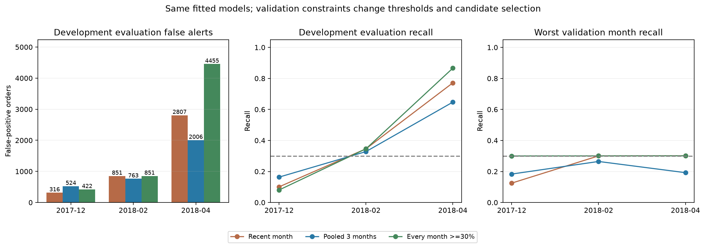

### 每月重訓的滾動驗證

已完成 **32 次訓練**：重播 2017-07～12、2018-02、2018-04 八個必要月份，各訓練 RF／Logistic × 原特徵／路線特徵四個候選。每月 M 第一日只使用核准 `<M−60天`、結果 `<M` 的訂單，為 M 月留下真正 out-of-time 分數。Evaluation 仍是原三個開發月，並非連續所有月份的部署測試。

E 時以三個成熟歷史月份各自舊版模型的分數決定門檻與候選，再由 E 當天新訓練的模型預測。最終模型雖已訓練到歷史 validation 訂單，**沒有拿最終模型重算它們的驗證分數**；同一歷史月在不同 E 仍重新篩 `label_available_time < E`，避免快取過早刪掉慢件。

最終 train 增加到 **26,431／38,522／50,358 張**（前次固定模型為 7,517／14,284／18,089 張）。以下在同一批 18,833 張訂單、1,642 張延遲比較；全部是**已檢視月份的開發回測**，本輪沒有評估原 holdout。

| 方案 | 誤報 FP | 抓到 TP | 漏掉 FN | Precision | Recall | 最差回測月 Recall |
| --- | ---: | ---: | ---: | ---: | ---: | ---: |
| 前次固定模型／每月達標（背景） | 5,728 | 609 | 1,033 | 9.61% | 37.09% | 8.07% |
| 滾動／最新月 | 6,923 | 1,008 | 634 | 12.71% | 61.39% | 8.74% |
| 滾動／三月合計 | 6,449 | 986 | 656 | 13.26% | 60.05% | 6.05% |
| **滾動／每月達標（預先指定主策略）** | **7,957** | **1,050** | **592** | **11.66%** | **63.95%** | **13.45%** |

主策略比前次固定模型**多抓 441 張延遲，也多 2,229 張誤報**；相對本次滾動／三月合計則多抓 64 張、多 1,508 張誤報，沒有達成減少誤報的目標。主策略三月 recall 為 **13.45%／78.43%／95.42%**，2018-04 單月誤報 **4,868 張**，仍未達成月份穩定性。前後比較同時改變最終 train 新近程度及 validation 模型版本，不能解釋為單一因素的因果效果。

該輪使用未校準的原始分數。以 2017-12 選中的 Logistic／原特徵為例，三個歷史月各自達 30% 的門檻為 0.74806／0.48004／0.54743，共同門檻 0.48004；後續十二月仍只抓到 60／446 張。報告記錄各月及 evaluation 的分數分位，作為轉移診斷，不能直接將差異歸因於未校準或單一特徵。主策略每個歷史驗證月都達 30%，仍不保證新模型月份達標。

三份可推論研究模型另存 `models/research/olist_delay_rolling_{month}.joblib`，只以 `--model` 明確載入；32 份內部月份版本另存 `rolling_versions/` 供重現，不含提醒門檻。未自動替換預設模型。完整方法、15 種候選／策略與操作見 [每月重訓實驗](docs/STAGE4_MONTHLY_RETRAINING.md)。

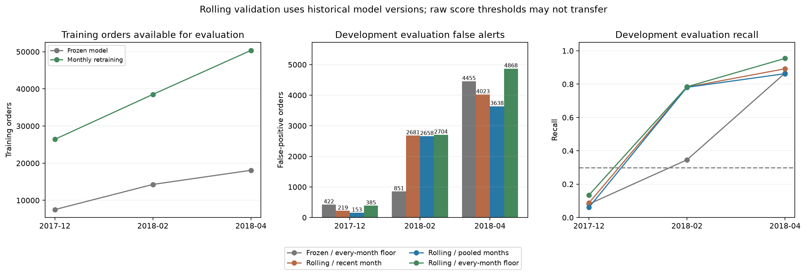

### 分數校準與每日提醒量上限

已比較原始分數、Sigmoid、Isotonic，並依使用者指定以 **每日最多 10%** 為主方案，另看 5%、20% 與無上限。沿用 32 份月份模型，核對原始資料、模型雜湊及全部 256,124 列舊分數，重算完整月份分數；本輪沒有重訓基礎模型，另 fit 24 個校準器。

每個回測起點 E，把三個歷史 OOT 月拆成「前兩月校準」與「第三月選門檻及候選」，標籤都須嚴格早於 E；兩段互不重疊。第三月尚無結果的訂單仍參與每日容量與排序，但不算驗證成績。門檻及選模固定後，才計算 E 當月結果。以下仍是已檢視的 **18,833 筆開發回測**，不是新的獨立測試；原 2018-05-26 起保留期間未評分。

| Sigmoid／歷史驗證選模 | 實際提醒 | 誤報 FP | 抓到延遲 TP | 漏報 FN | Precision | Recall | 最差回測月 recall |
| --- | ---: | ---: | ---: | ---: | ---: | ---: | ---: |
| 無上限 | 7,931（42.11%） | 6,923 | 1,008 | 634 | 12.71% | 61.39% | 8.74% |
| 每日最多 5% | 902（4.79%） | 720 | 182 | 1,460 | 20.18% | 11.08% | 8.30% |
| **每日最多 10%，主方案** | **1,845（9.80%）** | **1,493** | **352** | **1,290** | **19.08%** | **21.44%** | **14.13%** |
| 每日最多 20% | 2,867（15.22%） | 2,314 | 553 | 1,089 | 19.29% | 33.68% | 8.74% |

10% 相對同輪無上限，少 5,430 張誤報，也少抓 656 張延遲。**三組歷史驗證在 10% 上限下都無法抓到 30% 延遲**，因此門檻退到 0，依每日排名用滿可用名額，明確標示不可行；沒有把未達標結果稱為成功。20% 在三個歷史政策月可達標，但後續最差月份仍只有 8.74%。這輪無上限以最新一個政策月選門檻，不能把與前輪「三月各自達標」的差異單獨歸因於校準。

校準與少發提醒有不同作用。固定 RF／Route 比較時，Sigmoid 的開發 Brier 在三個月都低於原分數，例如 2018-04 為 0.196212 → 0.070136；但該月用校準期延遲率固定輸出的常數基準為 0.046074，仍更低。不能據此宣稱機率已可靠。實際正斜率 Sigmoid 沒改變排序，本輪各上限的提醒與原分數完全相同；誤報下降主要來自容量限制。完整三方法、四候選、60 列摘要與機率指標見 [校準與提醒上限實驗](docs/STAGE4_CALIBRATION_BUDGET.md)及[實際報告](reports/stage4/calibration_budget.json)。

容量為 `floor(比例 × 當日完整評分筆數)`，不跨日挪用；同分依原分數、訂單 ID 固定排序。需等每日批次結束，可能比核准時晚一天提醒。歷史分母仍是有效完成訂單 cohort，不能當成所有原始核准訂單的覆蓋率。研究模型另存 `models/research/olist_delay_calibrated_budget_{month}.joblib`；批次推論必須提供 `order_id`、`prediction_time` 與所需特徵，並明確加 `--complete-daily-batches`，不能用單張訂單推論來執行每日上限。旗標是呼叫端對完整批次的承諾，程式無法從片段 CSV 證明沒有漏列。

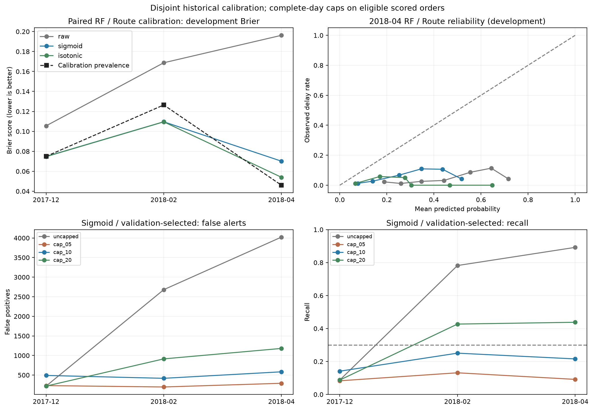

### 固定 10% 預算：漏報診斷與排名改善

依使用者要求，先繼續訓練與驗證，暫緩 Dashboard 及新圖表。改以每日完整批次排名取 `floor(10% × 當日筆數)`，門檻 0，未知結果仍競爭名額。三個歷史 OOT 月各用當月模型分數，以最差月 recall、合計 TP、AP 及固定候選順序選模；30% 是逐歷史月的適用門檻，固定決策後才看開發月。以下沿用相同 18,833 單／1,642 張延遲，都是反覆檢視的開發回測。

| 工作／方案 | 新增訓練 | 抓到 TP | 誤報 FP | 漏報 FN | 開發 Recall | 最差歷史月 Recall | 狀態 |
| --- | ---: | ---: | ---: | ---: | ---: | ---: | --- |
| 原校準／10% 主方案 | 0 | 352 | 1,493 | 1,290 | 21.44% | 17.50%¹ | 未達標 |
| 第一輪：加入賣家／路線／ZIP3，10 候選選模 | 48 | 352 | 1,493 | 1,290 | 21.44% | 17.50% | 仍選回原模型 |
| 第二輪：待件負載與每日排序，15 候選選模 | 40 | 352 | 1,493 | 1,290 | 21.44% | 17.50% | 仍選回原模型 |
| 第三輪：訓練答案時鐘與等待期，24 候選選模 | 72 | 358 | 1,487 | 1,284 | 21.80% | 18.33% | 小幅改善，仍未達標 |
| 第四輪：特徵工程，31 候選主選模 | 88 | 359 | 1,486 | 1,283 | 21.86% | 19.17% | 只多抓 1 張，仍未達標 |
| 第五輪：地理與負載交互消融，43 候選主選模 | 96 | 359 | 1,486 | 1,283 | 21.86% | 19.17% | 主方案不變，仍未達標 |
| 第六輪：Logistic 負載組 L2 強度，50 候選主選模 | 56 | 420 | 1,425 | 1,222 | 25.58% | 19.17% | 多抓 61 張，仍未達標 |
| 第七輪：路線／承諾／近期負載消融，56 候選主選模 | 48 | 417 | 1,428 | 1,225 | 25.40% | 19.17% | 少抓 3 張，未改善、仍未達標 |
| 第八輪：逾期未送達7／14天堆積消融，65候選主選模 | 72 | 418 | 1,427 | 1,224 | 25.46% | 19.17% | TP差+1；仍未達三個 fold 各歷史月 30% 下限 |
| 第九輪：相同83／101欄分類與每日排序，67候選主選模 | 16 | 418 | 1,427 | 1,224 | 25.46% | 19.17% | 七月改善、九月退步；主方案未採新排序模型 |
| 第十輪：排序L2＝1／10／100，71候選主選模 | 32 | 418 | 1,427 | 1,224 | 25.46% | 19.17% | L2＝100改善九月整體，但SP→SP少抓1筆、七月退步；主方案不變 |

¹ 17.50% 是本輪三歷史月 selector 對同組舊候選的結果；原校準實驗只用第三個政策月選模，不能混稱原實驗驗證制度。八輪主方案都提醒 1,845 張（9.80%，每日取整後低於 10%），歷史適用結果見各輪說明，研究模型未自動替換原本預設。合計新增 **520 次訓練**。

| 原 10% 方案的漏報群組 | 延遲總數 | 抓到 TP | 漏報 FN | Recall |
| --- | ---: | ---: | ---: | ---: |
| 主賣家 SP → 顧客 SP | 239 | 3 | 236 | 1.26% |
| SP → RJ | 409 | 211 | 198 | 51.59% |
| SP → MG | 84 | 0 | 84 | 0.00% |
| 承諾 22–30 天 | 915 | 216 | 699 | 23.61% |
| 承諾 15–21 天 | 381 | 102 | 279 | 26.77% |
| 承諾 31 天以上 | 300 | 32 | 268 | 10.67% |

路線與承諾區間是兩種分組，不能相加；絕對漏報量也受群組訂單量影響。699 張承諾 22–30 天漏報占全部漏報 54.19%。每日第 10–20% 名次另有 293 張漏報，20–50% 有 553 張，後半段有 444 張；每日名額已用滿，降門檻不能增加名額。

第一輪新增 45 欄風險特徵及 LightGBM／XGBoost 等六組候選，沿用 32 個舊版本。第二輪保留 45 欄，再加入全域／賣家／路線各五個待件負載特徵，共 60 欄；有效原始核准母體 99,281 筆，包含沒有配送結果的訂單，不以最終狀態過濾。送達嚴格早於查詢才移除，過承諾日次日午夜算逾期；資料缺取消時間，已核准取消單可能仍留在窗口。

第二輪新增 Logistic／LightGBM／XGBoost 及 45／60 欄 LambdaRank 五組候選。LambdaRank 以成熟訓練列的核准日分組，NDCG 的截斷 20 並非精確的每日 10% recall 目標；`sigmoid(margin)` 是單調分數介面，沒有重新校準機率。僅比較第二輪新增分類器的歷史選模，開發 TP 為 349；僅比較日排序器為 326，均未達歷史門檻。不能按開發成績事後挑一個看起來較好的模型，宣稱已改善。

方法、完整候選表與限制見[第一輪排名改善](docs/STAGE4_BUDGET_RANKING.md)、[第二輪待件與每日排序](docs/STAGE4_PENDING_RANKING.md)，實際聚合報告為 [漏報診斷](reports/stage4/budget_miss_diagnostics.json)、[第一輪](reports/stage4/budget_ranking.json)、[第二輪](reports/stage4/pending_ranking.json)。三個原開發月及實驗設計已受既有診斷影響，沒有新的獨立測試，原 holdout 本輪不評分。

第三輪只調整訓練答案的取得時間與核准等待期，保留實際配送時間、60 欄特徵、歷史驗證成熟篩選及每日分母。新增 `training_outcome_known_time = min(實際送達, 承諾日期次日午夜)`：準時答案在配送時已知，延遲答案在逾期時即可確認。比較 Logistic／原特徵、RF／路線、LightGBM／待件，交叉「實際送達＋等待 0 天」「新時鐘＋等待 0 天」「新時鐘＋等待 30 天」，九組固定候選、八個月份共 72 fit。仍有最終已送達群體的事後選擇偏差，且缺少事件入庫時間與承諾修改紀錄，不能將所有未送達訂單直接當作相同標籤。

依歷史驗證選模後，2017-12 改選 Logistic／原特徵／新時鐘／等待 0 天，抓到 69／446 張（原為 63 張）；2018-02、2018-04 仍選原 60 天 RF／路線。合計多抓 6 張、少 6 張誤報，recall **21.44% → 21.80%**，precision **19.08% → 19.40%**；最差歷史月僅 **18.33%**，最差開發月 **15.47%**，仍不能稱為適合上線。

分組沒有全面改善：SP→SP 漏報 **236 → 235**，但誤報 **58 → 67**；SP→RJ 漏報 **198 → 192**，但誤報 **525 → 544**；承諾 22–30 天漏報 **699 → 696**，誤報 **906 → 920**。合計誤報下降來自各群組名額重分配，不能說重點群組的誤報也下降。同模型、等待 0 天下，RF／路線改用新時鐘，開發 TP **297 → 349**；Logistic **365 → 363**、LightGBM **287 → 275**，不是所有模型都受益。

本輪適用門檻仍未通過，繼續暫緩視覺化。完整 29 列摘要、逐月結果、訓練樣本及同模型對照見[訓練答案時間實驗](docs/STAGE4_OUTCOME_CLOCK.md)與[第三輪實際報告](reports/stage4/outcome_clock.json)。

### 第四輪：增加特徵是否提高召回率

保留 60 欄，增加 9 個郵區地理欄位與 14 個逐列交互特徵，形成 83 欄：包含代表賣家距離、距離／承諾天數、待件／完成件壓力、逾期待件占比、每品項運費、密度近似與核准／承諾星期。新增地理來源採每郵區有效座標中位數；這是靜態參考假設，球面距離不是道路里程。另加 8 個出貨期限欄位形成 91 欄；因缺少期限建立／修改時間，只作敏感度比較，排除於主選模。

四家族使用相同 `deadline/wait0` 訓練訂單與固定參數，比較 60／83／91 欄；重用 LightGBM 的 60 欄格，其餘 11 候選、8 個月份共新增 88 fit。全部 35 候選都保留，主要選組比較 31 個不含出貨期限的候選。以下同家族合併開發召回率，使用相同 18,833 單、1,642 張延遲、1,845 個提醒名額：

| 模型 | 原 60 欄 | 地理＋交互 83 欄 | 83 減 60（百分點） | 加期限 91 欄，敏感度 |
| --- | ---: | ---: | ---: | ---: |
| Logistic | 21.80% | 21.62% | −0.18 | 21.68% |
| Random Forest | 22.78% | 19.37% | −3.41 | 23.39% |
| LightGBM | 16.75% | 14.43% | −2.31 | 16.20% |
| XGBoost | 16.87% | 16.02% | −0.85 | 14.74% |

**83 欄在四個家族的合併開發召回都下降，這輪沒有證明增加特徵可穩定改善。** 月份也不一致：RF 的 83 欄在 2017-12 為 17.71% → 20.85%，但 2018-02 為 23.93% → 17.30%，2018-04 為 26.80% → 23.20%。91 欄的 RF 比 60 欄高 0.61 個百分點，仍只是出貨期限可於核准取得的假設下結果，不能當成已確認可部署的改善。

主方案依歷史驗證，只在 2017-12 改選 XGBoost／83 欄，後兩月維持舊 RF／路線。開發 TP **358 → 359**、FP **1,487 → 1,486**、FN **1,284 → 1,283**，recall **21.80% → 21.86%**、precision **19.40% → 19.46%**；最差歷史月 **18.33% → 19.17%**，仍未達每歷史月 30%。只看 83 欄候選的歷史 selector，開發召回僅 **17.97%**；包含出貨期限的全候選 selector 也選同一主方案。不能把主方案多抓 1 張解讀成特徵工程普遍有效。

名額重分配仍有代價：SP→SP 漏報 **235 → 219**，誤報卻 **67 → 295**；承諾 22–30 天漏報 **696 → 701**，31 天以上 **267 → 273**。本輪仍不適合直接上線，預設模型維持原版 RF，Dashboard 暫緩。完整成對、逐月與漏報結果見[特徵工程方法](docs/STAGE4_FEATURE_ENGINEERING.md)、[第四輪實際報告](reports/stage4/feature_engineering.json)及[執行前規格](reports/stage4/feature_engineering_specification.json)。所有 E 月與研究設計已受開發診斷影響，原保留期間未重新評分。

### 第五輪：地理與負載交互分開測試

將前輪 23 個新增欄位拆成互不重疊的三組：G 為 9 個郵區／距離欄及 3 個距離比例；L 為 5 個待件壓力與逾期占比；O 為 6 個成本、密度及日曆交互。基準 60 欄本來就有原始待件數、路線及 ZIP3，移除 G 或 L 只移除該組新增欄位，並非完全去除地理或負載資訊。

四家族各比較基準 60、只加 G 的 72、只加 L 的 65、G+L 的 77，以及前輪完整 83 欄。同模型參數、訓練訂單與欄位相對順序保持一致，新增 12 候選 × 8 月 = **96 fit**，重用 248 個非出貨期限版本；主方案在全部 43 候選中依歷史月份選模。以下仍是相同 18,833 單／1,642 張延遲的開發回測，固定 1,845 個提醒名額：

| 模型 | 基準 60 | 地理 G：72 | 負載 L：65 | G+L：77 | 完整 83 |
| --- | ---: | ---: | ---: | ---: | ---: |
| Logistic | 21.80% | 21.44% | **22.05%** | 21.86% | 21.62% |
| Random Forest | 22.78% | 21.92% | 22.29% | 21.74% | 19.37% |
| LightGBM | 16.75% | 15.71% | 15.83% | 14.13% | 14.43% |
| XGBoost | 16.87% | 15.71% | 16.75% | 14.86% | 16.02% |

地理組在四家族的合併召回都低於基準，2018-02 四家族也全下降。負載組只有 Logistic 小幅改善：TP **358 → 362**、recall **21.80% → 22.05%**（+0.24 個百分點）；十二月多抓 2 張、二月多抓 3 張，但四月少抓 1 張。最差歷史召回 **16.24% → 16.59%**，仍未達 30%，不能按開發總召回直接替換主方案。

剩餘 O 組的方向也依模型而異：在 G+L 已存在時，RF 加回 O，召回 **21.74% → 19.37%**；LightGBM **14.13% → 14.43%**、XGBoost **14.86% → 16.02%**。這只說明目前組合下的差異，不是 O 單獨效果、逐欄重要性或因果結論。

歷史選模仍採前輪的 XGBoost／83 欄、RF／路線、RF／路線，主方案 TP **359**、FP **1,486**、FN **1,283**、recall **21.86%**，最差歷史召回 **19.17%**，三個 fold 均未達標。只比較負載候選的 selector 雖有 22.05% 開發召回，歷史下限較低，不能事後改用它宣稱成功。預設模型與 Dashboard 狀態保持原樣，原保留期間未重新評分。完整方法與逐月成對結果見[地理／負載消融](docs/STAGE4_FEATURE_ABLATION.md)、[第五輪實際報告](reports/stage4/feature_ablation.json)及[執行前規格](reports/stage4/feature_ablation_specification.json)。

### 第六輪：Logistic 負載組正則化強度

固定負載組 65 欄、L2、相同訓練訂單與前處理，測試 `C=0.01、0.03、0.1、0.3、1、3、10`；C 越小正則化越強。七格全部重新訓練，共 56 個月份版本，統一 `max_iter=10000` 並拒絕未收斂模型；實際迭代為 54–834，無 fit warnings。新 C=1 與前輪已收斂、上限 2000 的版本，八個月份的分數、係數、截距及迭代完全重現，不能把求解上限變更當成成效來源。

以下是各固定 C 在相同 18,833 單、1,642 張延遲、1,845 個提醒名額下的開發回測；最差歷史召回為三個 fold 所有歷史月的最低值，不以此開發表直接挑 C：

| 固定 C | 開發 TP | 開發召回 | 最差歷史召回 |
| ---: | ---: | ---: | ---: |
| 0.01 | 441 | 26.86% | 14.17% |
| 0.03 | 418 | 25.46% | 15.00% |
| 0.1 | 391 | 23.81% | 15.83% |
| 0.3 | 378 | 23.02% | 17.05% |
| 1 | 362 | 22.05% | 16.59% |
| 3 | 343 | 20.89% | 16.01% |
| 10 | 344 | 20.95% | 15.31% |

**較強正則化改善了本輪開發表現，但不代表所有歷史月份都應用 C=0.01。** 僅在七個 Logistic 候選中依歷史選模，三個 E 選 C=1、0.01、0.01，開發 TP 436、recall 26.55%；完整 50 候選主方案則選 XGBoost／83 欄、C=0.01、C=0.01，TP **359 → 420**、FP **1,486 → 1,425**、FN **1,283 → 1,222**，recall **21.86% → 25.58%**，precision **19.46% → 22.76%**。

| 主方案開發月份 | 本輪歷史選定模型 | 最差歷史召回 | 前輪開發召回 → 本輪 |
| --- | --- | ---: | --- |
| 2017-12 | XGBoost／83 欄 | 19.17% | 15.70% → 15.70% |
| 2018-02 | Logistic／65 欄／C=0.01 | 21.35% | 25.06% → 26.07% |
| 2018-04 | Logistic／65 欄／C=0.01 | 20.36% | 21.57% → 38.56% |

十二月 XGBoost 與 C=1 最差歷史召回同為 19.17%，但 XGBoost 的歷史合計 TP 95 高於 C=1 的 86，因此沿用 XGBoost；不能因 C=1 的十二月開發成績較高而事後改選。主方案最差歷史月仍為 **19.17%**，三個 fold 均未達 30%，最差開發月仍 15.70%。原保留期間未評分，預設模型維持原版 RF，Dashboard 暫緩。

改善也不是每條路線一致：SP→RJ 漏報 **189 → 220**，誤報 **547 → 396**；SP→SP 漏報 **219 → 214**，誤報 **295 → 329**。合計少 61 張誤報仍是名額重分配，各路線的漏報／誤報取捨需分別看。完整結果、收斂診斷與操作見[Logistic 正則化實驗](docs/STAGE4_LOGISTIC_REGULARIZATION.md)、[第六輪實際報告](reports/stage4/logistic_regularization.json)及[執行前規格](reports/stage4/logistic_regularization_specification.json)。所有數字仍是已看過期間的開發觀察，不是新的未知資料成績。

### 十二月與歷史驗證月份的漏報診斷

本輪沒有新增訓練或重新選模，重播 2017-12 與該 fold 的歷史驗證月 2017-07、08、09，比較既有 XGBoost／83 欄、Logistic 負載組／65 欄 C=1、C=0.01。沿用每日完整批次 `floor(10% × 當日訂單數)`，先讓未知結果訂單參與排名，再只用 **2017-12-01 前實際已送達**的歷史結果計算 FN／FP。以下為原選定 XGBoost 的實際結果；十二月仍是反覆檢視的開發回測。

| 月份／角色 | 完整訂單／可計結果 | 每日取整總容量 | TP | FP | FN | 召回 |
| --- | ---: | ---: | ---: | ---: | ---: | ---: |
| 2017-07／歷史驗證 | 3,827／3,827 | 370 | 21 | 349 | 86 | 19.63% |
| 2017-08／歷史驗證 | 4,217／4,216 | 407 | 23 | 383 | 97 | 19.17% |
| 2017-09／歷史驗證 | 4,162／4,159 | 405 | 51 | 354 | 129 | 28.33% |
| 2017-12／開發回測 | 5,675／5,675 | 554 | 70 | 484 | 376 | 15.70% |

XGBoost 八月有 1 個未知結果提醒，因此可計 TP+FP 為 406、完整提醒仍為 407。**八月是三個比較模型共同最弱的歷史月**：XGBoost、C=1、C=0.01 召回分別為 19.17%、19.17%、14.17%。C=0.01 的九月召回雖為 30.56%，仍無法通過三歷史月各自至少 30% 的門檻。

| 原選定 XGBoost 的診斷 | 實際結果 | 代表的問題 |
| --- | --- | --- |
| 十二月 SP→RJ | 漏 136／161 張延遲 | 占全月漏報 36.17%，是最大單一路線 |
| 十二月 SP→SP | 315 個提醒中 295 張為 FP | 占全月 FP 60.95%，名額分配仍需改善 |
| 十二月承諾 22 天以上 | 漏 350／396 張延遲 | 占全月漏報 93.09% |
| 七／八月承諾 22–30 天 | 分別漏 43／44、51／56 張延遲 | 長承諾的弱點在十二月前已存在 |
| 十二月完整日排名 | 49 張 FN 在 10–20%；327 張在 20% 以後 | 多數漏報沒有接近提醒名額邊緣 |
| 十二月路線近 90 天完成 ≥100 筆 | 仍漏 305／366 張延遲 | 主要問題不能只歸於新路線缺資料 |

不同維度的漏報群組會重疊，不能相加。十二月 Logistic C=1／0.01 分別漏 360／355 張，開發召回 19.28%／20.40%；相對 XGBoost，兩者都補抓 49 張，卻各新增 33／28 張漏報。C=0.01 讓 SP→RJ 漏報 136 → 121，但 SP→SP 漏報 37 → 51；不是每條路線都改善。三模型十二月共同漏掉 **304 張**，錯誤重疊只供診斷，不能把提醒聯集當成符合 10% 上限的集成方案，也不能按十二月結果事後換模型。

| 本輪進度 | 狀態 | 實際結果 |
| --- | --- | --- |
| 漏報重播與分組 | 完成 | 12 個既有模型版本、53,643 筆月份／模型分數與原提醒一致 |
| 測試與 Notebook | 通過 | 280 項測試、24 個程式區塊完整執行；提交無輸出、無新圖表 |
| 新訓練／新選模 | 未新增 | 三個 fold 主方案最差歷史召回仍 19.17%，未達標 |
| 預設模型／Dashboard | 維持研究中 | 預設沿用原版 RF，暫緩 Dashboard 與新圖表 |

依此診斷，本輪固定「路線 × 承諾天數 × 近期負載變化」規格做逐月消融，特別確認八月是否改善。完整月度、排名、歷史筆數、模型交換與操作見[十二月漏報診斷](docs/STAGE4_DECEMBER_MISS_DIAGNOSTICS.md)及[實際聚合報告](reports/stage4/december_miss_diagnostics.json)。原 2018-05-26 起保留期間未重新評分；本輪研究母體仍是有效且最終已送達訂單，不代表所有核准訂單。

### 第七輪：路線 × 承諾天數 × 近期負載變化

先固定規格，再比較三個 backbone：Logistic 負載 C=1／C=0.01，以及 XGBoost 地理與交互。各增加 13 個近期核准量／成長數值形成 trend，再加 4 個承諾／歷史餘裕數值交互與 2 個路線／承諾／成長類別形成 cross；Logistic 輸入為 78／84 欄，XGBoost 為 96／102 欄。分類器參數、訓練訂單及前處理規則保持對應 backbone 設定，不另搜尋 C、門檻或出貨期限。

新增 ledger 使用原始所有有效核准，包含取消與未送達訂單，只計核准 `< t` 的 7／14 天窗口，與前一個等長窗口比較；route/promise lane 固定分箱為 0–7、8–14、15–21、22–30、31+ 天。這是到件量代理，不能當作實際承運商運能。缺 promise 不計 lane、仍計 route；未知 route 不合併，分母為 0 的占比變化保留缺值。

| 本輪工作 | 狀態 | 實際結果 |
| --- | --- | --- |
| 特徵工程 | 完成實作 | trend +13 數值；cross 再 +4 數值、+2 類別 |
| 逐月消融 | 完成 | 六新候選 × 八月份，共 48 fit；32 Logistic 均收斂 56–453 次，全部無 fit warnings |
| 提醒與選模 | 沿用 | 每日完整批次 floor(0.10 × 當日訂單數)；先最低歷史月召回，再 TP／AP／固定順序 |
| 八月歷史驗證 | 部分改善，仍未達標 | XGB trend 19.17% → 21.67%，cross 退至 18.33%；其他組沒有一致改善 |
| 主方案開發回測 | 未改善 | 420 → 417 TP，FP／FN 各多 3，合併召回 25.58% → 25.40% |
| 十二月成對診斷 | 完成 | Logistic trend 減少長承諾 FN，但 SP→RJ 的 FP 增加，跨月效果不穩定 |
| 最終保留期間／Dashboard | 暫緩 | 2018-05-26 起不重新評分；不自動替換預設 RF |

所有三個 backbone 的固定候選結果來自[完整實驗報告](reports/stage4/route_load_interactions.json)：

| 固定 backbone | baseline 開發召回 | trend 開發召回 | cross 開發召回 |
| --- | ---: | ---: | ---: |
| Logistic C=1 | 22.05% | 20.77% | 19.37% |
| Logistic C=0.01 | 26.86% | 27.16% | 25.88% |
| XGBoost | 16.02% | 15.04% | 14.43% |

固定 C=0.01 trend 合計多抓 5 張，但十二月多 15 張、二月少 7 張、四月少 3 張，沒有一致月份增益；cross 在三個 backbone 合併結果都低於自己的 trend 與 baseline。主方案按三歷史月選模，十二月與二月仍用舊候選；四月 trend 歷史下限 **20.36% → 20.78%** 因而入選，開發召回卻 **38.56% → 37.58%**，不能看完 E 再改回舊候選。三個 fold 仍全未達 30%，預設 RF 維持，Dashboard 暫緩。

八月 XGB trend 雖多抓 3 張，承諾 ≥22 天仍漏 **68／74**，SP→RJ 還多漏 1 張；加 cross 後長承諾漏報變為 71 張。十二月 Logistic C=1 trend 將長承諾 FN **329 → 294**、SP→RJ FN **125 → 96**，但該路線 FP **62 → 112**；SP→SP FP **175 → 50**，同時 FN **44 → 55**。C=0.01 trend 也有類似名額交換，XGB trend 的十二月長承諾 FN 與 SP→SP FP 反而增加，不能把某個局部改善當成全面成功。

完整逐月成敗、特徵公式、切分與完整日批次操作見[第七輪說明](docs/STAGE4_ROUTE_LOAD_INTERACTIONS.md)、[執行前規格](reports/stage4/route_load_interactions_specification.json)及[成對錯誤報告](reports/stage4/route_load_diagnostics.json)。三個 E 都是已檢視的開發回測，30% 適用門檻不變。


### 第八輪：逾期未送達訂單的7／14天堆積變化

固定原Logistic負載C=1／0.01與XGBoost地理三個基底，分別加7天、14天、兩者合併的逾期待件歷史量、件數差與log1p成長。單一lag加9數值，合併加18；新候選不再疊加前輪核准量／類別交互，完整65候選仍保留前輪56作歷史選模比較。

過去快照各自依當時已知事件計算，不使用後來已送達狀態回填；當時90天核准視窗移動與缺取消時間都可能影響堆積變化，下降不等同物流改善。

| 基底 | 原基底 | 7 天 | 14 天 | 7＋14 天 |
| --- | --- | --- | --- | --- |
| Logistic C=1 | 22.05% | 21.50% | 21.50% | 21.74% |
| Logistic C=0.01 | 26.86% | 26.98% | 26.55% | 26.43% |
| XGBoost | 16.02% | 16.99% | 17.30% | 18.76% |

以上為三個開發月合併召回，所有候選維持每日完整批次10%。主方案TP **417 → 418**、FP **1428 → 1427**、FN **1225 → 1224**，召回 **25.40% → 25.46%**。主方案按三歷史月選模，不能按開發成績事後改選；仍未達三個 fold 各歷史月 30% 下限。

| 本輪工作 | 狀態／實際結果 |
| --- | --- |
| 新特徵與訓練 | 72新fit；7天、14天、合併分開測試 |
| 時點／原值核對 | 1,735,092新值雙算法一致；11,181,704原值保留 |
| 測試與重播 | 313項測試、26個Notebook區塊、520模型／4,163,640分數核對通過 |
| 預設模型與保留測試 | 原RF維持，2018-05-26起未重新評分，Dashboard暫緩 |

完整逐月成敗、八月／十二月路線與承諾／排名交換、72組配對、操作與限制見[堆積變化實驗](docs/STAGE4_BACKLOG_CHANGES.md)、[實際報告](reports/stage4/backlog_changes.json)、[事前規格](reports/stage4/backlog_changes_specification.json)及[成對診斷](reports/stage4/backlog_diagnostics.json)。本輪仍是開發研究。

### 七、九月退步路線與提醒名額診斷

本步只重播原XGBoost地理83欄與堆積7天、14天、合併101欄版本，**0次新fit、不改選模**。七、九月是2017-12-01選模時的歷史驗證；九月3筆未知結果仍競爭每日名額，但不計入TP／FP。原始保留測試未重新評分。

| 歷史驗證月 | 原版→合併召回 | 補抓／新增漏報 | 主要退步路線 | 路線TP原→新 |
| --- | --- | --- | --- | --- |
| 2017-07 | 19.63%→16.82% | 7／10 | SP→SP，失去5筆全屬承諾8–14天 | 12→8 |
| 2017-09 | 28.33%→26.11% | 8／12 | SP→BA，失去6筆全屬承諾22–30天 | 7→2 |

七月SP→RJ提醒24→53，TP仍0；九月SP→BA提醒20→7。七月121次替換拆為同日同路線37與跨路線每日淨名額84；九月100次拆為25與75，每日容量仍為floor(10%×完整訂單數)。這是邊際名額帳務，不能解讀為特定訂單或路線間的一對一因果轉移。

兩月22筆新增漏報中20筆落到每日排名10–20%，另外2筆20–50%。下一步適合以本輪相同83／101欄與相同訓練時鐘，成對比較分類及每日排序目標，並一起核對其他路線的補抓與誤報；先前已有待件基底排序實驗，本輪堆積配對尚未比較。不能直接按這兩個已檢視月份加路線固定配額後宣稱新資料改善。

完整路線、承諾與每日分組、7／14天參照、重現方式見[本步說明](docs/STAGE4_BACKLOG_ROUTE_EXCHANGES.md)及[實際報告](reports/stage4/backlog_route_exchanges.json)。新增純分析模組與12項測試，Notebook新增一節表格，沒有新圖。主方案開發召回仍25.46%、歷史下限19.17%，適用門檻仍未達成。

| 本步驗證 | 實際結果 |
| --- | --- |
| 全套測試／Notebook | 325項通過／27個程式區塊完整執行；提交無輸出 |
| 模型與分數重播 | 8個既有版本、31,956筆分數及提醒集合一致 |
| 獨立統計核對 | 136,834欄一致，包含路線、日期、承諾與每日名額 |
| 原產物保護 | 642份既有模型、報告與圖檔SHA-256不變 |

### 第九輪：相同特徵下的分類與每日排序目標

固定83欄地理、101欄合併堆積特徵與deadline_wait0訓練時鐘，重播16個既有XGBoost分類版本，新訓練16個XGBoost每日排序版本。核心樹參數與訓練訂單相同；排序改用rank:ndcg及每日成熟列分組、固定topk20配對焦點。這不等於每天10%的切點，評估仍按完整每日批次floor(10%×N)取提醒；沒有開發eval_set、早停或依成績改參數。排序sigmoid margin是有界分數，不是校準機率。

| 固定特徵組 | 分類TP／開發召回 | 排序TP／開發召回 | 排序相對分類 |
| --- | --- | --- | --- |
| 地理83欄 | 263／16.02% | 271／16.50% | 多抓8筆 |
| 堆積101欄 | 308／18.76% | 305／18.57% | 少抓3筆 |

上表同為三個已反覆檢視的開發月、18,833單、1,642筆延遲、1,845個提醒。在2017-12 fold的歷史驗證，101欄排序七月TP18→28，九月47→35：七月補抓16、失去6；九月補抓8、失去20。原本因加入堆積特徵而新增的22筆漏報，兩種排序模型各找回9筆，但不能忽略另外失去的延遲。

路線也有取捨：101欄排序讓七月SP→SP的TP8→13、SP→RJ的TP0→2；九月SP→BA的TP2→4，但SP→SP提醒116→188、TP11→8、誤報105→180。不能只展示修復的群組；所有路線、承諾與排名得失均保留。

67候選主方案沿用65個舊候選的雜湊綁定原指標，再加2個排序候選，按歷史最低召回、TP、AP及固定順序選模。其他63候選的504個舊版本沒有重播；只有16分類版本重播與16新fit。三個fold都沒有改選主方案，開發TP仍418、召回25.46%、歷史下限19.17%，未達適用要求。這組固定排序設定未穩定改善，不能推論所有排序方法都無效。

方法、逐月成敗及操作見[分類與排序實驗](docs/STAGE4_BACKLOG_OBJECTIVES.md)、[事前規格](reports/stage4/backlog_objectives_specification.json)、[正式報告](reports/stage4/backlog_objectives.json)與[成對診斷](reports/stage4/backlog_objective_diagnostics.json)。完整專案回顧見[專案進度](docs/PROJECT_PROGRESS.md)。本輪維持原預設RF與原保留期間，Notebook只新增表格。

| 本輪驗證 | 實際結果 |
| --- | --- |
| 測試／Notebook | 342項通過／28個程式區塊完整執行，提交無輸出 |
| 模型與帳本 | 32版本／170,516月版預測／256,224分數列一致 |
| 獨立統計核對 | 67候選選模、74摘要、660,018個路線診斷欄位通過 |
| 推論與舊產物 | 四月6,624單／650提醒；643份既有產物SHA不變 |

### 第十輪：固定排序設定，只比較L2正則化

本輪僅改`reg_lambda`，固定83／101欄、訓練時鐘與訂單、每日分組、400棵樹及其他參數、NDCG／topk20、完整每日10%提醒政策。L2＝10重播既有版本，1與100各兩種特徵、八個月份，共32次新fit；沒有新增特徵、改路線名額或按結果擴大搜尋。

| 固定特徵組 | L2＝1 TP／開發召回 | 原L2＝10 TP／開發召回 | L2＝100 TP／開發召回 |
| --- | --- | --- | --- |
| 地理83欄 | 272／16.57% | 271／16.50% | 315／19.18% |
| 堆積101欄 | 305／18.57% | 305／18.57% | 323／19.67% |

上表使用相同三個開發月、18,833單、1,642筆延遲與1,845個提醒。較強L2＝100相對10分別多抓44與18筆，但不能依開發最高分直接改選。

以下為2017-12 fold的九月歷史驗證，固定101欄；整日容量仍405，SP→SP只是其中的路線份額：

| 九月指標 | L2＝1 | 原L2＝10 | L2＝100 |
| --- | --- | --- | --- |
| 全部路線TP／FP | 37／368 | 35／370 | 49／356 |
| SP→SP提醒 | 182 | 188 | 105 |
| SP→SP TP／FP | 8／174 | 8／180 | 7／98 |

L2＝100讓SP→SP少83個提醒、少82筆誤報，也少抓1筆延遲；其原失去的3筆延遲兩種新L2都沒有補回。相對分類器新增的99筆準時提醒，L2＝100移出66筆，但還有其他提醒進出，不能把66當成整條路線FP淨差。

九月全部路線中，原新增154筆準時提醒有86筆被移出、原失去20筆延遲有10筆被補回；相對L2＝10完整比較是補抓18、失去4，淨多抓14。SP→BA TP4→10、SP→RJ8→10、SP→PE1→3；SP→SC1→0、SP→SP8→7。小樣本路線仍保留旗標，不依局部群組加人工配額。

月份也有取捨：101欄L2＝100七月TP28→18，SP→SP提醒252→291、TP13→12、誤報239→279；九月改善沒有跨月一致成立。71候選主方案按原歷史規則仍選原三個模型，TP418、FP1427、FN1224、開發召回25.46%、歷史下限19.17%不變，未達適用要求。

完整方法、逐月成敗、來源與路線得失見[L2實驗說明](docs/STAGE4_RANK_REGULARIZATION.md)、[訓練前規格](reports/stage4/rank_regularization_specification.json)、[正式報告](reports/stage4/rank_regularization.json)與[診斷報告](reports/stage4/rank_regularization_diagnostics.json)。本輪重播32個舊配對版本、另32新fit；67舊候選指標按來源雜湊凍結重用，其他504個舊版本未重新評分。原RF、原保留期間與Dashboard安排維持。

| 本輪驗證 | 實際結果 |
| --- | --- |
| 測試／Notebook | 363項通過／29個程式區塊完整執行，提交無輸出 |
| 模型與帳本 | 64版本／341,032月版預測／512,448分數列一致；只改L2 |
| 歷史選模與診斷 | 71候選、77摘要、51組對照與713,674個群組欄位核對通過 |
| 推論與保護 | 四月6,624單／650提醒；665份既有產物SHA不變 |

### 第十一輪：固定L2＝100，只比較排序配對焦點

固定83／101欄、成熟訓練訂單與每日群組、400棵樹及其他參數，只比較原生`lambdarank_num_pair_per_sample=10／20／40`。k＝20重播既有L2＝100模型，10與40各兩種特徵、八個月份，共32次新fit。k是訓練配對關注的固定前段位置，不是每日10%切點；提醒仍按完整每日批次`floor(0.10×N)`，未知結果先競爭名額再遮罩計分。

以下使用2017-12 fold、實際送達嚴格早於2017-12-01的歷史答案，七月107筆延遲、九月180筆。每日容量固定，七月370、九月405個提醒。

| 固定L2＝100的特徵組 | k | 七月TP／召回 | 九月TP／召回 | 三個開發月TP／召回 |
| --- | --- | --- | --- | --- |
| 地理83欄 | 10 | 18／16.82% | 48／26.67% | 321／19.55% |
| 地理83欄，研究對照 | 20 | 20／18.69% | 50／27.78% | 315／19.18% |
| 地理83欄 | 40 | 18／16.82% | 47／26.11% | 302／18.39% |
| 堆積101欄 | 10 | 21／19.63% | 52／28.89% | 339／20.65% |
| 堆積101欄，研究對照 | 20 | 18／16.82% | 49／27.22% | 323／19.67% |
| 堆積101欄 | 40 | 22／20.56% | 51／28.33% | 323／19.67% |

101欄k＝10相對20，七、九月各多抓3筆；k＝40多抓4、2筆，兩者均通過事前描述目標A「兩月不低於目前L2＝100／k20」。但目標B「七月恢復舊L2＝10的28筆、九月至少49筆」均未達成，七月仍少7、6筆；k＝40還讓八月TP22→20。83欄兩種新k則讓七、九月都退步。這些目標不參與選模，不能合併兩月後掩蓋單月退步。

改善伴隨新漏報：101欄k＝10七月補抓4、失去1，九月補抓6、失去3；k＝40分別補抓4／失去0、補抓6／失去4。九月兩種新k都讓SP→RJ TP10→8；k＝10的3筆新漏報全在承諾15–21天。k＝40讓SP→SP提醒105→139，TP只7→8、FP98→131。不能只展示淨增加的延遲件，也不能按路線得失作因果推論或事後加配額。

主方案保留71個舊候選指標，加入4個新候選，按原本「最大化歷史最低召回、TP、AP、固定順序」選模。十二月改選101欄k＝10，歷史最低召回19.17%→19.63%，但十二月開發TP70→65；二月與四月候選不變。因此最新75候選研究主方案合計**TP418→413、FP1427→1432、FN1224→1229、開發召回25.46%→25.15%**。原71候選方案保留作對照，不能看過開發退步後改回並冒稱新方案成績。

三個開發月仍為已反覆檢視的2017-12／2018-02／2018-04，共18,833單、1,642筆延遲與1,845提醒，並非新未知測試。三個fold仍都未通過每歷史月至少30%召回要求；本輪研究artifact沒有替換原預設RF，2018-05-26起原保留期間未重新評分，Dashboard繼續暫緩。

完整方法、其他路線得失、固定漏報群體及重現操作見[配對焦點實驗](docs/STAGE4_RANK_PAIR_FOCUS.md)、[事前規格](reports/stage4/rank_pair_focus_specification.json)、[正式報告](reports/stage4/rank_pair_focus.json)與[成對診斷](reports/stage4/rank_pair_focus_diagnostics.json)。本輪重播32個舊版本、另32新fit；其他536個舊月份模型未重新評分。八個配對候選以外的67個舊候選只保留來源指標，逐筆資料與模型繼續忽略。

| 本輪驗證 | 實際結果 |
| --- | --- |
| 測試／Notebook | 391項通過／30個程式區塊完整執行；提交無輸出，沒有新圖 |
| 獨立模型與帳本 | 64版本、341,032月版分數、512,448帳本列、96組指標一致 |
| 歷史選模 | 75候選、18次組別選模、81摘要與6個兼顧旗標核對通過 |
| 獨立路線診斷 | 54組比較、1,186,544個公開群組欄位一致，保留補抓及新漏報 |
| 推論與舊產物 | 四個新四月模型與主方案各6,624單／650提醒；703份既有產物SHA不變 |

### 第十二輪：固定模型，按每日訂單量檢查七月改善與十二月退步

本步只讀前輪已凍結分數，**0次訓練、0次模型重播、0次選模**。保留83／101欄各k＝10／20／40與分類背景，按完整每日訂單量N分箱；完整日容量仍為`floor(0.10×N)`，先排序再遮罩未知答案。七月使用2017-12 fold、實際送達嚴格早於2017-12-01的歷史答案；十二月是已檢視開發月的事後診斷。

下表固定101欄、L2＝100，只比較k＝20→10。七月3,827單／370提醒，十二月5,675單／554提醒，每個模型的日容量完全相同。

| 每日N | 七月天數／TP變化 | 十二月天數／TP變化 |
| --- | --- | --- |
| 1–99 | 7天；3→4 | 4天；5→3 |
| 100–199 | 23天；15→16 | 17天；25→25 |
| 200–399 | 1天；0→1 | 9天；33→34 |
| 400+ | 0天；無此批次 | 1天；5→3 |
| 合計 | 18→21，多抓3筆 | 68→65，少抓3筆 |

十二月小批次損失來自12/24：52單、5個名額，TP3→1，MG→RJ與SP→RJ各失去1筆。唯一400+日期12/05有415單、41個名額，補抓1筆又失去3筆，TP5→3；三筆新漏報均承諾22–30天。200–399組反而多抓1筆，因此不能把退步全解釋為「大批次的固定k太小」。七月200–399組及十二月400+組都只有一天，只供描述。

**主方案切換是另一個比較**：83欄分類→101欄k10排序，同時改變特徵、目標與正則化；十二月TP70→65的分箱淨額是＋1／＋6／−9／−3，主要損失在200–399組。這與同101欄單改k的−2／0／＋1／−2不同，不能將主方案全部5筆損失歸因於k。

固定k與每日10%名額確實不總吻合：k10七月僅4／31天、十二月2／31天數值相等；k20為1／31與0／31。另一方面，訓練query只含當時成熟列，七月／十二月中位數71／100筆。k10的`sum(min(k,q))/sum(q)`位置覆蓋率為13.66%／9.79%，十二月更接近10%卻仍退步；此比例不是實際配對數或梯度權重，也不是推論完整日母體。

下一次建議固定101欄、L2＝100與其他設定，以現有topk10作研究對照，只比較`lambdarank_pair_method=topk→mean`。數值參數10在mean代表每列取樣的配對數，並非前10名或動態10%切點；內部正規化也隨方法改變，不能宣稱同計算量或純切點效果。本步沒有執行此訓練，也沒有證據保證它會補回漏報。

| 本步進度與驗證 | 實際結果 |
| --- | --- |
| 每日與路線對帳 | 62個完整日批次、9組比較、142,884個群組欄位獨立重算一致 |
| 訓練query | 531個歷史日期；重建成熟ID／日群組，與保存metadata一致 |
| 測試／Notebook | 406項測試、31個程式區塊通過；提交無輸出、沒有新圖 |
| 既有產物保護 | 741份模型、報告與圖檔SHA不變；39份嚴格JSON、128個文件連結通過 |
| 模型與研究成績 | 全部維持；主開發25.15%、歷史下限19.63%，預設仍為原RF |

完整六個排序候選、所有分箱路線得失、排名與操作見[每日訂單量診斷](docs/STAGE4_RANK_BATCH_SIZE.md)及[聚合報告](reports/stage4/rank_batch_size_diagnostics.json)。原保留期間未重新評分，逐筆資料與模型仍由Git忽略。

### 第十三輪：固定101欄與L2＝100，只比較topk與mean配對

本輪停止擴大固定k搜尋，沿用101欄、成熟訓練ID／每日query、前處理、400棵樹與其他設定，只改`lambdarank_pair_method=topk→mean`，數值參數`lambdarank_num_pair_per_sample=10`不變。topk的10是前段位置；mean的10是每列取樣配對數，不是動態每日10%。normalization設定相同，但內部正規化行為隨method改變，不能稱為同計算量或單純切點效果。

八個月份新訓練8個mean版本、重播8個既有topk10版本，沒有新增特徵、eval_set或早停。提醒仍按完整每日批次`floor(0.10×N)`，未知答案先競爭名額，再遮罩計算歷史指標。

| 期間／用途 | topk抓到延遲／召回 | mean抓到延遲／召回 | 淨差 |
| --- | --- | --- | --- |
| 七月歷史驗證，2017-12 fold | 21／19.63% | 22／20.56% | ＋1 |
| 九月歷史驗證，2017-12 fold | 52／28.89% | 45／25.00% | −7 |
| 十二月開發回測 | 65／14.57% | 52／11.66% | −13 |
| 二月開發回測 | 171／19.21% | 95／10.67% | −76 |
| 四月開發回測 | 103／33.66% | 79／25.82% | −24 |
| 三個開發月合計 | 339／20.65% | 226／13.76% | −113 |

歷史答案仍要求實際送達嚴格早於各fold截止；上表七、九月截止為2017-12-01。三個開發月仍是已反覆檢視的2017-12／2018-02／2018-04，共18,833單、1,642筆延遲與1,845個提醒，並非新未知測試。兩個固定候選分開比較：mean在開發補抓51筆、同時失去164筆，FP1506→1619、FN1303→1416，沒有達到減少漏報的目的。

每日量與路線也沒有一致改善。九月100–199筆批次TP38→31；十二月100–199組25→20、200–399組34→28，400+組則3→3。七月雖整體多抓1筆，SP→SP仍13→10；九月SP→BA 11→5、SP→SP多40個提醒僅多抓1筆。十二月承諾31+天TP21→9，15–21天多用60個提醒、TP仍14；二月SP→RJ TP101→38，SP→SP雖17→27，也多166筆誤報。路線、承諾與日量是重疊視角，不能相加或當作因果證據；小群組仍保留旗標。

主方案沿用75個舊候選的凍結指標，加1個mean候選，共76個，按原歷史最低召回、TP、AP與固定順序選模。**三個fold均未選mean**，成對選組也都保留topk；完整研究主方案仍TP413、FP1432、FN1229、開發召回25.15%、歷史下限19.63%，不是上表固定topk候選的20.65%。各歷史月30%適用要求仍未達成，預設原RF與原保留期間不變。

完整規格、其他月份成敗、日量／路線／承諾與排名交換見[topk與mean實驗](docs/STAGE4_RANK_PAIR_METHOD.md)、[訓練前規格](reports/stage4/rank_pair_method_specification.json)、[正式報告](reports/stage4/rank_pair_method.json)及[成對診斷](reports/stage4/rank_pair_method_diagnostics.json)。其餘592個舊月份版本未重新評分；逐筆分數與模型繼續忽略。本輪只支持停止這個mean分支，不能推論所有mean設定都無效，也不自動追加搜尋。

| 本輪驗證 | 實際結果 |
| --- | --- |
| 測試／Notebook | 431項通過／32個程式區塊完整執行；提交65個cell無輸出，沒有新圖 |
| 獨立模型與帳本 | 16版本、85,258月版分數、128,112帳本列、24組指標一致 |
| 歷史選模與路線 | 9次組別選模、79摘要、12階段／361日批次、447,324群組欄位核對通過 |
| 推論與來源保護 | 四月新mean與主方案各6,624單／650提醒；742份既有產物SHA不變 |
| 上傳前檢查 | 訓練前規格不變；42份嚴格JSON、136個文件連結通過 |

### 第十四輪：盤點物流訊號與預測當下的可用資訊

本步**0次新訓練、0次新模型預測**。檢查本機9份Olist CSV與現有101欄，將本單里程碑、嚴格過去歷史、已有敏感度分支與尚缺的紀錄分開。作業數字只使用核准、事件與查詢均嚴格早於2018-05-01的範圍；全檔只讀schema、列數、大小及SHA作來源核對，沒有重評原保留期間。

| 資訊／訊號 | 核准時點的使用判斷 |
| --- | --- |
| 購買、核准、原承諾與交易屬性 | 前兩者是決策時計；承諾及交易／主檔沿用當時已有且未被事後改寫的假設 |
| 本單實際交運與送達時間 | 不可提前使用未來事件；只有交運後才有本單備貨耗時，送達後才知道完整耗時 |
| 過去訂單交運速度 | 可作新候選，只收預測前已發生且在90日窗口內的事件，並假設及時入庫 |
| `shipping_limit_date` | 品項排程期限，不是實際出貨；已有8欄獨立敏感度分支，不當成全新訊號 |
| 最終`order_status`、未來評論 | 不能當作核准時狀態或特徵；取消沒有事件時間，不能回推當時已取消 |
| 承運商、包裹掃描、入庫與修訂時間 | 本機9份CSV沒有這些紀錄，不能憑現有資料補出 |

盤點有73,254筆有效核准訂單，核准至交運非負事件70,922筆；516筆交運早於核准、27筆送達早於核准、23筆送達早於交運，異常可能重疊，不能相加或補成0小時。848筆多賣家訂單只有訂單級carrier時間，不能解讀為每個品項或包裹的實際出貨。事件時間也不能證明系統已在當下收到；CSV沒有入庫與歷史版本紀錄。

已逾承諾但未送達屬於逾期監測，必須與尚可提前提醒分開。核准後3天有69,052筆一般未送達可監測代理，其中5筆已逾承諾，尚可提前提醒69,047筆；交運後70,890筆未送達代理中197筆已逾承諾，尚可提前提醒70,693筆。較晚時點的母體、可介入時間及每日10%分母都改變，不能把這些數量當作召回，也不能直接與核准時25.15%比較。事件特徵用`<t`，但送達`<=t`就保守排除提醒。

下一輪建議**維持核准時點，101→104欄**，只加一小組「主賣家過去90天交運事件數、核准至交運耗時p50、p90」，其餘L2＝100、topk10、訓練時計、評分母體與每日10%不變。每個t各自回溯`[t−90天,t)`，不足5件時耗時留缺失、保留事件數，並隔離當時已知的矛盾里程碑；不讀未來送達或最終狀態。先不一起加入未交運負載或改到交運後預測，讓差異能對應到這一組新訊號。

| 核准月份 | 有效核准盤點母體 | 主賣家至少5筆過去交運事件 | 支持比例 |
| --- | --- | --- | --- |
| 七月 | 3,974 | 3,333 | 83.87% |
| 九月 | 4,301 | 3,625 | 84.28% |
| 十二月 | 5,832 | 5,099 | 87.43% |
| 二月 | 6,706 | 5,948 | 88.70% |
| 四月 | 6,778 | 5,781 | 85.29% |

上表使用未按最終送達篩選的核准母體，並非原模型已送達樣本的最終可用率。支持事件目前只要求核准至交運非負，下一次依當時可見矛盾隔離後仍須重報；這是資料可行性，沒有證明新增三欄能提高召回。四月近截止有右設限，也不能把較短的已觀測耗時當成服務改善。

完整時點矩陣、已有101欄分解、36個檢查點、資料限制與下一輪條件見[物流訊號與時點盤點](docs/STAGE4_LOGISTICS_AVAILABILITY.md)及[聚合報告](reports/stage4/logistics_availability.json)。本輪沒有建立104欄模型，主方案開發仍413TP／25.15%，預設原RF與Dashboard安排維持。

| 本輪進度與驗證 | 實際結果 |
| --- | --- |
| 新訓練／新模型預測 | 0／0；未改選模型、未計算新召回或重評保留測試 |
| 獨立原始資料核對 | 9份來源、6個作業群體、36個檢查點、19個歷史月份，1,453項聚合事實一致 |
| 測試／Notebook | 455項測試、33個程式區塊通過；保留原65個cell，提交67個cell無輸出、無新圖 |
| 上傳前保護 | 756份既有產物SHA不變；43份嚴格JSON、140個文件連結通過 |

在專案根目錄執行：

```powershell
.\.venv\Scripts\python.exe scripts\train_delay_model.py
.\.venv\Scripts\python.exe scripts\compare_delay_models.py --n-jobs 4
.\.venv\Scripts\python.exe scripts\improve_delay_alerts.py --min-recall 0.30 --n-jobs 4
.\.venv\Scripts\python.exe scripts\diagnose_delay_errors.py
.\.venv\Scripts\python.exe scripts\compare_waiting_strategies.py --n-jobs 4
.\.venv\Scripts\python.exe scripts\compare_multimonth_validation.py --n-jobs 4
.\.venv\Scripts\python.exe scripts\compare_monthly_retraining.py --n-jobs 4
.\.venv\Scripts\python.exe scripts\compare_calibration_budget.py
.\.venv\Scripts\python.exe scripts\diagnose_budget_misses.py
.\.venv\Scripts\python.exe scripts\improve_budget_ranking.py --n-jobs 4
.\.venv\Scripts\python.exe scripts\improve_pending_ranking.py --n-jobs 4
.\.venv\Scripts\python.exe scripts\improve_outcome_clock.py --n-jobs 4
.\.venv\Scripts\python.exe scripts\improve_feature_engineering.py --n-jobs 4
.\.venv\Scripts\python.exe scripts\ablate_delay_features.py --n-jobs 4
.\.venv\Scripts\python.exe scripts\tune_logistic_regularization.py --n-jobs 4
.\.venv\Scripts\python.exe scripts\diagnose_december_misses.py
.\.venv\Scripts\python.exe scripts\train_route_load_interactions.py --specification-only --n-jobs 2
.\.venv\Scripts\python.exe scripts\train_route_load_interactions.py --n-jobs 2
.\.venv\Scripts\python.exe scripts\diagnose_route_load_interactions.py
.\.venv\Scripts\python.exe scripts\train_backlog_changes.py --specification-only --n-jobs 2
.\.venv\Scripts\python.exe scripts\train_backlog_changes.py --n-jobs 2
.\.venv\Scripts\python.exe scripts\diagnose_backlog_changes.py
.\.venv\Scripts\python.exe scripts\diagnose_backlog_route_exchanges.py
.\.venv\Scripts\python.exe scripts\compare_backlog_objectives.py --specification-only --n-jobs 2
.\.venv\Scripts\python.exe scripts\compare_backlog_objectives.py --n-jobs 2
.\.venv\Scripts\python.exe scripts\diagnose_objective_misses.py
.\.venv\Scripts\python.exe scripts\compare_rank_regularization.py --specification-only --n-jobs 2
.\.venv\Scripts\python.exe scripts\compare_rank_regularization.py --n-jobs 2
.\.venv\Scripts\python.exe scripts\diagnose_rank_regularization.py
.\.venv\Scripts\python.exe scripts\compare_rank_pair_focus.py --specification-only --n-jobs 2
.\.venv\Scripts\python.exe scripts\compare_rank_pair_focus.py --n-jobs 2
.\.venv\Scripts\python.exe scripts\diagnose_rank_focus.py
.\.venv\Scripts\python.exe scripts\diagnose_rank_batch_size.py
.\.venv\Scripts\python.exe scripts\compare_rank_pair_method.py --specification-only --n-jobs 2
.\.venv\Scripts\python.exe scripts\compare_rank_pair_method.py --n-jobs 2
.\.venv\Scripts\python.exe scripts\diagnose_rank_pair_method.py
.\.venv\Scripts\python.exe scripts\audit_logistics_availability.py
.\.venv\Scripts\python.exe scripts\predict_delay.py --order-id e481f51cbdc54678b7cc49136f2d6af7
.\.venv\Scripts\python.exe scripts\predict_delay.py --profile balanced --order-id e481f51cbdc54678b7cc49136f2d6af7
.\.venv\Scripts\python.exe -m unittest discover -s tests -v
```

本階段直接讀 CSV，不需要 MySQL。原模型存於 `models/olist_delay_model.joblib`，平衡模型獨立存於 `models/olist_delay_balanced.joblib`，資料與逐筆預測存於 `data/processed/`，均由 Git 忽略；GitHub 保留程式、Notebook、指標與圖表，模型可依指令重建。

- [Stage 4 教學 Notebook](notebooks/04_olist_delay_prediction.ipynb)
- [特徵、標記、限制與推論說明](docs/STAGE4_DELAY_PREDICTION.md)
- [完整實驗指標及資料版本](reports/stage4/metrics.json)
- [多模型開發回測完整結果](reports/stage4/model_comparison.json)
- [誤報改善方法與平衡模式操作](docs/STAGE4_ALERT_OPTIMIZATION.md)
- [誤報改善完整結果](reports/stage4/alert_optimization.json)
- [月份落差與誤報診斷說明](docs/STAGE4_MONTHLY_DIAGNOSTICS.md)
- [逐月、分群與標籤偏差完整結果](reports/stage4/monthly_error_diagnostics.json)
- [等待期與路線承諾實驗方法](docs/STAGE4_WAITING_EXPERIMENT.md)
- [等待期完整回測結果](reports/stage4/waiting_strategy_comparison.json)
- [多月份驗證方法與限制](docs/STAGE4_MULTIMONTH_VALIDATION.md)
- [多月份完整回測結果](reports/stage4/multimonth_validation.json)
- [每月重訓的滾動驗證方法](docs/STAGE4_MONTHLY_RETRAINING.md)
- [每月重訓完整結果](reports/stage4/monthly_retraining.json)
- [分數校準與每日提醒上限方法](docs/STAGE4_CALIBRATION_BUDGET.md)
- [校準與提醒上限完整結果](reports/stage4/calibration_budget.json)

先前多模型比較完成 21 次訓練、誤報改善 16 次、等待期與路線承諾比較 24 次、多月份驗證 12 次、每月重訓 32 次，校準比較另 fit 24 個校準器；當時 154 項測試與 17 個 Notebook 程式區塊通過，完整核對證據保留於各實驗文件。

前三輪固定 10% 排名研究完成 **206 項自動測試**與 Notebook **20 個程式區塊**驗證，提交版本不保留執行輸出。第一輪獨立核對 80 個版本與 640,560 列匯出分數，第二輪核對 120 個版本與 960,840 列分數；待件特徵另抽樣 250 筆查詢、逐欄重算 3,750 次。真實 6,624 單的 LightGBM 待件模型批次 CLI 分數／提醒集合與研究報告一致，提醒 650 單（逐日取整），缺少完整批次聲明會拒絕；此處是推論重現檢查，不能當新測試成績。當時保留的 70 份既有模型、報告及圖檔 SHA-256 不變。原始資料、模型、逐筆分數與驗證執行狀態都保留在 Git 忽略路徑。

第三輪獨立重載 **192 個版本**（72 新訓練、120 重用），從原始資料核對 96,394 個訓練答案時間，重算 1,023,096 筆月份／模型分數、6,472 個訓練補值中位數、1,537,344 列匯出資料、288 組指標與每日容量、15 組歷史選模、29 列摘要、三份最終研究模型及 2,571 個漏報分組。分數列數含不同候選與 fold 的重複訂單，不能當成獨立樣本數；這些檢查確認實驗可重現，沒有新增未知資料成績。

第四輪目前 **241 項測試、Notebook 21 個程式區塊完整執行通過**，提交 Notebook 仍無輸出。新增 31 欄核對 2,988,214 個值，14 個交互欄位另作全 96,394 筆逐列獨立計算。重載 **280 個版本**（192 重用、88 新訓練），核對 12,776 個訓練補值中位數、1,492,015 筆月份／候選分數、2,241,960 列匯出、420 組指標與每日容量、18 組歷史選模、41 列摘要、64 組成對切分及 64 組參數等式、三份研究 artifact 和 2,571 個漏報分組。60／83／91 欄各用實際四月 6,624 單執行 CLI，皆提醒 650 單，分數及提醒集合與報告一致，1,710 筆前導零 ZIP 正確保留；缺完整批次聲明或單筆呼叫均拒絕。這些是重現檢查，不是新測試期間。

本輪開始前的 **254 份既有模型、報告與圖檔 SHA-256 全數不變**；17 份 JSON 報告及 61 個文件連結檢查通過。新增來源只記錄檔名、大小與雜湊，資料、模型、逐筆結果與執行證明仍在 Git 忽略路徑。沒有新增 Dashboard 或圖表。

第五輪目前 **251 項測試、Notebook 22 個程式區塊完整執行通過**，提交版本不留輸出。只加負載的路徑從六份原始表重建，96,394 筆 × 65 欄共 6,265,610 個值與前輪來源一致；五個比例另核對 481,970 個值，不需地理表。獨立重載 **344 個版本**（248 重用、96 新訓練），重算 1,833,047 筆月份／候選分數、16,200 個訓練補值中位數、2,754,408 列匯出、516 組指標與每日容量、21 組歷史選模、50 列摘要、128 組切分及 128 組參數等式、三份研究 artifact 和 2,571 個漏報分組。72／65／77 欄各以四月 6,624 單執行 CLI，分數與提醒集合均一致、皆提醒 650 單，前導零 ZIP 與完整批次保護通過。本輪開始前 **347 份模型、報告及圖檔 SHA-256 不變**，19 份嚴格 JSON、62 個文件連結檢查通過；原特徵檔保持不動，模型、資料與逐筆分數繼續忽略。這些數量含候選與 fold 重複列，是重現檢查，不是新增獨立樣本或測試期間。

第六輪目前 **259 項測試、Notebook 23 個程式區塊完整執行通過**。獨立重載 **400 個版本**（344 重用、56 新訓練），重算 2,131,450 筆月份／模型分數、19,392 個訓練補值中位數、3,202,800 列匯出、600 組指標與每日容量、9 組歷史選模、53 列摘要、7 條 C 對照、三份研究 artifact 與 2,571 個漏報分組，另核對訓練標準化統計。56 個模型的迭代、係數範數及截距紀錄相符；八個月份 C=1 新舊排名／提醒集合相同，三 fold 指標完全重現。C=0.01／1／10 各對四月 6,624 單執行 CLI，皆提醒 650 單，分數、前導零 ZIP 與完整批次保護通過。**448 份既有模型、報告與圖檔 SHA-256 不變**，21 份嚴格 JSON、65 個文件連結檢查通過；沒有新增圖表，資料、模型與逐筆分數繼續忽略。這些仍是重現檢查，沒有新增未知測試成績。

第七輪 **300 項測試、Notebook 25 個程式區塊完整執行通過**，提交 Notebook 不留輸出、沒有新增圖表。48 個新 fit 無 warnings，32 個 Logistic 全收斂；raw 核准量獨立重算 96,394 × 19 = **1,831,486 個新增值**，**9,350,218 個原值**完全保留。獨立重載 **448 個版本**，核對 2,387,224 筆月份分數、23,136 個訓練補值中位數、432 組 OHE 契約、48 組配對 ID／參數、3,587,136 列匯出、672 組指標與每日容量、9 組選模、59 列摘要、三組特徵包對照、三份研究 artifact 與 2,571 列主方案漏報分組。十二月／歷史配對另核對 36 個版本、160,929 筆分數、36 組錯誤交換、12 組重疊及 13,896 列分組。六個新 cell 及文件主方案 CLI 均以四月 6,624 單重現 650 個提醒，分數、1,710 張 ZIP 前導零、無結果輸入與完整批次保護通過；**510 份既有模型、報告與圖檔 SHA-256 不變**。這些是重現檢查，分數列包含候選／fold 重複訂單，沒有新增獨立測試成績。

## 下一步規劃

目前仍以 Stage 4 固定每日10%預算改善辨識能力。物流盤點完成，下一輪建議保留核准時點、101欄與原設定作對照，只新增主賣家過去90天交運count／p50／p90三欄，先不混入未交運負載或更換預測時點。本輪沒有訓練104欄模型，研究主開發25.15%、歷史下限19.63%維持。資料事件時間不等於入庫時間，新特徵仍需嚴格時點與原群體成對驗證；新期間確認、Dashboard、Stage5、推薦系統與API待討論。

---

## 目前專案狀態

| 階段 | 狀態 | 目前成果／待辦 |
| --- | --- | --- |
| Stage 1：資料與環境 | 完成 | Python、MySQL、資料匯入 |
| Stage 2：SQL | 完成 | 基礎查詢與商業分析 |
| Stage 3：EDA | 初版完成 | 訂單、營收、品類、配送分析 |
| Stage 4：延遲預測 | 研究中 | 物流訊號與時點盤點完成；101→104三欄方案尚未訓練；研究主開發25.15%、歷史下限19.63%，適用門檻未達 |
| Stage 5：評論預測 | 尚未開始 | 預測時點與低評分標記待定 |
| Stage 6：RFM | 尚未開始 | 顧客分群 |
| Stage 7：Dashboard | 暫緩 | 先確認延遲模型適用程度 |
| Stage 8：Retailrocket EDA | 尚未開始 | 使用者行為分析 |
| Stage 9–13：推薦系統 | 尚未開始 | 熱門、共現、個人化推薦 |
| Stage 14–15：API 與前端 | 尚未開始 | FastAPI、AJAX 串接 |
