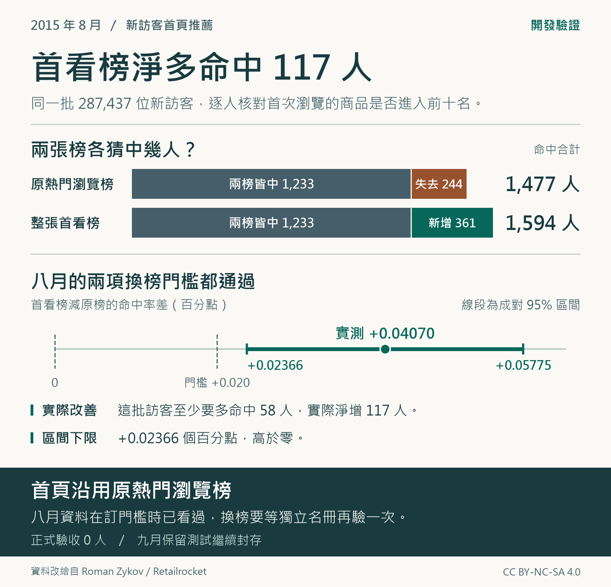
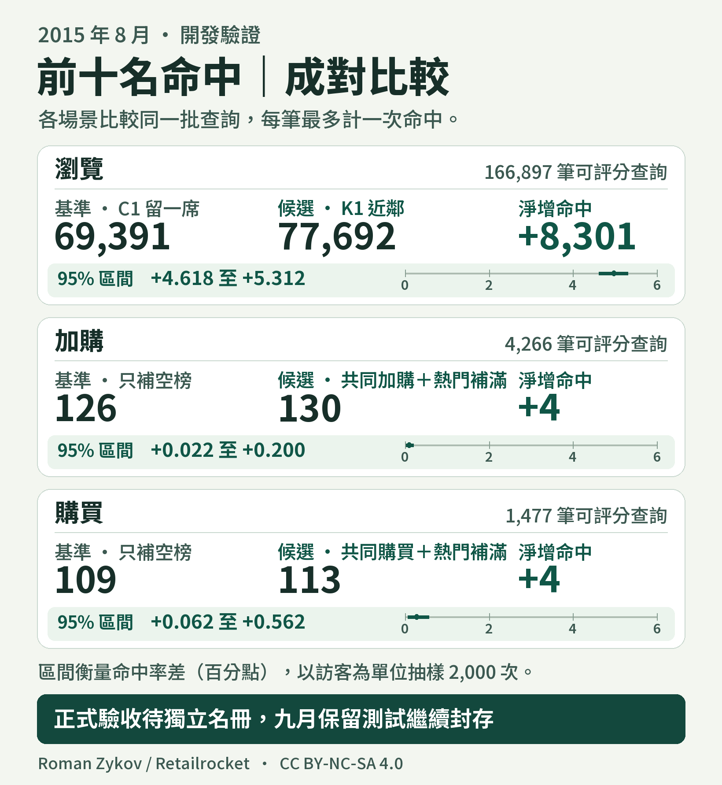
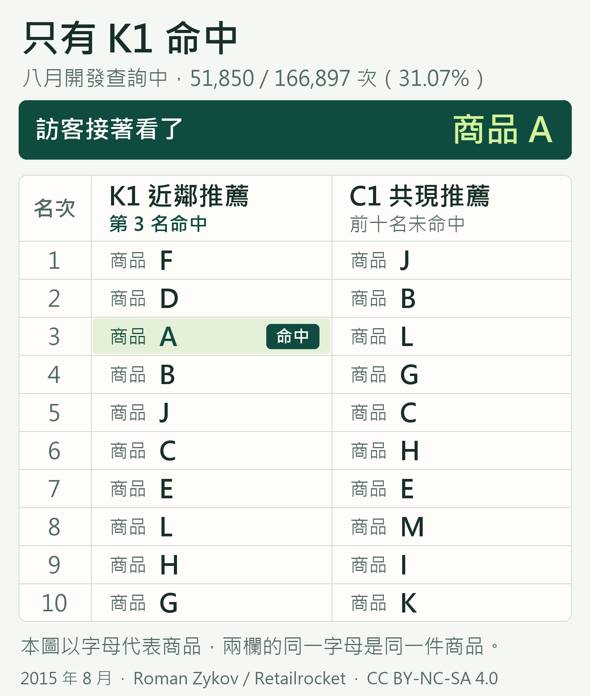
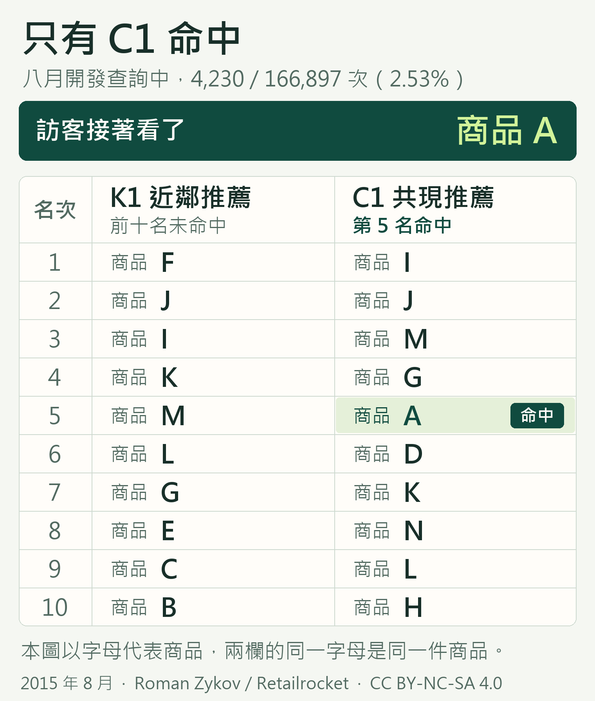
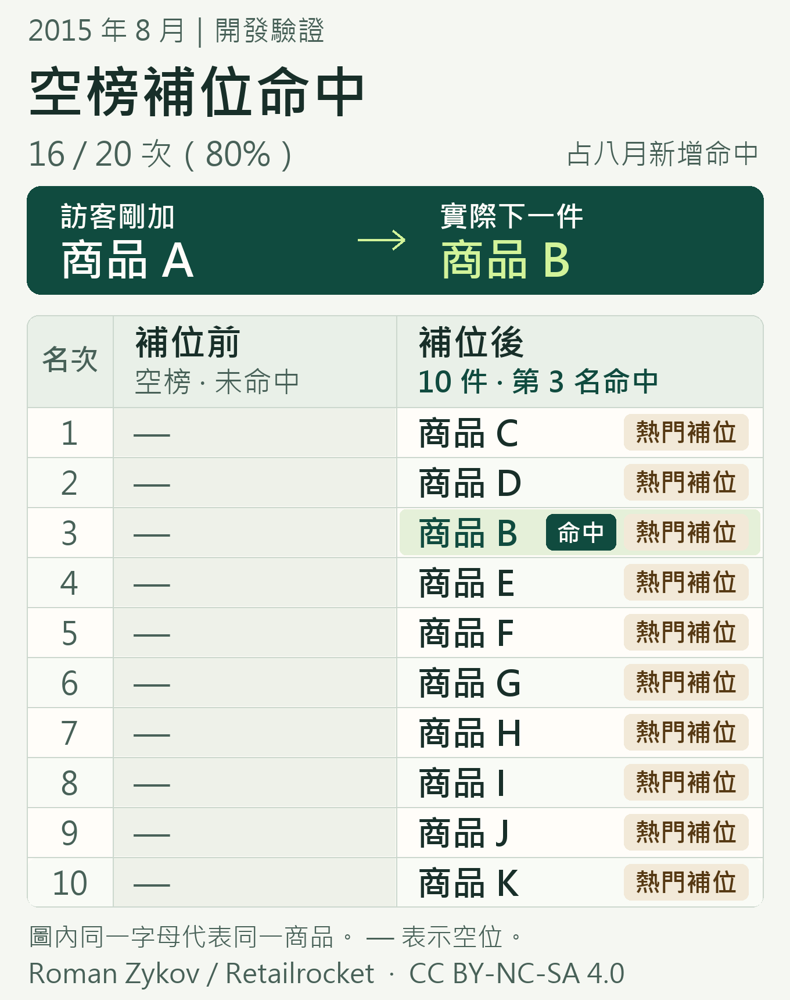
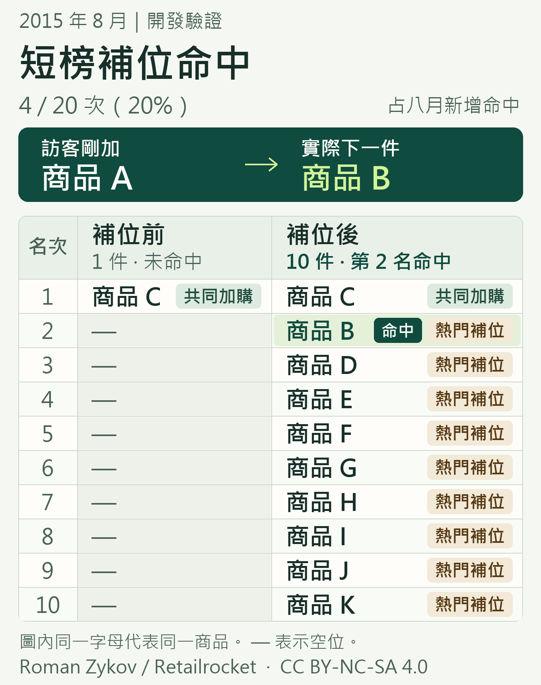
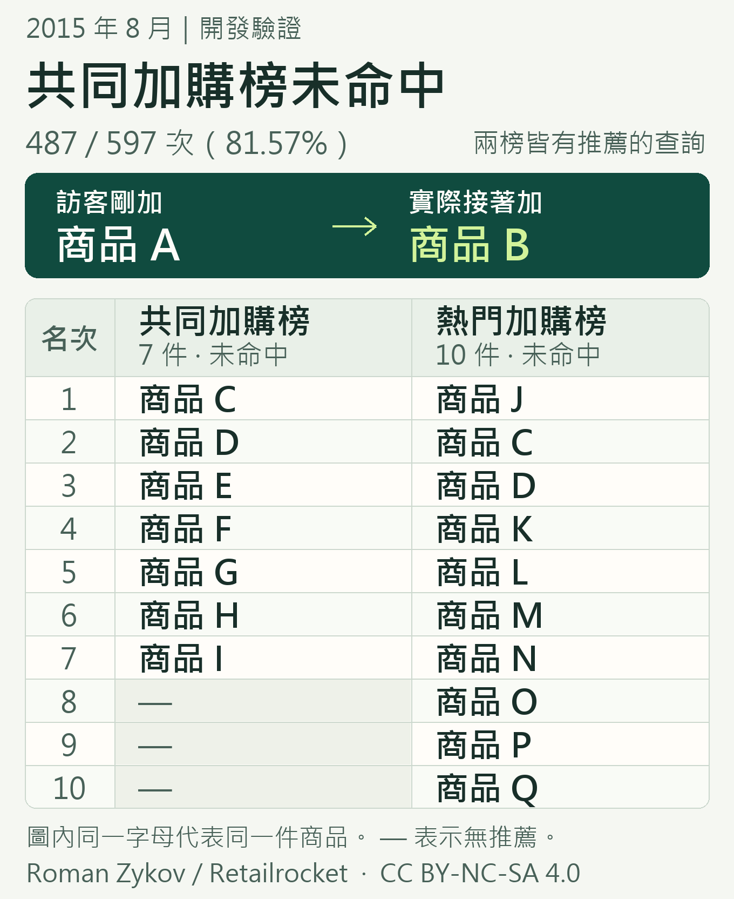
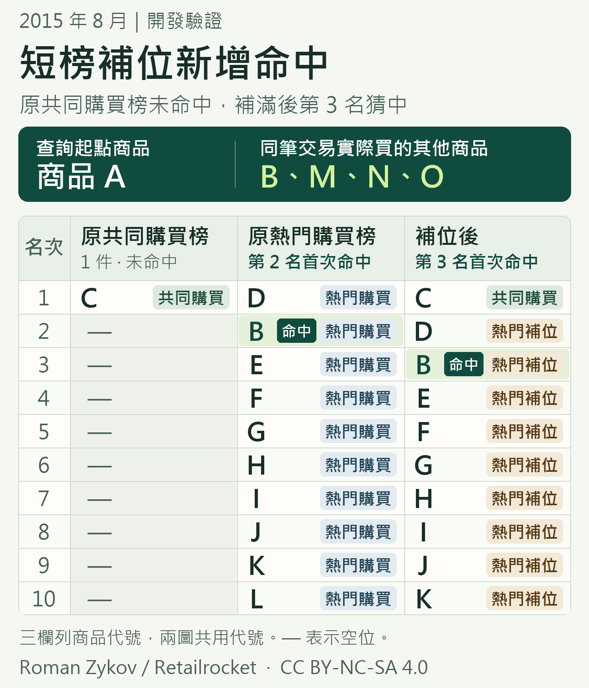
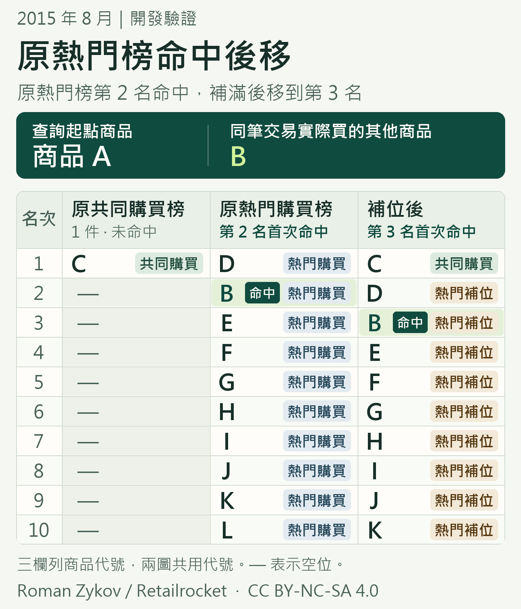
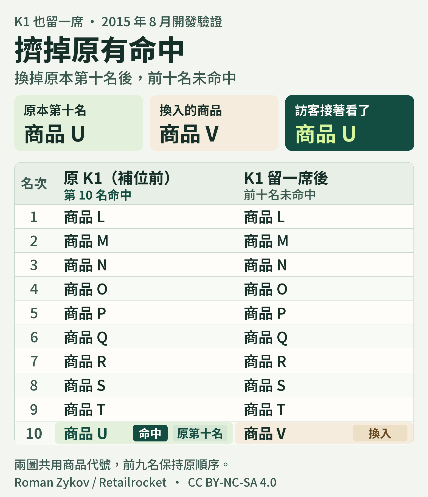

# 電商智慧推薦系統

一位訪客看完一件商品，接下來會點哪一件？這個專案用 Retailrocket 的歷史瀏覽紀錄比較熱門榜、共現與近鄰推薦，也用 Olist 訂單與 UCI 零售資料研究品類銷售與顧客行為。

**[開啟首頁熱門商品](https://likaisuwork9616.github.io/smart-ecommerce-recommendation-system/)**。選瀏覽、加購或購買榜，點任一商品就能看它的十件推薦。從加購榜點進去會先看到「其他人也加入購物車」，也能切到共同瀏覽或共同購買，逐席查看哪些商品來自共同配對、哪些由熱門榜補位。[商品 11 的加購推薦](https://likaisuwork9616.github.io/smart-ecommerce-recommendation-system/products/?item=11&mode=cart&from=cart)

**[從八月新訪客雙榜點進商品推薦](https://likaisuwork9616.github.io/smart-ecommerce-recommendation-system/home-first-view/)**。兩榜共 13 件商品，每一席都能點開。試著勾選「只看有增減的名次」，點首看榜第 6 名的商品 221，切換瀏覽、加購或購買，看前十名的每一席來自共同配對還是熱門補位。按「回新訪客雙榜」可回到同一席，並保留篩選。[從已篩選的雙榜開始](https://likaisuwork9616.github.io/smart-ecommerce-recommendation-system/home-first-view/?changes=1)

另外兩個[匿名商品案例](https://likaisuwork9616.github.io/smart-ecommerce-recommendation-system/products/)可對照有共同配對和全靠熱門補位的差異。[K1 留一席回放](https://likaisuwork9616.github.io/smart-ecommerce-recommendation-system/k1-recency/)可比較換掉第十名後新增與失去命中的兩筆案例。

### 首頁熱門商品怎麼排？

所有訪客看到同一份歷史快照，無須登入或提供瀏覽紀錄。三榜都使用 Retailrocket 從 2015 年 5 月 4 日起、到 8 月 1 日零時前的訓練資料（UTC）。每榜十席，合計有 22 件不同商品。相同代號在三榜和商品案例中指同一件商品。

| 可直接開啟的榜單 | 排名依據 | 第一名 |
| --- | --- | --- |
| [熱門瀏覽](https://likaisuwork9616.github.io/smart-ecommerce-recommendation-system/?ranking=browse) | 去除重複紀錄後的瀏覽事件數 | 商品 23，1,876 次 |
| [熱門加購](https://likaisuwork9616.github.io/smart-ecommerce-recommendation-system/?ranking=cart) | 去除重複紀錄後的加購事件數 | 商品 11，160 次 |
| [熱門購買](https://likaisuwork9616.github.io/smart-ecommerce-recommendation-system/?ranking=purchase) | 含有該商品的交易筆數，同筆交易內同商品只計一次 | 商品 20，63 筆 |

購買榜第二名商品 11 也出現在 63 筆交易。各榜遇到同分，沿用原商品編號由小到大的順序。頁面上的次數描述訓練期人氣。[公開榜單資料](docs/recommendation-demo/popularity.json) · [產榜程式](scripts/export_home_popularity.py) · [只換第十名的結果](#home-first-view-single-slot) · [新訪客首頁的八月成效對照圖](#home-first-view-acceptance)

回訪者的八月回測分三步比較，並在七月用更早的紀錄重新產榜。[熱門榜與共同瀏覽榜](#august-returning-home) · [替上次看的商品留第十席](#august-returning-home-slot) · [兩榜都留席後的成效](#august-returning-home-paired-slots) · [七、八月成效對照](#july-returning-home-paired-slots) · [回訪者首頁換榜門檻](#returning-home-acceptance)

**點進商品 11 會看到什麼？** 它的瀏覽榜和加購榜各有十件共同配對商品，第一名都是商品 33。切到購買榜後，前八席有共同購買紀錄，第九、十席依序由熱門商品 20、21 補上。切換模式後仍可一鍵回到剛才的熱門榜。[商品 11 的購買推薦](https://likaisuwork9616.github.io/smart-ecommerce-recommendation-system/products/?item=11&mode=purchase&from=cart) · [22 件商品的核對結果](docs/PROJECT_PROGRESS.md#popular-product-details)

<a id="august-home-first-view"></a>

### 八月首次出現的訪客，第一件看的是熱門商品嗎？

**287,437 位在八月首次出現且有瀏覽紀錄的訪客中，1,477 位首次瀏覽的商品落在首頁熱門前十名（0.514%），約每千人 5 位。** 首頁用 2015 年 8 月 1 日零時（UTC）凍結的熱門瀏覽榜，整月沿用同一排序。

| 顯示的名次 | 命中訪客數 | 占 287,437 人 |
| --- | ---: | ---: |
| 只列第 1 名 | 225 | 0.078% |
| 列前 5 名 | 911 | 0.317% |
| 列前 10 名 | 1,477 | 0.514% |

5 月 3 日至 7 月 31 日有過瀏覽、加購或購買紀錄的訪客均已排除。八月才首次出現的 288,328 人中，891 人整月沒有瀏覽紀錄，其餘每人計一次。同一毫秒看了多件時，任一件上榜就算命中。

資料只有商品行為，無法確認訪客是否看過首頁。這項開發回測衡量熱門榜涵蓋多少人的首次瀏覽，首頁的實際點擊率仍待曝光與點擊紀錄驗證。[回測報告](reports/mainline/recommendation_august_home_browse_20261124.json) · [重現方式](docs/PROJECT_PROGRESS.md#august-home-first-view)

<a id="august-home-first-view-pair"></a>

### 改用新訪客第一次看的商品排榜，能多猜中多少人？

**同樣列十件商品，新訪客首看榜命中 1,594 人（0.555%），現行熱門瀏覽榜命中 1,477 人（0.514%）。逐人比較，新增 361 人、失去 244 人，淨增 117 人，命中率提高 0.041 個百分點。**

| 同一批八月訪客的首次瀏覽 | 訪客數 |
| --- | ---: |
| 兩榜都命中 | 1,233 |
| 只有新訪客首看榜命中（新增） | 361 |
| 只有現行熱門瀏覽榜命中（失去） | 244 |
| 兩榜都未命中 | 285,599 |
| 合計 | 287,437 |

現行榜按訓練期的全部瀏覽次數排名。候選榜按 952,637 位訓練期新訪客第一次看的商品排名，同一毫秒看了多件，每件各得一票。兩榜有七件商品相同。新進候選榜的第六名帶來 250 位新增命中，占全部新增的 69.3%。這是八月開發回測，衡量首次瀏覽的涵蓋率，實際首頁點擊效果仍待曝光與點擊資料驗證。[成對報告](reports/mainline/recommendation_august_home_first_view_pair_20261124.json) · [計票與重現方式](docs/PROJECT_PROGRESS.md#august-home-first-view-pair)

<a id="august-home-weekly"></a>

### 首看榜的改善集中在哪一週？首頁值得換榜嗎？

**建議首頁先沿用現行熱門瀏覽榜，首看榜保留為新訪客候選。** 首看榜全月淨多命中 117 人，四個完整週中有三週領先，8/10–16 少命中 14 人。第六名的 250 位新增命中分布於全部六個週段，最高的 8/24–30 占 69 人（27.6%），該週占全月評分訪客的 22.7%。即使單獨拿掉這一週，其餘時段合計仍淨增 62 人。

| 八月週段（UTC） | 評分訪客 | 首看榜新增 | 失去原有命中 | 淨增 | 其中第六名新增（占 250 人） |
| --- | ---: | ---: | ---: | ---: | ---: |
| 8/1–2 | 16,545 | 37 | 9 | +28 | 12（4.8%） |
| 8/3–9 | 66,864 | 74 | 59 | +15 | 36（14.4%） |
| 8/10–16 | 64,106 | 71 | 85 | -14 | 58（23.2%） |
| 8/17–23 | 65,083 | 80 | 57 | +23 | 66（26.4%） |
| 8/24–30 | 65,126 | 88 | 33 | +55 | 69（27.6%） |
| 8/31 | 9,713 | 11 | 1 | +10 | 9（3.6%） |
| **全月** | **287,437** | **361** | **244** | **+117** | **250（100%）** |

每人依首次瀏覽日歸週，週一至週日，首尾只計八月內的日期。「第六名新增」已包含在該週的新增人數中。換榜的主要顧慮是對單一商品的依賴。其餘兩件新進商品合計只帶來 111 位新增，少於換出商品失去的 244 位。八月是開發回測，首頁的實際點擊效果仍待曝光與點擊紀錄驗證。[各週命中明細與重現方式](docs/PROJECT_PROGRESS.md#august-home-weekly) · [逐週報告](reports/mainline/recommendation_august_home_weekly_20261124.json)

<a id="july-home-first-view-pair"></a>

### 把時間往前移一個月，首看榜還能多猜中嗎？

七月與八月各用該月開始前的資料重排兩張前十名。七月榜用 5 月 4 日至 6 月 30 日的資料，八月榜再多用七月資料。每月只評當月才首次出現且有瀏覽的訪客，每人計一次。熱門瀏覽榜依全部瀏覽次數排名，首看榜依新訪客第一次看的商品排名。

**兩個月都是首看榜多命中，但新增命中最多的都是同一件商品。建議首頁先沿用熱門瀏覽榜，首看榜保留為新訪客候選。**

| 開發回測 | 評分訪客 | 熱門瀏覽榜命中 | 首看榜命中 | 新增 | 失去 | 淨增 | 命中率差（百分點） |
| --- | ---: | ---: | ---: | ---: | ---: | ---: | ---: |
| 七月 | 354,930 | 2,086（0.588%） | 2,186（0.616%） | 474 | 374 | +100 | +0.028 |
| 八月 | 287,437 | 1,477（0.514%） | 1,594（0.555%） | 361 | 244 | +117 | +0.041 |

核對原始商品編號後，七月首看榜第 8 名與八月第 6 名是同一件商品。它在七月貢獻 **236／474 人（49.8%）** 的新增命中，八月貢獻 **250／361 人（69.3%）**。其餘商品在七月合計新增 238 人，低於換榜失去的 374 人。八月其餘商品新增 111 人，也少於當月失去的 244 人。實際首頁點擊效果仍待曝光與點擊紀錄驗證。[七月成對報告](reports/mainline/recommendation_july_home_first_view_pair_20261124.json) · [名冊與逐席核對](docs/PROJECT_PROGRESS.md#july-home-first-view-pair)

<a id="home-first-view-single-slot"></a>

### 新訪客首頁只換第十名值得嗎？

**建議首頁沿用熱門瀏覽榜。只換第十名，七月比原榜少命中 57 人，八月多命中 136 人。** 兩個月都保留原榜前九名，第十席換成首看榜中排名最高、且未進原榜前十的商品。兩次都選到當月首看榜第六名。帶來最多新增的同一件商品，七月排第八，到了八月才排第六，因此只有八月選中它。

| 開發回測 | 新訪客 | 原熱門瀏覽榜命中 | 只換第十名命中 | 整張首看榜命中 | 只換一席比原榜淨增減 | 整張首看榜比原榜淨增 |
| --- | ---: | ---: | ---: | ---: | ---: | ---: |
| 七月 | 354,930 | 2,086 | 2,029 | 2,186 | −57 | +100 |
| 八月 | 287,437 | 1,477 | 1,613 | 1,594 | +136 | +117 |

| 只換一席的得失 | 保住整榜新增的人數 | 失去的原有命中（單席／整榜） | 比換整榜少失去幾人 |
| --- | ---: | ---: | ---: |
| 七月 | 74／474（15.6%） | 131／374 | 243 |
| 八月 | 250／361（69.3%） | 114／244 | 130 |

七月只換一席，比換整榜救回了 243 位原本猜得到的訪客，卻少猜到 400 位新命中的訪客。八月剛好相反，救回 130 人，只少了 111 位新增，最後比整張首看榜多命中 19 人。整張首看榜兩月都優於原榜，保留為候選。這裡衡量的是榜單能否猜中訪客首次瀏覽的商品，實際首頁點擊效果仍待曝光與點擊紀錄驗證。[三榜逐人回測報告](reports/mainline/recommendation_home_first_view_single_slot_20261124.json) · [名冊與重現方式](docs/PROJECT_PROGRESS.md#home-first-view-single-slot)

<a id="home-first-view-acceptance"></a>

### 新訪客首頁達到什麼門檻才換榜？

**整張首看榜在八月兩項門檻都通過，首頁仍沿用原熱門瀏覽榜。** 八月是訂門檻時已看過的開發資料。是否換榜要等獨立名冊驗收，目前正式評分 **0 人**，九月保留測試繼續封存。

打開互動展示可並排看完整前十名，也可以勾選「只看有增減的名次」。首看榜第 6 名商品 221 新增 250 人，第 8 名商品 222 新增 30 人，第 9 名商品 157 新增 81 人。換出原榜第 7 名商品 28、第 9 名商品 16 與第 10 名商品 30，分別失去 115、15、114 人。其餘七件商品兩榜都有，可查看各自在另一榜的名次。[打開兩榜逐席對照](https://likaisuwork9616.github.io/smart-ecommerce-recommendation-system/home-first-view/)

商品 221 在八月首看榜帶來 250 位新增命中。點進它的商品頁，可以看到訓練期間有哪些商品常和它一起被瀏覽。商品 221、222、157 的瀏覽前十名各有十席共同瀏覽。三件商品的加購與購買榜則都由各自的熱門榜補滿十席。[看商品 221 的三種推薦](https://likaisuwork9616.github.io/smart-ecommerce-recommendation-system/products/?item=221&mode=browse&from=home-first-view&arm=candidate&changes=1) · [推薦來源與核對結果](docs/PROJECT_PROGRESS.md#first-view-product-details)



圖表依 Roman Zykov／Retailrocket 資料的八月聚合結果繪製。[八月計分報告](reports/mainline/recommendation_home_first_view_acceptance_august_20261124.json) · [資料來源](https://www.kaggle.com/datasets/retailrocket/ecommerce-dataset) · [圖表授權 CC BY-NC-SA 4.0](https://creativecommons.org/licenses/by-nc-sa/4.0/)

| 換榜條件 | 八月開發結果 |
| --- | --- |
| 每 10,000 位新訪客至少淨多命中 2 人，即命中率差至少 +0.020 個百分點。 | 這批 287,437 人至少要多命中 58 人，實際**淨增 117 人**。 |
| 以訪客為單位成對重抽樣 2,000 次，命中率差的 95% 區間下限須大於 0。 | 區間下限為 **+0.02366 個百分點**。 |

兩榜都取 2015 年 8 月 1 日零時前排好的十件商品。對同一位新訪客，首次瀏覽時看過的商品只要有一件上榜就算命中，每人每榜最多計一次。只有首看榜猜中的 361 人算新增，只有原榜猜中的 244 人算失去。兩榜都中的 1,233 人與兩榜都沒中的 285,599 人也計入分母。[重跑八月與合成測試](docs/HOME_FIRST_VIEW_ACCEPTANCE.md#run-home-score) · [獨立名冊計分入口](docs/HOME_FIRST_VIEW_ACCEPTANCE.md#score-independent-roster)

<a id="august-returning-home"></a>

### 回訪者再來時，上次看的商品能幫首頁多猜中幾人？

**八月的 22,766 位回訪者中，原熱門榜命中 118 人（0.52%），從上次瀏覽商品找共同瀏覽推薦的候選榜命中 798 人（3.51%）。** 兩榜各列十件，逐人比較後，候選榜新增 756 人、失去 76 人，淨增 **680 人**。命中率差為 **+2.987 個百分點**，以訪客為單位成對重抽樣的 95% 區間為 **+2.736 至 +3.237 個百分點**。

| 訪客在八月前留下的紀錄 | 訪客數 | 原熱門榜命中 | 候選榜命中 | 新增 | 失去 |
| --- | ---: | ---: | ---: | ---: | ---: |
| 最後瀏覽的商品有共同配對 | 18,320 | 104 | 784 | 756 | 76 |
| 有瀏覽，商品沒有共同配對 | 4,419 | 14 | 14 | 0 | 0 |
| 只有加購或交易紀錄 | 27 | 0 | 0 | 0 | 0 |
| **合計** | **22,766** | **118** | **798** | **756** | **76** |

80.47% 的回訪者拿得到共同瀏覽推薦。這些人的候選榜先放訓練期常被一起看的商品，剩餘名額依原熱門榜順序補滿。其餘 4,446 人直接用原榜。命中指榜上有訪客八月首次瀏覽當下看的商品。由於資料沒有首頁曝光紀錄，首頁實際點擊率仍待驗證。

八月有 **2,995 人（13.16%）**回來就又看了上次瀏覽的商品。這也是下一個實驗選擇保留第十席的原因。[八月共同瀏覽回測報告](reports/mainline/recommendation_august_returning_home_20261127.json) · [回訪者定義與重跑方式](docs/PROJECT_PROGRESS.md#august-returning-home)

<a id="august-returning-home-slot"></a>

### 替回訪者上次看的商品留第十席，值得嗎？

**在同一批 22,766 位回訪者中，留席讓首頁前十名從命中 798 人（3.51%）增至 3,765 人（16.54%）。** 基準是上面的「共同瀏覽優先、熱門補滿十件」。保留前九名，只在上次看的商品缺席時換掉第十名，新增命中 **2,994 人**、失去 **27 人**，淨增 **2,967 人**。命中率差為 **+13.03 個百分點**，成對 95% 區間為 **+12.60 至 +13.47 個百分點**。

| 原先能提供的推薦 | 訪客數 | 留席前命中 | 留席後命中 | 新增 | 失去 | 淨增 |
| --- | ---: | ---: | ---: | ---: | ---: | ---: |
| 有共同瀏覽配對 | 18,320 | 784 | 3,277 | 2,519 | 26 | +2,493 |
| 有上次瀏覽商品，沒有共同配對 | 4,419 | 14 | 488 | 475 | 1 | +474 |
| 先前只有加購或購買紀錄 | 27 | 0 | 0 | 0 | 0 | 0 |
| **合計** | **22,766** | **798** | **3,765** | **2,994** | **27** | **+2,967** |

2,995 位重看者中，有 1 人在同一毫秒看了多件商品，原榜已猜中其中一件，所以新增為 2,994 人。原先前九名猜中的 771 人全部保住，原先靠第十名猜中的 27 人全部失去。把名次也算進來，平均倒數排名（MRR@10）從 **0.01743** 升至 **0.03047**。

留席版值得列為回訪者首頁候選。公開首頁沿用原熱門榜，正式採用待獨立名冊驗收，九月保留測試繼續封存。這裡衡量的是能否猜中首次瀏覽，首頁實際點擊率仍待曝光與點擊紀錄驗證。[八月留席回測報告](reports/mainline/recommendation_august_returning_home_slot_20261127.json) · [逐人核對與重跑方式](docs/PROJECT_PROGRESS.md#august-returning-home-slot)

<a id="august-returning-home-paired-slots"></a>

### 純熱門榜也留第十席後，共同瀏覽還能多猜中幾人？

**八月同一批 22,766 位回訪者中，共同瀏覽留席榜比純熱門留席榜淨多猜中 695 人。** 兩榜各自保留上次看的商品。該商品已在榜上就維持原名次，缺席才換掉第十名。每人只比較八月首次瀏覽，兩榜都用八月前的資料排榜。

| 八月開發回測 | 純熱門榜＋留席 | 共同瀏覽優先、熱門補滿＋留席 |
| --- | ---: | ---: |
| 前十名命中人數 | 3,070 | 3,765 |
| 前十名命中率 | 13.49% | 16.54% |
| 平均倒數排名（MRR@10） | 0.01440 | 0.03047 |

逐人比較，**共同瀏覽新增 730 人、失去 35 人**。命中率提高 **3.053 個百分點**，成對 95% 區間為 **+2.824 至 +3.299 個百分點**。新增的 730 人中，有 **459 人在前三名就猜中**，其中 236 人在第一名。兩榜都命中的 3,035 人中，11 人的命中名次提前、41 人後移、2,983 人相同。

全部增減都來自有共同瀏覽配對的 18,320 人。其餘 4,446 人拿到的兩張榜單相同。八月結果支持保留共同瀏覽留席版作為回訪者首頁候選。公開首頁沿用原熱門榜，正式驗收等獨立名冊，九月保留測試繼續封存。[八月雙榜成對報告](reports/mainline/recommendation_august_returning_home_paired_slots_20261127.json) · [分組結果與重跑方式](docs/PROJECT_PROGRESS.md#august-returning-home-paired-slots)

<a id="july-returning-home-paired-slots"></a>

### 換到七月，共同瀏覽留席榜還能多猜中幾人？

**七月重現了八月的優勢。** 只用 2015 年 5 月 4 日至 6 月 30 日的瀏覽紀錄重排兩榜後，在同一批 21,406 位七月回訪者中，共同瀏覽新增命中 **720 人**、失去 **28 人**，比純熱門留席榜淨多命中 **692 人**。兩榜都保留上次看的商品，已在榜內就維持原名次，缺席才換掉第十名。

| 開發回測 | 七月 | 八月 |
| --- | ---: | ---: |
| 計分回訪者 | 21,406 人 | 22,766 人 |
| 純熱門榜＋留席命中 | 3,206 人（14.98%） | 3,070 人（13.49%） |
| 共同瀏覽優先、熱門補滿＋留席命中 | 3,898 人（18.21%） | 3,765 人（16.54%） |
| 共同瀏覽新增／失去／淨增 | 720／28／**+692 人** | 730／35／**+695 人** |
| 命中率差（成對 95% 區間，百分點） | +3.233（+2.980 至 +3.471） | +3.053（+2.824 至 +3.299） |
| MRR@10（純熱門 → 共同瀏覽） | 0.01603 → **0.03412** | 0.01440 → **0.03047** |

七月新增的 720 位命中者中，**477 人在前三名就猜中**，其中 268 人排第一。共同瀏覽在兩個月都讓前十名命中率提高約 3 個百分點，全體回訪者的 MRR@10 也上升。七月紀錄曾用於八月模型的訓練，這兩次結果均屬開發回測。公開首頁沿用原熱門榜，正式驗收等獨立名冊，九月保留測試繼續封存。[七月成對報告](reports/mainline/recommendation_july_returning_home_paired_slots_20261127.json) · [八月成對報告](reports/mainline/recommendation_august_returning_home_paired_slots_20261127.json) · [重建榜單與核對方法](docs/PROJECT_PROGRESS.md#july-returning-home-paired-slots)

<a id="returning-home-acceptance"></a>

### 回訪者首頁什麼時候才換榜？

**只有在獨立名冊上同時通過以下三項門檻，回訪者首頁才採用「共同瀏覽優先、熱門補滿＋留席」。** 正式比較的基準是「純熱門榜＋留席」。兩榜都在上次看的商品缺席時才換掉第十名。現在公開首頁仍顯示原熱門瀏覽榜。

| 候選相對基準的改善 | 獨立名冊的換榜門檻 | 七月開發結果 | 八月開發結果 |
| --- | --- | ---: | ---: |
| 前十名命中率差 | **≥ +2.00 個百分點**，即每千人至少淨多命中 20 人 | +3.233 個百分點 | +3.053 個百分點 |
| 命中率差的成對 95% 區間 | **下限 > 0 個百分點** | +2.980 至 +3.471 | +2.824 至 +3.299 |
| 平均倒數排名差（MRR@10） | **≥ +0.010** | +0.01809 | +0.01607 |

獨立名冊到位後，先固定評分窗，沿用八月回測的訓練快照。每位窗前已有行為、窗內有瀏覽的回訪者計一次。依窗前最後看的商品排出兩榜，再對照該人窗內首次瀏覽當下的全部商品。窗前只有加購或購買的人，兩榜都給原熱門榜。只有候選命中算新增，只有基準命中算失去，兩者相減就是淨增。命中率差與 MRR@10 都用全體可計分回訪者作分母。95% 區間按訪客成對重抽樣 2,000 次，三項一律用未四捨五入的值判斷。

命中率差與 MRR@10 兩項門檻，分別要求保留較弱月份（八月）約 66% 與 62% 的改善。七、八月的開發結果都達到三個數值，正式名冊尚未到位，目前記為**待驗**。獨立驗收若有任一項未達，首頁仍沿用原榜。九月保留測試繼續封存。[完整換榜規則與計分步驟](docs/HOME_RETURNING_VISITOR_ACCEPTANCE.md) · [七、八月回測對照](#july-returning-home-paired-slots)

<a id="august-paired-results"></a>

## 八月推薦成對結果



圖表改繪自 Roman Zykov／Retailrocket 的資料，區間按訪客抽樣 2,000 次估計。[八月成對報告](reports/mainline/recommendation_default_paired_august_20261123.json) · [瀏覽失誤分析](#august-browse-miss-analysis) · [K1 留一席對照圖](#k1-recency-replay) · [正式採用門檻](#recommendation-default-acceptance) · [資料來源](https://www.kaggle.com/datasets/retailrocket/ecommerce-dataset) · [圖表授權 CC BY-NC-SA 4.0](https://creativecommons.org/licenses/by-nc-sa/4.0/)

## 推薦回放｜兩張榜單各猜中幾次？

在 2015 年 8 月的 **166,897 次開發驗證查詢**中，每次都推薦十件商品。熱門榜猜中 **698 次（0.42%）**，依商品共同瀏覽紀錄排序的共現模型猜中 **30,072 次（18.02%）**。共現模型淨多猜中 **29,374 次**。最常見的結果仍是兩份榜單都沒猜中，占 **81.78%**。


回放把兩份榜單與訪客實際接著看的商品並排。只要前十名包含下一步瀏覽的任一件商品，這次查詢就算命中一次。下表最後一欄是各類別在封存檔中的第一筆案例。

| 前十名命中結果 | 查詢次數 | 占全部查詢 | 該類第一筆案例 |
| --- | ---: | ---: | --- |
| 只有共現模型命中 | 29,718 | 17.81% | 下一件商品在共現榜第 5 名 |
| 只有熱門榜命中 | 344 | 0.21% | 下一件商品在熱門榜第 5 名 |
| 兩者皆命中 | 354 | 0.21% | 熱門榜第 6 名，共現模型第 2 名 |
| 兩者皆未命中 | 136,481 | 81.78% | 共現模型的十個名額全由熱門商品補足 |

**模型何時猜不中？** 兩種方法都用 2015 年 8 月以前的瀏覽紀錄訓練。8 月有 11,943 次查詢，模型對訪客下一步實際瀏覽的所有商品都缺乏訓練資料支持，兩張榜單在這批查詢都零命中。9 月的預留回溯測試仍鎖定，上線後對購買率與營收的影響也仍待驗證。[開發驗證與限制](docs/STAGE10_RETAILROCKET_C1_P0_RESEARCH_HANDOFF_V1.md) · [四筆回放案例的核對紀錄](docs/PROJECT_PROGRESS.md#2026-11-19-推薦回放)

### 留一席給最近看過的商品，有多少幫助？

在同一批 **166,897 次開發查詢**中，保留原共現榜前九名，只在最近看過且可推薦的商品還沒上榜時替換第十名。結果有 **40,238 次新增命中，919 次失去原有命中，淨多猜中 39,319 次**。

| 全部開發查詢 | 原共現榜 | 最近商品留一席 | 差異 |
| --- | ---: | ---: | ---: |
| 前十名至少猜中一件的查詢 | 30,072 | 69,391 | +39,319 |
| 前十名命中率 | 18.02% | 41.58% | +23.56 個百分點 |
| 考慮命中名次的平均分數（NDCG@10，愈高愈好） | 0.106401 | 0.174500 | +0.068100 |

「最近」以同一次瀏覽截至查詢當下的紀錄為準。只有在查詢前已出現在目錄的商品才可選，同毫秒有多件合格時取數值編號最小的一件。選中的商品已在前十、或找不到合格商品時保留原榜。實際替換了 151,080 次。

#### 換掉第十名的兩個案例

兩張圖各取該類第一筆實際回放。每張圖內，A 是原第十名，B 是換入的最近商品；兩圖的代號分別對應各自案例的商品。


瀏覽資料來自 Roman Zykov／Retailrocket 的 *Retailrocket recommender system dataset* v2（CC BY-NC-SA 4.0）。本頁截圖呈現回放統計，兩張案例圖將商品編號改為圖內代號。[資料來源與授權紀錄](docs/STAGE8_RETAILROCKET_SOURCE_AND_CONTRACT_V1.md#來源版本與授權)

本機互動版可切換案例，查看原商品編號與當時的瀏覽紀錄。[本機新增命中案例](http://127.0.0.1:8765/replay?case=recency_gained) · [本機擠掉原有命中案例](http://127.0.0.1:8765/replay?case=recency_lost)

### 找到看過相似商品的訪客，能猜得更準嗎？

K1 從訓練資料找出最多 500 段看過相似商品的瀏覽紀錄，再依相似程度替商品投票。在同一批八月開發查詢中，K1 的前十名猜中 **77,692 次**，比原共現榜淨多 **47,620 次**。

| 推薦方式 | 前十名命中次數 | 命中率 | 平均排名分數 NDCG@10 |
| --- | ---: | ---: | ---: |
| 原共現榜 C1（主要對照） | 30,072 | 18.02% | 0.106401 |
| 共現榜留一席給最近商品（同月參照） | 69,391 | 41.58% | 0.174500 |
| 近鄰推薦 K1 | **77,692** | **46.55%** | **0.351510** |

有 **51,850 次只有 K1 猜中**，也有 **4,230 次只有 C1 猜中**。命中商品排得愈前面，NDCG@10 給的分數愈高。K1 相對 C1 平均多 **0.245110**，按訪客配對抽樣的 95% 區間為 **[0.236805, 0.253356]**。仍有 89,205 次 K1 前十名沒有猜中，包含 11,943 次下一步商品全部缺乏訓練支持的查詢。九月保留測試與上線成效仍待驗證。[全量驗算方法](docs/STAGE12_K1_AUGUST_READBACK_20261119.md) · [八月結果與限制](reports/stage12/k1_august_readback_20261119.json)

#### K1 與 C1 的兩個回放案例

兩張圖各取八月開發查詢中該類的第一筆。**先找商品 A**，它是這位訪客實際接著看的商品，再看 A 出現在哪一榜、第幾名。同一張圖的兩欄共用商品代號，下一張圖另行編碼。





圖卡改繪自 Roman Zykov／Retailrocket 的歷史瀏覽資料，商品編號已替換為圖內代號。下表連到可查看原商品編號的本機互動回放。[資料來源](https://www.kaggle.com/datasets/retailrocket/ecommerce-dataset) · [圖卡授權 CC BY-NC-SA 4.0](https://creativecommons.org/licenses/by-nc-sa/4.0/)

| 開啟本機回放 | 占全部 166,897 筆開發查詢 | 這一例的實際結果 |
| --- | ---: | --- |
| [只有 K1 命中](http://127.0.0.1:8765/replay?case=k1_vs_c1_k1_only) | 51,850 次（31.07%） | 下一件商品在 K1 第 3 名，C1 前十名未命中。 |
| [只有 C1 命中](http://127.0.0.1:8765/replay?case=k1_vs_c1_c1_only) | 4,230 次（2.53%） | 下一件商品在 C1 第 5 名，K1 前十名未命中。 |

<a id="cart-august-results"></a>

## 其他人也加入購物車，能猜中下一件嗎？

訪客剛把一件商品加入購物車，接著還會加什麼？用 Retailrocket **2015 年 8 月的加購紀錄**做開發驗證。共同加購榜只列出訓練期內至少有兩位不同訪客曾在同一段購物活動中一起加購的商品，最多十件。熱門加購榜則按訓練期的加購次數排名。兩榜都排除訪客剛加的那件商品。

| 八月實際結果 | 共同加購榜 | 熱門加購榜 |
| --- | ---: | ---: |
| 全部 14,725 次加購機會中，能推薦至少一件 | 1,839 次（12.49%） | 14,725 次（100%） |
| 全部 14,725 次中，能列滿十件 | 255 次（1.73%） | 14,725 次（100%） |
| 可驗證下一步的 4,266 次中，能推薦至少一件 | 597 次（13.99%） | 4,266 次（100%） |
| 同樣 4,266 次中，前十名猜中下一步加購 | **110 次（2.58%）** | **30 次（0.70%）** |

只有共同加購榜猜中的有 100 次，只有熱門榜猜中的有 20 次，因此共同加購榜**淨多猜中 80 次**。只看共同加購榜能推薦、也有下一步可核對的 597 次，它猜中 110 次，熱門榜在同一批猜中 14 次。全部加購機會中有 **12,886 次**找不到合格配對。

資料沒有購物車編號，以同一訪客相鄰活動間隔不超過 30 分鐘界定購物階段。當段沒有下一個加購時點的 9,449 次，以及下一個時點只重加原商品的 1,010 次，都計入覆蓋率。命中率只用能觀察到下一步加了其他商品的 4,266 次，空榜也算未命中。這是八月歷史行為的結果，九月保留測試仍鎖定，實際展示能否帶來更多加購仍待驗證。[驗證方法與重跑方式](docs/PROJECT_PROGRESS.md#cart-august-validation) · [八月聚合報告](reports/stage13/retailrocket_cart_next_add_201508.json)

<a id="cart-popular-fill-results"></a>

### 共同加購優先，熱門加購補滿十席

保留共同加購榜每件商品的原名次，再依訓練期熱門加購榜的順序，跳過已列出的商品，把空位補滿。同一批 **4,266 次**八月開發查詢的結果如下。

| 推薦方式 | 前十名命中 | 第 1 名命中 | MRR@10 |
| --- | ---: | ---: | ---: |
| 原共同加購榜 | 110 次（2.58%） | 47 次 | 0.015784 |
| 原熱門加購榜 | 30 次（0.70%） | 14 次 | 0.004506 |
| 只在共同加購榜全空時改用熱門榜 | 126 次（2.95%） | 50 次 | 0.017450 |
| **保留共同加購，再用熱門補滿** | **130 次（3.05%）** | **50 次** | **0.017849** |

補滿後，原共同加購榜的 **110 次命中都保留原名次**，另增加 **20 次**。其中 16 次來自空榜，4 次來自原本只列出部分商品的榜單。這 4 次的首次命中分別有 3 次在第 2 名、1 次在第 5 名。MRR@10 讓前面名次的命中得分更高，並將未命中計為零。

14,725 次加購機會都能列滿十件，其中 12,886 次（87.51%）會全部使用熱門商品。八月補位驗證有逐席記錄來源，九月保留測試繼續封存。[補位方法與逐名次統計](docs/PROJECT_PROGRESS.md#cart-popular-fill) · [八月補位報告](reports/stage13/retailrocket_cart_popular_fill_201508.json)

<a id="cart-fill-replay-cards"></a>

#### 空榜與短榜的補位對照

兩張圖各取該類在八月驗證順序中的第一筆。每張圖以 **A** 代表訪客剛加的商品，以 **B** 代表實際接著加的商品。左欄是補位前，右欄是補位後。每個有商品的席位都標示來源，次數與占比以 **20 次新增命中**為分母。





圖卡改繪自 Roman Zykov／Retailrocket 的歷史加購資料。可從下表開啟本機互動回放，查看原商品編號。[資料來源](https://www.kaggle.com/datasets/retailrocket/ecommerce-dataset) · [圖卡授權 CC BY-NC-SA 4.0](https://creativecommons.org/licenses/by-nc-sa/4.0/)

| 本機補位回放 | 占新增命中 | 這一筆的變化 |
| --- | ---: | --- |
| [空榜補位命中](http://127.0.0.1:8765/replay?case=cart_fill_empty) | 16 次（80%） | 原榜為空，補入 10 件熱門商品後，第 3 名猜中實際下一件。 |
| [短榜補位命中](http://127.0.0.1:8765/replay?case=cart_fill_short) | 4 次（20%） | 原本只列 1 件。保留第 1 名、補入 9 件後，第 2 名猜中實際下一件。 |

<a id="cart-replay-cards"></a>

### 回放兩次實際加購

兩張圖各取原共同加購榜在八月驗證順序中的第一筆命中或未命中。每張圖把訪客剛加的商品標為 **A**，實際接著加的商品標為 **B**。同一張圖的兩欄共用代號，每張圖各自編碼。次數與占比都以**兩榜有推薦、且能核對下一步的 597 次**為分母。




圖卡改繪自 Roman Zykov／Retailrocket 的歷史加購資料。由下表開啟本機互動回放，可查看原商品編號。[資料來源](https://www.kaggle.com/datasets/retailrocket/ecommerce-dataset) · [圖卡授權 CC BY-NC-SA 4.0](https://creativecommons.org/licenses/by-nc-sa/4.0/)

| 本機互動回放 | 次數與占比 | 在這一筆看到什麼 |
| --- | ---: | --- |
| [共同加購榜命中](http://127.0.0.1:8765/replay?case=cart_hit) | 110 次（18.43%） | 第 3 筆。兩榜各列十件，實際下一件排在共同加購榜第 2 名，熱門榜未命中。 |
| [共同加購榜未命中](http://127.0.0.1:8765/replay?case=cart_miss) | 487 次（81.57%） | 第 1 筆。共同加購榜只列出七件，第 8 至 10 名留空，熱門榜列滿十件。兩榜都沒猜中。 |

<a id="purchase-basket-results"></a>

## 其他人也買了，有多少交易支持？

用八月之前的 Retailrocket 交易事件建榜，把同一匿名訪客、同一交易編號下的不同商品視為一組。共同購買榜只列出至少由兩位不同訪客支持的搭配。熱門購買榜則按商品出現在多少筆訓練交易排序。

| 2015 年 8 月開發驗證 | 共同購買榜 | 熱門購買榜 |
| --- | ---: | ---: |
| 全部 4,613 次商品查詢中（含單件交易），可推薦至少一件 | 191（4.14%） | 4,613（100%） |
| 1,477 次能核對同筆交易其他商品的查詢中，前十名命中 | 33（2.23%） | **94（6.36%）** |
| 只看共同購買榜有商品可推的同一批 118 次，前十名命中 | **33（27.97%）** | 18（15.25%） |

八月 3,660 個交易群組中有 524 個含至少兩件不同商品。共同購買的訊號集中在少數商品。這次以同筆交易的其他商品驗證搭配，實際購買先後與展示後的轉換率仍需另驗。九月保留測試繼續封存。[驗證方法與限制](docs/PROJECT_PROGRESS.md#purchase-basket-validation) · [八月聚合報告](reports/stage13/retailrocket_purchase_basket_201508.json)

<a id="purchase-popular-fill-results"></a>

### 共同購買優先，熱門購買補滿十席

保留共同購買榜的原名次，再按原熱門購買榜的順序，跳過已在榜上的商品，補滿十席。以下比較沿用同一批 **1,477 次**八月開發查詢。

| 推薦方式 | 前十名命中 | 第 1 名命中 | MRR@10 |
| --- | ---: | ---: | ---: |
| 原共同購買榜 | 33 次（2.23%） | 27 次 | 0.020199 |
| 原熱門購買榜 | 94 次（6.36%） | 32 次 | 0.039570 |
| 只在共同購買榜全空時改用熱門榜 | 109 次（7.38%） | 59 次 | 0.054126 |
| **保留共同購買，再用熱門補滿** | **113 次（7.65%）** | **59 次** | **0.055029** |

補滿比原熱門榜多命中 **19 次**，原熱門榜的 94 次命中都保留。其中 14 次首次命中前移、76 次同名次、4 次後移。相較只補空榜，短榜再補滿多命中 **4 次**，首次命中都在第 3 名。全部 4,613 次商品查詢都能列滿十件，其中 4,422 次（95.86%）完全使用熱門商品。[逐筆比對方法與重跑方式](docs/PROJECT_PROGRESS.md#purchase-popular-fill) · [八月補位報告](reports/stage13/retailrocket_purchase_popular_fill_201508.json)

<a id="purchase-fill-replay-cards"></a>

#### 購買補位的兩筆三榜回放

圖中並排比較原共同購買榜、原熱門購買榜和補位後的十席。八月的「短榜新增命中」和「原熱門榜命中後移」是**同一組 4 筆查詢**，這裡選兩筆不同的交易。兩圖共用商品代號，起點都是 **A**，原熱門榜和補位榜猜中的搭配商品都是 **B**。第一筆同筆買了 B、M、N、O，第二筆只同筆買了 B。





「短榜新增命中」是相對只補空榜，「原熱門榜命中後移」則相對原熱門購買榜。圖卡改繪自 Roman Zykov／Retailrocket 的交易資料。下表保留本機互動回放，可查看原商品編號。[資料來源](https://www.kaggle.com/datasets/retailrocket/ecommerce-dataset) · [圖卡授權 CC BY-NC-SA 4.0](https://creativecommons.org/licenses/by-nc-sa/4.0/)

| 開啟本機回放 | 同筆交易的其他商品 | 原共同購買榜 | 原熱門購買榜 | 補位後 |
| --- | ---: | --- | --- | --- |
| [短榜補位新增命中](http://127.0.0.1:8765/replay?case=purchase_fill_short_gain) | 4 件 | 只列 1 件，未命中 | 第 2 名首次命中 | 第 3 名首次命中 |
| [原熱門榜命中後移](http://127.0.0.1:8765/replay?case=purchase_fill_popular_later) | 1 件 | 只列 1 件，未命中 | 第 2 名首次命中 | 第 3 名首次命中 |

<a id="recommendation-default-acceptance"></a>

## 什麼情況下採用新的預設推薦？

瀏覽、加購、購買各自用相同查詢對照。候選須在 **100% 的查詢列滿十件不同的合格商品**，且第 1 名命中率至少等於基準。MRR@10 以每筆首次命中名次的倒數計分，未命中給零分，愈高表示命中較多或較早。

| 場景 | 候選／主要基準 | 前十名命中率門檻 | MRR@10 門檻 | 八月命中率（基準 → 候選） | 八月增益 95% 區間（百分點） |
| --- | --- | ---: | ---: | ---: | ---: |
| 瀏覽 | 近鄰 K1／共現榜留一席給最近看過的商品 | 比基準至少高 1.00 個百分點 | 比基準至少高 0.010 | 41.58% → 46.55% | +4.618 至 +5.312 |
| 加購 | 共同加購優先，熱門補滿／只補空榜 | 比基準至少高 0.05 個百分點 | 至少等於基準 | 2.95% → 3.05% | +0.022 至 +0.200 |
| 購買 | 共同購買優先，熱門補滿／只補空榜 | 比基準至少高 0.10 個百分點 | 至少等於基準 | 7.38% → 7.65% | +0.062 至 +0.562 |

成對計分入口在八月重現了三組比較。以訪客為單位做 2,000 次抽樣後，三組命中率增益的 95% 區間下限均高於零。加購和購買各多命中四次。這些是已看過的開發資料，正式採用仍須在另一份獲准名冊通過同一套門檻。九月保留測試繼續封存。[八月成對報告](reports/mainline/recommendation_default_paired_august_20261123.json) · [驗收清單與重跑命令](docs/RECOMMENDATION_DEFAULT_ACCEPTANCE_CHECKLIST.md) · [完整門檻與原榜比較](docs/RECOMMENDATION_DEFAULT_ACCEPTANCE.md)

<a id="august-browse-miss-analysis"></a>

### 八月瀏覽失誤分析

逐筆核對同一批 166,897 次開發查詢的 K1、原 C1 與 C1 留一席榜單。可推薦指商品首次被瀏覽的時間早於查詢。下一個時點有多件實際瀏覽商品時，只要其中一件符合資格，就計為有可推薦目標。

| 查詢群組 | 拆分結果 | 筆數 | 占該群組 |
| --- | --- | ---: | ---: |
| 只有 C1 留一席榜命中的 6,376 筆 | 原 C1 就命中 | 3,742 | 58.69% |
| 同上 | 靠留一席才命中 | 2,634 | 41.31% |
| K1 與 C1 留一席都未命中的 82,829 筆 | 當時至少有一件目標商品可推薦 | 77,143 | 93.14% |
| 同上 | 當時所有目標商品均未進入可推薦目錄 | 5,686 | 6.86% |

K1 漏掉的查詢中，有 2,635 筆的最近合格商品就是實際目標。原 K1 有 1,242 筆到第十名才首次命中，這是替換第十名時可能擠掉的命中上限。[完整失誤分析報告](reports/mainline/recommendation_browse_miss_analysis_20261123.json)

<a id="august-k1-recency-slot"></a>

### K1 也留一席

用八月全部 166,897 筆查詢比較原 K1 與留一席。保留前九名，最近看過且可推薦的商品尚未上榜才替換第十名，共替換 17,592 筆。

| 方法 | 前十名命中 | 命中率 | MRR@10 |
| --- | ---: | ---: | ---: |
| 原 K1 | 77,692 | 46.55% | 0.31544528 |
| K1 也留一席 | 80,258 | 48.09% | 0.31698276 |

逐筆對照**新增命中 2,635 次、擠掉 69 次，淨增 2,566 次**。命中率增加 1.54 個百分點，MRR@10 增加 0.00153748。前九名逐筆保持原位，兩種方法都命中的查詢也保留原首次命中名次。這是八月開發結果，正式採用仍待獨立名冊，九月保留測試繼續封存。[完整成對結果](reports/mainline/recommendation_k1_recency_slot_20261123.json)

<a id="k1-recency-replay"></a>

#### 補位前後的兩筆回放

兩例各取八月封存名冊中該類的第一筆。公開回放與下方圖卡的商品代號一致，可並排查看補位前後的前十名，以及原本第十名、換入商品與實際下一件。[新增命中](https://likaisuwork9616.github.io/smart-ecommerce-recommendation-system/k1-recency/?case=gained) · [擠掉原有命中](https://likaisuwork9616.github.io/smart-ecommerce-recommendation-system/k1-recency/?case=lost) · [案例核對紀錄](reports/mainline/recommendation_k1_recency_replay_20261123.json)




圖卡改繪自 Roman Zykov／Retailrocket 的八月開發案例。下表可點開本機回放。[資料來源](https://www.kaggle.com/datasets/retailrocket/ecommerce-dataset) · [圖卡授權 CC BY-NC-SA 4.0](https://creativecommons.org/licenses/by-nc-sa/4.0/)

| 本機案例 | 八月名冊位置 | 原 K1 | K1 留一席後 |
| --- | ---: | --- | --- |
| [新增命中](http://127.0.0.1:8765/replay?case=k1_recency_gained) | 第 149 筆 | 前十名未命中 | 換入商品在第十名命中 |
| [擠掉原有命中](http://127.0.0.1:8765/replay?case=k1_recency_lost) | 第 1,640 筆 | 第十名命中 | 原命中商品被換出 |

<a id="august-personalization-signals"></a>

### 瀏覽查詢有多少能用加購與購買歷史？

同一批 **166,897 筆八月開發查詢**中，**29,549 筆（17.70%）**在查詢前已有同一訪客的加購或購買紀錄，涉及 **3,063 位（4.92%）**匿名訪客。用事件毫秒判斷先後，查詢同一毫秒的行為也排除。每筆查詢只屬一組，訪客會隨歷史改變而出現在不同組。

| 查詢前的行為紀錄 | 查詢數（占比） | 訪客數 | 原 K1 未命中 | K1 留一席未命中 | 有共現配對 |
| --- | ---: | ---: | ---: | ---: | ---: |
| 只有瀏覽 | 137,348（82.30%） | 61,130 | 68,617 | 66,866 | 0 |
| 有加購、沒有購買紀錄 | 13,121（7.86%） | 2,406 | 7,805 | 7,562 | 12,563 |
| 有購買紀錄 | 16,428（9.84%） | 845 | 12,783 | 12,211 | 16,230 |
| **全部** | **166,897（100%）** | **62,235** | **89,205** | **86,639** | **28,793** |

「有共現配對」指先前加購或購買的商品中，至少一件有既有訓練期的共同瀏覽配對。這樣的查詢占全部 **17.25%**，其中 **19,315 筆** K1 留一席未命中，有 **18,698 筆**的實際下一步至少一件在當時可推薦目錄。[盤點聚合報告](reports/mainline/recommendation_august_personalization_signals_20261123.json) · [重跑方式與核對](docs/PROJECT_PROGRESS.md#august-personalization-audit)

<a id="august-personalization-pair"></a>

### 加重加購和購買，能更常猜中下一次瀏覽嗎？

在八月開發查詢中，**瀏覽 1、加購 3、購買 5** 比只用瀏覽**少命中 394 次**。兩版都用同一份 C1 共同瀏覽配對、候選目錄與熱門補位順序。從 2015 年 5 月 3 日起累積同一訪客跨次造訪的紀錄，納入當下已看見的商品，加購與購買則須嚴格早於查詢。每件商品的每種行為只計一次，各類權重相加。

| 八月開發查詢 | 只用瀏覽命中 | 加權後命中 | 新增／擠掉 | MRR@10（原 → 新） |
| --- | ---: | ---: | ---: | ---: |
| 全部 166,897 筆 | 29,413（17.62%） | 29,019（17.39%） | 336／730 | 0.080210 → 0.079010 |
| 其中有可用配對的 28,793 筆 | 2,660（9.24%） | 2,266（7.87%） | 336／730 | 0.038401 → 0.031444 |

有可用配對的查詢中，25,164 筆的前十名商品或順序改變。兩榜都命中的查詢裡，首次命中有 469 筆提前、684 筆後移。用訪客為單位做 2,000 次成對重抽樣，整體命中率差為 **−0.236 個百分點**（95% 區間 −0.294 至 −0.179），有可用配對組為 **−1.368 個百分點**（−1.838 至 −0.995）。這組固定權重在八月的命中率與排名都下降，建議到此收尾。正式驗收待獨立名冊，九月保留測試繼續封存。[成對回測報告](reports/mainline/recommendation_august_personalization_pair_20261124.json) · [重現與抽核](docs/PROJECT_PROGRESS.md#august-personalization-pair-check)

<a id="august-action-ablation"></a>

### 加購和購買各自對下一次瀏覽有多少影響？

沿用上輪全部 166,897 筆八月開發查詢與同一個瀏覽共現模型，分別打開加購權重 3 或購買權重 5。**只加購淨少命中 310 次，只購買淨少 141 次。** 兩版的首次命中排名也都比只用瀏覽差。

| 使用的行為 | 全部查詢前十名命中 | 相對只用瀏覽，新增／失去 | 淨增 | 全部查詢 MRR@10 | 有可用訊號的 28,793 筆中命中 |
| --- | ---: | ---: | ---: | ---: | ---: |
| 只用瀏覽 | 29,413（17.62%） | — | — | 0.080210 | 2,660（9.24%） |
| 瀏覽＋加購 | 29,103（17.44%） | 310／620 | −310 | 0.079220 | 2,350（8.16%） |
| 瀏覽＋購買 | 29,272（17.54%） | 80／221 | −141 | 0.079806 | 2,519（8.75%） |
| 瀏覽＋加購＋購買 | 29,019（17.39%） | 336／730 | −394 | 0.079010 | 2,266（7.87%） |

再看上輪兩種行為一起加權時的 336 次新增命中與 730 次失去命中。同一筆查詢的兩個單獨加權版本，有時會重現同一個結果。

| 哪種加權方式能重現這筆變化 | 新增命中 | 失去命中 |
| --- | ---: | ---: |
| 單獨比較時，僅加購版重現 | 253 | 466 |
| 單獨比較時，僅購買版重現 | 29 | 55 |
| 加購版、購買版各自都重現 | 45 | 152 |
| 只有兩種行為一起加權才出現 | 9 | 57 |

按訪客成對重抽樣 2,000 次，只加購相對只用瀏覽的全體命中率差 95% 區間為 −0.238 至 −0.133 個百分點，只購買為 −0.118 至 −0.053 個百分點。這批資料支持以只用瀏覽作為這項個人化比較的基準。正式驗收待獨立名冊，九月保留測試繼續封存。[完整報告](reports/mainline/recommendation_august_action_ablation_20261124.json) · [重跑與核對方式](docs/PROJECT_PROGRESS.md#august-action-ablation-check)

## 從訂單到顧客，三個分析問題

| 問題 | 專案做了什麼、看到了什麼 | 查看成果 |
| --- | --- | --- |
| **SQL｜每筆已送達訂單平均多少錢？** | 先把同一張訂單的各商品售價與運費加總，再對訂單取平均。這樣一張有三件商品的訂單也只計一次。這是十個商業查詢之一。 | [MySQL 查詢原文](sql/03_business_analysis.sql) · [Olist 資料表關聯圖](docs/olist_core_erd.png) |
| **商業分析｜哪些品類的商品銷售金額最高？** | Olist 的前三名依序是健康美容、鐘錶禮品、寢具衛浴與餐桌用品。排名按訂單明細的商品售價加總，運費另計。 | [前十品類實際圖表](reports/images/olist_top10_categories_revenue.png) · [八張圖與統計口徑](docs/STAGE3_BUSINESS_ANALYSIS.md) |
| **顧客分群｜隔一年，顧客還在同一群嗎？** | 在另一份 UCI 零售資料中，以第一年的門檻，按距上次購買的時間、購買頻率與金額（RFM）分級。兩年都活躍且資料完整的 2,663 人中，只有 289 人（10.85%）三項分級都相同。這項結果描述跨年變動，行銷成效仍待驗證。 | [跨年分群與分母](docs/STAGE6_UCI_RFM_TEMPORAL_V1.md) · [Olist 與 UCI 分群研究](docs/STAGE6_RFM_RESEARCH_HANDOFF.md) |

## 目前進度

| 工作 | 狀態 |
| --- | --- |
| 推薦展示 | 三張熱門榜上的 22 件商品都能點進推薦頁，切換瀏覽、加購與購買。公開展示另有兩個匿名商品案例和兩筆 K1 留一席回放。本機可搜尋 199,125 件訓練商品，也可查看十個瀏覽、四個加購與兩個購買回放案例。[首頁熱門商品](https://likaisuwork9616.github.io/smart-ecommerce-recommendation-system/) · [K1 回放與圖卡](#k1-recency-replay) · [本機啟動方式](#開啟商品推薦網頁) |
| 預設推薦驗收 | 三組候選與基準版本已固定，成對計分入口已通過合成與八月核對。正式採用等獨立名冊，九月保留測試繼續封存。[計分入口與驗收清單](docs/RECOMMENDATION_DEFAULT_ACCEPTANCE_CHECKLIST.md#paired-scorer) |
| 其他人也加入購物車 | 八月補位驗證將前十名命中由 110 次增至 130 次。GitHub 首頁可直接看空榜補位與短榜補位的新增命中及每席來源，本機也可切換兩例。[補位對照圖](#cart-fill-replay-cards) · [補位驗證與回放](docs/PROJECT_PROGRESS.md#cart-popular-fill) |
| 其他人也買了 | 八月補滿十席命中 113 次，比原熱門購買榜多 19 次。GitHub 與本機都可看兩例的三榜名次及逐席來源。[三榜對照圖](#purchase-fill-replay-cards) |
| K1 近鄰推薦 | 八月 166,897 筆開發查詢完成獨立驗算，K1 比 C1 淨多命中 47,620 次。可在首頁直接查看兩者成效與限制。[八月驗算紀錄](docs/STAGE12_K1_AUGUST_READBACK_20261119.md) |
| 個人化推薦 | 八月固定權重回測完成。兩種行為合用淨少命中 394 次，分別只加入加購、只加入購買時各少 310、141 次。[訊號覆蓋](#august-personalization-signals) · [成對結果](#august-personalization-pair) · [單獨加權比較](#august-action-ablation) |
| 每日 10% 延遲提醒 | 等待每日完整訂單名冊、資料首次可查時間、歷史版本及日結對帳。收到後再驗證固定 10% 提醒預算的適用性。[資料交接明細](docs/PROJECT_PROGRESS.md#daily10-source-check) |

[專案進度](docs/PROJECT_PROGRESS.md) · [分階段文件索引](docs/README.md) · [完整實驗與操作紀錄](docs/PROJECT_ARCHIVE.md)

## 開啟商品推薦網頁

先備妥專案虛擬環境與 Stage 10 商品查詢模型。[模型檔案與啟動說明](docs/PROJECT_ARCHIVE.md#開啟商品推薦網頁)

要查詢加購和購買推薦，將已驗證的 Stage 8 事件資料庫還原到 `shop-mysql-runtime/retailrocket_dataset_v1/builder.sqlite`。服務啟動時用 2015-05-04 至 2015-08-01 前的固定 UTC 訓練資料建立兩種推薦索引，並核對既有訓練報告。[加購報告](reports/stage13/retailrocket_cart_next_add_201508.json) · [購買報告](reports/stage13/retailrocket_purchase_basket_201508.json)

啟動本機網頁服務。

```powershell
.\.venv\Scripts\python.exe -m scripts.serve_c1_demo
```

開啟[本機商品查詢](http://127.0.0.1:8765/)，輸入商品編號或點選範例，再選「其他人也看了」、「其他人也加入購物車」或「其他人也買了」。加購與購買先保留共同榜原名次，再依各自的熱門榜補到十席，並標明每席來源。無共同配對時，全榜由熱門商品補位。這兩種榜單是開發候選，正式採用待獨立名冊驗收，九月保留測試繼續封存。

### 準備本機推薦回放

瀏覽回放使用 Stage 10 保存包。K1 案例另需從本機 Stage 12 保存包還原 `shop-mysql-runtime/retailrocket_session_knn_paired_v1/queries.jsonl`。[回放來源與啟動說明](docs/PROJECT_ARCHIVE.md#開啟商品推薦網頁) · [K1 八月驗收報告](reports/stage12/k1_august_readback_20261119.json)

備妥上述八月保存包後，執行以下命令建立 K1 留一席回放檔。程式會核對全量統計與兩例收據，再將商品編號及榜單存到本機。[K1 留一席回放](#k1-recency-replay)

```powershell
.\.venv\Scripts\python.exe -B -m scripts.k1_recency_replay
```

首次建立加購回放時，備妥訓練盤點使用的 Stage 8 本機事件資料庫，在專案根目錄執行下列指令。程式會依八月驗證報告核對兩例，將商品編號與榜單存入本機。之後可直接啟動服務。[加購案例核對紀錄](reports/stage13/retailrocket_cart_replay_201508.json)

```powershell
.\.venv\Scripts\python.exe -m scripts.cart_replay_examples
```

首次建立兩筆熱門補位回放時，使用同一份 Stage 8 本機事件資料庫，執行下列指令。[補位案例核對紀錄](reports/stage13/retailrocket_cart_popular_fill_replay_201508.json)

```powershell
.\.venv\Scripts\python.exe -m scripts.cart_popular_fill_replay
```

首次建立兩筆購買補位回放時，同樣使用 Stage 8 本機事件資料庫。[購買案例核對紀錄](reports/stage13/retailrocket_purchase_popular_fill_replay_201508.json)

```powershell
.\.venv\Scripts\python.exe -m scripts.purchase_popular_fill_replay
```

準備好案例後，啟動或重啟服務，再開啟[本機推薦回放](http://127.0.0.1:8765/replay)。
